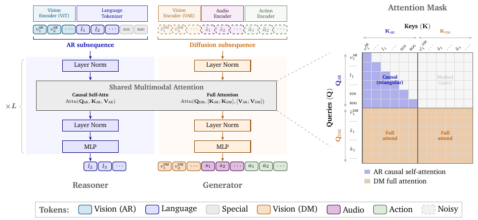
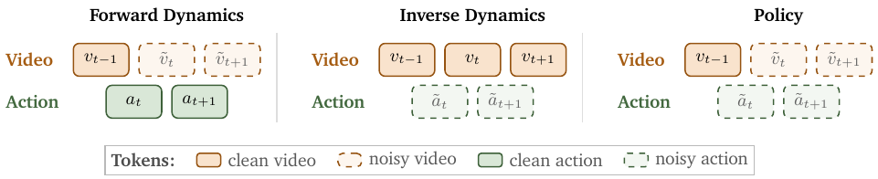
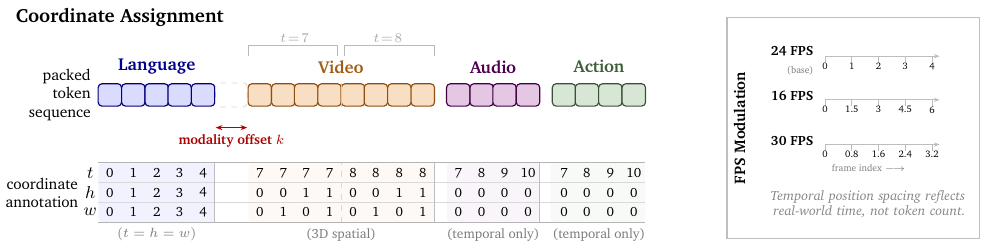
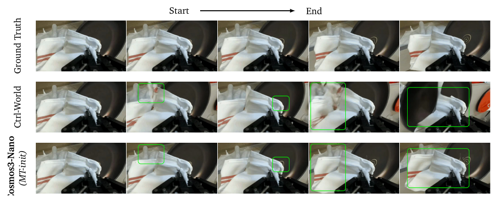






## 1. 问题与背景
{: #problem }

Cosmos 3 将理解场景、预测未来和生成动作组织为同一套多模态序列建模问题。模型接收和生成语言、图像、视频、音频及动作，通过改变条件和预测目标，在 VLM、视频生成器、正向动力学模型、逆动力学模型与机器人策略之间切换。技术报告同时介绍模型结构、分阶段训练、数据处理、部署及评价。[^paper]

本文笔记沿机器人应用展开：统一模型如何获得动作先验，动作表示如何连接不同 embodiment，以及这个先验如何经过 DROID 后训练变为可执行策略。

## 2. 核心贡献
{: #contributions }

1. 采用 Mixture-of-Transformers（MoT），以自回归 Reasoner 和扩散 Generator 两套参数共享序列级注意力接口，连接语言理解与连续模态生成。
2. 用统一几何动作表示、模态专用投影和物理时间位置编码，组织机器人、人类手部、相机和车辆运动。
3. 在中期训练中同时学习正向动力学、逆向动力学与视频—动作联合预测，形成可供下游后训练使用的动作先验；DROID 策略在 RoboLab specific 指令设置下达到 39.7% 成功率。

## 3. 方法
{: #method }

### Reasoner 与 Generator 如何连接

序列先放自回归 token，再放扩散 token。Reasoner 处理文本和 ViT 视觉特征，以 next-token prediction 输出语言；Generator 处理视频 VAE、音频和动作的连续 token，以 rectified flow matching 生成目标。每层分别拥有归一化、注意力投影与 MLP 参数：Reasoner 内部使用因果注意力，Generator 对两条流的 K/V 做完整注意力，因此能读取语言语义与其他连续模态。

<figure>
  
  <figcaption><strong>原文 Fig. 5 · Reasoner 与 Generator 的注意力连接。</strong> Generator 读取两条流的条件，Reasoner 保留内部因果注意力。 来源：Cosmos 3，arXiv v4，PDF 第 11 页。 <a href="https://arxiv.org/pdf/2606.02800v4#page=11">原文出处</a>。</figcaption>
</figure>

两塔均由已训练 VLM 权重初始化。Nano 以 Qwen3-VL-8B 为基础，总计约 16B；Super 以 Qwen3-VL-32B 为基础，总计约 64B。视觉理解使用 ViT，生成使用 Wan2.2-TI2V-5B 的 VAE，视频时间压缩为 4 倍。Generator 训练阶段冻结 Reasoner，更新生成相关参数。（§2、§4）

### 同一段轨迹的三种预测方向

令动作 $$a_t$$ 对应画面 $$v_{t-1}$$ 到 $$v_t$$ 的转移。通过选择哪些 token 保持干净、哪些 token 加噪，模型获得三种训练模式：

| 模式 | 已知条件 | 预测目标 | 对应能力 |
| :--- | :--- | :--- | :--- |
| Forward dynamics | 当前视觉与动作 | 后续视觉 | 预测执行某个动作后的场景 |
| Inverse dynamics | 前后视觉序列 | 动作 | 推断产生这段变化的运动 |
| Policy | 当前视觉与语言等条件 | 未来视频与动作 | 联合生成操作和预期结果 |

<figure>
  
  <figcaption><strong>原文 Fig. 4 · 三种动作预测方向。</strong> 相同视频—动作样本通过改变预测目标组成三种训练模式。 来源：Cosmos 3，arXiv v4，PDF 第 10 页。 <a href="https://arxiv.org/pdf/2606.02800v4#page=10">原文出处</a>。</figcaption>
</figure>

统一训练目标是各模态速度预测误差的加权和。条件 token 从损失中屏蔽；中期训练把动作损失乘以 10，平衡归一化动作向量较小的逐元素误差。（§4.2.2）

### 几何动作先验与可执行动作

中期训练把运动表示为相邻状态的相对变换：

$$
\Delta T_t=T_{t-1}^{-1}T_t.
$$

每个位姿含三维平移与六维旋转表示；夹爪开合或手指位置保留当前状态。单臂、双臂、类人机器人分别对应 10、20、29 维几何向量，人类头部加双手为 57 维。不同域使用独立的输入输出投影，进入共享骨干。这一层通过状态差分获得 pseudo-actions，学习跨 embodiment 的运动结构。（§2.1.3）

DROID 策略后训练重新初始化动作编码器、动作解码 MLP 与动作 embedding，并为这些参数使用五倍学习率。策略输入当前本体状态、三视角图像和任务短指令；腕部图像位于上方，两张外部视角并排放在下方，形成 540×640 的画布。输出改为 **32 步未来绝对关节位置动作**，同时预测辅助 RGB 视频；控制器通过 Franky 按 **15 Hz** 执行。由此，通用几何运动先验在目标机器人数据上连接到具体控制接口。（§4.2.5）

### 按真实时间对齐模态

3D MRoPE 为视频提供时间、高度、宽度位置，为动作与音频提供时间位置。各模态用每秒 token 数 TPS 调整时间步长：

$$
\delta_t=\frac{\mathrm{TPS}_{\mathrm{base}}}{\mathrm{TPS}},\qquad
\mathrm{TPS}_{\mathrm{base}}=24/4=6.
$$

视频的 TPS 等于 FPS 除以 VAE 时间压缩率，动作的 TPS 等于采样频率，音频约为每秒 25 token。相同物理时间跨度因此对应相同的位置范围。

<figure>
  
  <figcaption><strong>原文 Fig. 6 · 跨模态物理时间对齐。</strong> 时间坐标按真实时长缩放，使不同采样率的模态共享时间轴。 来源：Cosmos 3，arXiv v4，PDF 第 13 页。 <a href="https://arxiv.org/pdf/2606.02800v4#page=13">原文出处</a>。</figcaption>
</figure>

### 数据与训练

| 阶段 | 数据与训练职责 | 规模或配比 |
| :--- | :--- | :--- |
| Reasoner 预训练与 SFT | 学习图文、视频语言理解，再加强 Physical AI 任务 | SFT 8,200 步，全局 batch 512 |
| Generator 预训练 | 图像、视频、音频生成，固定 74k token 打包、多分辨率训练 | 767M 图像、347.7M 视频片段；Nano 31.05T 训练 token |
| Generator 中期训练 | 引入动作、控制视频以及物理场景数据 | 动作流占 25%；动作数据 8.4M episode、61.3k 小时，其中机器人约 5.36k 小时 |
| DROID 策略后训练 | 去除失败示范和 idle frame，加入本体状态及具体动作输出 | DROID 原始约 76k 轨迹、350 小时；学习率 2×10⁻⁴ |

动作数据还包括第一视角人类运动约 41.3k 小时、车辆约 10k 小时、相机运动约 4.6k 小时。推理采用四步扩散、CFG scale 3 和 noise shift 5，跳过 RGB 视频 latent 解码，策略服务部署在两张 RTX Pro 6000 上。（§3.2.3、§4.2.5）

## 4. 实验与证据
{: #evidence }

### 评价设置

动作实验比较 PT-init 与 MT-init：前者从通用生成预训练初始化，后者额外经过多域动作中期训练；随后在相同模型规模、下游数据和计算预算下后训练。正向动力学用 PSNR 衡量给定动作后的视频预测，机器人闭环策略用任务成功率。RoboLab 包含 120 项任务和三种指令具体程度；specific 设置每项十次 rollout。RoboArena 通过真实机器人双盲成对比较得到排名；MolmoSpaces 使用仿真任务及 oracle 成功指标。（§6.2.5）

<figure>
  
  <figcaption><strong>原文 Fig. 24 · 给定动作后的视觉预测。</strong> 该图比较正向动力学的视觉预测，闭环策略成功率另见 Table 19。 来源：Cosmos 3，arXiv v4，PDF 第 68 页。 <a href="https://arxiv.org/pdf/2606.02800v4#page=68">原文出处</a>。</figcaption>
</figure>

| 实验问题 | 设置与指标 | 结果 | 原文位置 |
| :--- | :--- | :--- | :--- |
| 动作中期训练是否改善视觉动态预测 | DROID，Nano 正向动力学 PSNR | PT-init 23.24 dB，MT-init 25.52 dB；Ctrl-World 22.99 dB | Table 18 |
| DROID 策略的任务执行 | RoboLab，vague / default / specific 成功率 | 20.6% / 36.8% / 39.7%；π0.5 为 15.2% / 28.0% / 28.1% | Table 19 |
| 动作中期训练对策略的作用 | RoboLab specific | MT-init 后训练 39.7%，PT-init 后训练 30.2% | Table 19 |
| 新环境与 embodiment 的后训练速度 | LIBERO-10，每 checkpoint 500 次 rollout | 1,000 步：91.4% 对 73.8%；2,000 步：97.4% 对 95.2% | Table 20 |
| 预测视频与所输出动作的一致性 | RoboLab 执行同一动作块后比较画面 | 左侧视角 23.19 dB，腕部视角 17.33 dB | 附录 E.5 |

报告中的 RoboArena 排名快照为 2026 年 5 月 30 日第一；MolmoSpaces 在 2026 年 6 月 20 日的 All Combined 设置下取得 39.0% oracle 成功率。跨榜单使用相同策略及超参数。（Fig. 26、27）

### 三种动作模式的协同

附录 E.4 用 Cosmos3-Edge 在 PushT 上比较单模式训练 2k 步与三模式联合训练 6k 步，使每种模式的训练次数一致。联合训练将逆动力学 MSE 从 1.11×10⁻³ 降至 3.09×10⁻⁴，策略覆盖率从 74.1% 升至 77.3%，同时正向动力学 PSNR 从 27.13 降至 26.22 dB。结果呈现共享训练在动作推断、控制与画面重建之间的具体取舍。

模型的通用能力另由理解、图像、视频和音频基准评价：Reasoner 的 48 项基准分为通用、机器人、基础设施和驾驶四组；Super 的机器人理解组平均为 57.8，Qwen3-VL-32B 为 52.6。图像与视频专用 checkpoint 则由独立后训练获得。（§6.1、§6.2）

## 5. 相关工作
{: #related-work }

Qwen3-VL（Bai et al., 2025b）提供语言与视觉理解初始化，Wan（Wan et al., 2025a）提供视频 VAE。Transfusion（Zhou et al., 2025a）与 BAGEL（Deng et al., 2025）将文本自回归和连续视觉生成接入统一框架；Cosmos 3 进一步把动作和音频纳入序列，并引入正向、逆向与策略三种动作训练。DreamZero（Ye et al., 2026）同样联合预测视频和动作，Cosmos 3 将其放入覆盖更多模态及动力学方向的通用模型。（§7）

## 6. Insights · 思考与启示
{: #takeaways }

### 批判性阅读：跨模式迁移与额外训练量如何区分？

联合训练中，逆动力学误差与覆盖率改善，同时视频 PSNR 下降。这说明控制所需的信息与像素重建质量可以朝不同方向变化。三模式各训练 2K 步的联合配置还使用了更多总更新，性能差异同时包含监督类型与计算预算的影响。

**区分实验。** 可固定总更新数、轨迹集合与模型容量，比较单模式、多模式和单模式重复采样；再对同一观测施加不同动作，评估模型能否区分接触结果。这样才能判断收益来自跨模式约束，还是更多训练，以及视频误差是否发生在影响动作的区域。

### 进一步的阅读联系

**阅读联想：统一接口由信号含义、时间和预测方向共同定义。** Cosmos 3 为各域保留专用动作投影，用共享物理时间轴对齐序列，再用干净条件与加噪目标决定模型做什么。对于力反馈 context，这个视角提示先明确测量到的 wrench 对应哪段动作和哪一时刻，以及它在序列里承担观测、待预测响应还是控制目标的角色。

**阅读联想：新模态的基础能力可以通过分阶段训练建立。** 本文在中期训练加入动作，再通过目标机器人后训练获得可执行接口，展示了从通用语义到交互先验再到控制映射的过程。与示范驱动 ICL 放在一起阅读时，可以把“模型已掌握哪些信号关系”与“当前 context 提供哪些新条件”分开描述，进一步理解在线适配所依赖的预训练基础。

## 参考与补充

[^paper]: NVIDIA. *Cosmos 3: Omnimodal World Models for Physical AI*, arXiv:2606.02800v4，2026。[论文](https://arxiv.org/abs/2606.02800v4) · [项目](https://research.nvidia.com/labs/cosmos-lab/cosmos3) · [代码](https://github.com/nvidia/cosmos) · [DROID 策略权重入口](https://huggingface.co/nvidia/Cosmos3-Nano-Policy-DROID)。架构见 §2，动作训练见 §3.2.3、§4.2，机器人结果见 §6.2.5，模式协同与视频动作一致性见附录 E.4–E.5；数字与版本对应上述技术报告。

