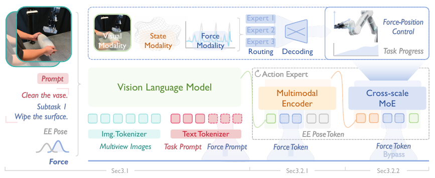
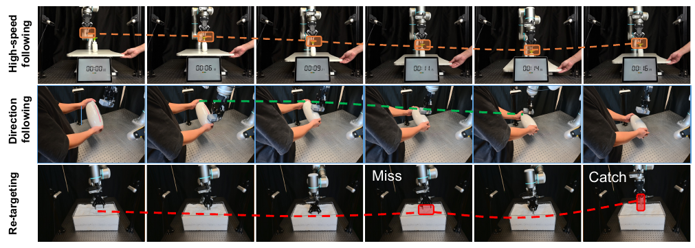






## 1. 问题与背景
{: #problem }

擦拭、按压与装配同时需要空间定位和接触调节：机器人先把工具带到目标附近，再依据接触力调整动作，并在阶段完成后转向下一步。ForceVLA2 将这三件事组织为一套 VLA：**用子任务提示表达当前操作阶段，用实时六轴力/力矩感知接触，用位姿与力联合输出执行操作。** 论文关注的是接触过程中持续闭环的力位协同。[论文 §1、§3]

以齿轮装配为例，抓取、对准、插入分别需要不同的信息。视觉语言特征描述目标和阶段，末端位姿描述当前位置，力信号反映接触后的物理状态。ForceVLA2 在高层语义和动作专家两个层次引入力信息，使策略在自由空间运动、接触探索与插入期间动态调整各模态的作用。

## 2. 核心贡献
{: #contributions }

1. **构建带阶段信息的力感知 VLA。** Force prompt 把当前子任务写入文本条件，与多视角图像、总任务指令共同进入 VLM；模型同时预测阶段进度，使提示随任务执行更新。
2. **建立实时力反馈与混合动作之间的通路。** 多模态编码器融合位姿、wrench 和视觉语言语义；Cross-Scale MoE 再接收直达的力特征，输出末端位姿变化与目标接触力。
3. **采集面向力位协同的数据并开展实机评估。** ForceVLA2-Dataset 包含 5 类任务、1,000 条轨迹和约 50 万个同步时间步；完整方法在五项任务上的平均成功率为 66%。[§3–5、Table 1]

## 3. 方法
{: #method }

### 整体思路：语义阶段、实时接触、联合动作

ForceVLA2 基于 $$\pi_0$$ 的视觉语言编码与 flow-matching 动作生成框架。视觉编码器采用 SigLIP，VLM 基于 PaliGemma。策略输入包括三路 RGB 图像、总任务指令、当前 force prompt、末端位姿和六轴 wrench。[§3.1–3.2]

<figure>
  
  <figcaption><strong>原文 Fig. 2 · 多尺度力信息的融合。</strong> 图中上层提示描述当前子任务；动作专家既接收融合了任务语义的状态特征，也接收直达的力特征，最后联合生成力位动作。来源：ForceVLA2，arXiv v1，第 4 页。 <a href="https://arxiv.org/pdf/2603.15169v1#page=4">原文出处</a>。</figcaption>
</figure>

| 信息 | 表示与作用 | 输出或下游去向 |
| :--- | :--- | :--- |
| 图像、任务文本、force prompt | 全局任务与当前子任务的视觉语言条件 | VLM 上下文 token |
| 末端位姿 $$p$$ | 7 维表示：位置与四元数 | 线性投影后的状态 token |
| 实时 wrench $$f_{\mathrm{raw}}$$ | 6 维：三轴力与三轴力矩 | 一路参与状态融合，一路直达 MoE |
| 动作 $$a_t$$ | $$[\Delta p_t;f_t]$$，7 维位姿变化与 6 维接触力/力矩 | 混合力位控制 |
| 阶段进度 $$s_t$$ | 连续进度值 | 更新当前子任务及其文本提示 |

这里的“力”包含力矩；位姿的 7 维表示来自位置加四元数。正文的策略表示见式（2）、（3）、（9），附录 A 同时使用位置加旋转的 6 维表示讨论控制问题。

### Force prompt 如何与阶段切换配合

每项任务预先定义一列子任务，force prompt 记录当前处于哪一步。例如总任务为清洁花瓶，阶段文本可以描述“擦拭表面”。训练数据依据视觉和同步力曲线离线切分为 3–5 个子任务，形成阶段监督。执行时，模型预测的进度达到切换阈值后，控制器进入下一子任务并重置进度。因此，force prompt 承担的是**带物理阶段含义的文本状态**。[§3.1、§3.2.2、§4]

进度标签综合方向对齐、剩余目标距离与力幅值。记归一化方向对齐量为 $$\theta$$、距离为 $$l$$、力幅值为 $$f$$，论文将三个统计分布的概率相乘，得到：

$$
\hat s_t=\theta^{\alpha}\exp(-\lambda l)\frac{f-n}{m-n},
\qquad \alpha=2,\quad\lambda=2.
$$

其中 $$[n,m]$$ 为力的归一化范围。该标签把“朝向是否对齐、是否靠近目标、接触力是否达到相应水平”共同编码为阶段完成度，作为子任务推进的学习目标。[式（10）]

### 实时 wrench 怎样参与动作生成

末端位姿与 wrench 分别经线性层形成 $$E_P$$ 和 $$E_F$$，拼接成状态 token。状态 token 作为 query，对视觉语言上下文 $$E$$ 做 cross-attention，得到带任务语义的状态表示。同时，$$E_F$$ 沿旁路直接进入后续 MoE。最终条件序列可写为：

$$
E_{\mathrm{cond}}=
[E;\operatorname{CrossAttn}([E_P;E_F],E);E_F].
$$

Cross-Scale MoE 配有视觉、状态、力三类轻量 MLP 专家，门控网络按 token 生成路由权重。自由空间运动时可以突出视觉语义，接触时可以提高状态或力特征的作用。直接力通路保留即时接触信息，融合通路则让同一力响应与当前任务阶段关联。[§3.2.1–3.2.2、式（4）–（6）]

动作头从高斯噪声初始化动作块，根据上述条件执行 flow matching，逐步生成联合的位姿变化和力指令。模型每轮重新接收视觉、位姿、力观测，生成下一段动作，并更新阶段进度，形成“观测接触—生成力位动作—观测新接触”的闭环。[式（7）–（9）]

### 数据、训练与执行

数据来自 7 自由度 Flexiv Rizon 4s，配 DH Robotics AG-95 夹爪及带力反馈的 GELLO 遥操作系统。两台固定 D455 和一台腕部 D435 以 30 fps 采集图像；末端六轴力/力矩以 300 Hz 记录，机器人状态同步记录。视觉流统一为 $$480\times640$$，经归一化与时间戳同步后存储。采集时改变物体位置姿态，增加交互分布的多样性。[§4、Fig. 4]

| 环节 | 数据与学习目标 | 产物 |
| :--- | :--- | :--- |
| 示范整理 | 同步图像、位姿、wrench；依据力曲线及视觉标注阶段边界 | 带 force prompt 和阶段进度的轨迹 |
| 监督训练 | 基于示范学习条件 flow-matching 力位动作，并预测子任务进度 | ForceVLA2 策略 |
| 闭环执行 | 持续输入当前观测，生成动作块与阶段进度 | 力位指令和下一阶段提示 |

附录 C 给出的训练设置为 8 张 A100、batch size 32、30,000 步，约 10 小时；优化器为 AdamW，学习率采用 cosine decay，EMA decay 为 0.99，随机种子为 42。在 RTX 4090 上报告的推理速度为 15 Hz，action chunk 长度为 30。[附录 C、Table 4]

## 4. 实验与证据
{: #evidence }

### 实验设置与主要结果

实验覆盖按压瓶泵、清洁花瓶、擦黑板、从泡沫球中寻找盘子、齿轮装配五项任务，每项独立测试 20 次，指标为完整任务成功率。比较方法包括 ACP、$$\pi_0$$、$$\pi_{0.5}$$、直接加入力输入的 $$\pi_0$$ w/ F，以及 ForceVLA。[§5.1]

| 方法 | 按压瓶泵 | 清洁花瓶 | 擦黑板 | 寻找盘子 | 齿轮装配 | 平均 |
| :--- | ---: | ---: | ---: | ---: | ---: | ---: |
| $$\pi_0$$ | 35% | 20% | 35% | 0% | 0% | 18% |
| $$\pi_{0.5}$$ | 45% | 30% | 45% | 15% | 20% | 31% |
| ACP | 25% | 30% | 25% | 0% | 0% | 16% |
| $$\pi_0$$ w/ F | 30% | 25% | 20% | 10% | 0% | 17% |
| ForceVLA | 70% | 25% | 55% | 15% | 10% | 35% |
| **ForceVLA2** | **80%** | **75%** | **70%** | **35%** | **70%** | **66%** |

以上数值来自 Table 1。ForceVLA2 相对 $$\pi_0$$、$$\pi_{0.5}$$ 和 ForceVLA 的平均成功率分别提高 **48、35、31 个百分点**；齿轮装配达到 70%，比该任务次高的 20% 提高 50 个百分点。

### 闭环反应的具体表现

动态测试中，作者在按压前突然降低瓶子的底座，模型随新的接触位置调整动作并完成按压；擦拭时旋转花瓶，模型沿曲面滑动并上移，持续保持接触；搜索盘子时，模型在抓取落空后继续探测并重新抓取。Fig. 6 用执行序列展示了这些行为。[§5.2]

<figure>
  
  <figcaption><strong>原文 Fig. 6 · 接触条件变化下的反应。</strong> 三行依次展示高度跟随、擦拭方向跟随和抓取重试，体现实时反馈对执行过程的调节。来源：ForceVLA2，arXiv v1，第 10 页。 <a href="https://arxiv.org/pdf/2603.15169v1#page=10">原文出处</a>。</figcaption>
</figure>

### 消融与分析

模块消融从 $$\pi_0$$ 的 18% 开始：加入 Force Prompt 后达到 27%；再加入 Multimodal Encoder 达到 40%；最后加入 Cross-Scale MoE 达到 66%。这组逐步组合对应 +9、+13、+26 个百分点。[Table 2]

MoE 输入消融中，状态条件的平均成功率为 36%，加入视觉语言条件后为 50%，再加入力模态后为 66%。力输入对清洁花瓶、寻找盘子、齿轮装配的结果分别从 40%、0%、40% 提升到 75%、35%、70%；按压与擦黑板则从 85%、85% 变为 80%、70%。这组结果呈现了不同接触任务对力条件的具体响应。[Table 3]

附录进一步比较力信息的注入位置：VLM pathway 为 5%，Multimodal Encoder 为 58%，在此基础上与位姿状态融合为 66%。最终结构采用动作专家中的多模态融合与状态融合路径。[附录 C、Fig. 8、Table 5]

## 5. 相关工作
{: #related-work }

ForceVLA2 继承 $$\pi_0$$（Black 等，2024）的视觉语言条件与 flow-matching 动作生成，把动作空间扩展到显式力位联合输出。与 ForceVLA（Yu 等，2025）相比，它进一步加入子任务 force prompt、阶段进度和面向混合控制的跨尺度融合。ACP（Hou 等，2024）通过虚拟动作与导纳控制表达顺应性，ForceVLA2 则由学习策略联合给出位姿与接触力。[§2、§5.1]

在数据层面，RH20T（Fang 等，2024）提供包含标定力信号的多模态示范，REASSEMBLE（Sliwowski 等，2025）关注装配/拆卸的同步视觉、状态与力数据。ForceVLA2-Dataset 进一步把子任务提示、进度以及力动作监督组织到同一轨迹中。[§2、§4]

## 6. Insights · 思考与启示
{: #takeaways }

### 批判性阅读：逐项加模块的增益，如何分到具体机制？

按顺序加入 Force Prompt、Multimodal Encoder、Cross-Scale MoE 的 +9、+13、+26 个百分点，衡量的是各模块在此前配置上的条件增益。交换加入顺序或组合方式，增益可能改变；其中阶段提示还把接触先验带进了任务描述。

**区分实验。** 可固定阶段提示，对实时力与提示一致／冲突的情形分别测量动作纠正和阶段推进；再补齐关键模块组合。这样能分开“更准确地识别阶段”和“在同一阶段内改善力位调节”，并判断 MoE 收益是否依赖提示已经提供的线索。

### 进一步的阅读联系

**论文结果：力的输入、表示与动作出口共同构成闭环。** 读这篇论文时，可以沿“六轴 wrench—双通路编码—MoE—位姿与力动作”追踪一次接触。阶段文本又为这个闭环提供了操作语义，解释为何同样的接触信号在擦拭、探测和插入阶段会对应不同动作。

**阅读联想：可以把 context 分成阶段信息与交互历史两种粒度。** ForceVLA2 的阶段文本提供当前任务状态，实时 wrench 提供当前接触观测。对力控 ICL 而言，此前的动作—力响应序列可以再提供“当前物体怎样响应动作”的信息。由此产生的问题是：模型如何把同一阶段内的多次接触结果，整合成对刚度、摩擦或对准状态的判断，并在下一次动作中使用？

**阅读联想：力位联合输出为适配提供了两个可观察的结果。** 当 context 改变时，可以同时观察预测位姿变化与目标力怎样变化，以理解策略究竟调整了运动方式、接触目标，还是二者的配合。ForceVLA2 的输入输出组织，为沿这个方向理解已有 force-conditioned policy 提供了清楚的接口参照。

## 参考与补充

发表信息：CVPR · 2026。[来源](https://openaccess.thecvf.com/content/CVPR2026/html/Li_ForceVLA2_Unleashing_Hybrid_Force-Position_Control_with_Force_Awareness_for_Contact-Rich_CVPR_2026_paper.html)。

- Yang Li、Zhaxizhuoma、Hongru Jiang 等，**ForceVLA2: Unleashing Hybrid Force-Position Control with Force Awareness for Contact-Rich Manipulation**，arXiv:2603.15169v1，2026-03-16。发表于 CVPR 2026。[论文](https://arxiv.org/abs/2603.15169v1) · [PDF](https://arxiv.org/pdf/2603.15169v1) · [项目页](https://sites.google.com/view/force-vla2/home)。
- 方法见第 4–7 页，数据见第 8 页，实验见第 9–12 页，训练设置与注入位置消融见附录 C（第 15–16 页）。图片裁自原文 Fig. 2、Fig. 6 和 Table 1–2。
- 原论文采用作者—年份引用：Black 等，$$\pi_0$$（2024）；Yu 等，ForceVLA（2025）；Hou 等，Adaptive Compliance Policy（2024）；Fang 等，RH20T（2024）；Sliwowski 等，REASSEMBLE（2025）。对应原文 References，第 18–19 页。

