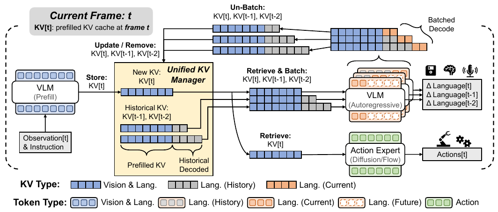
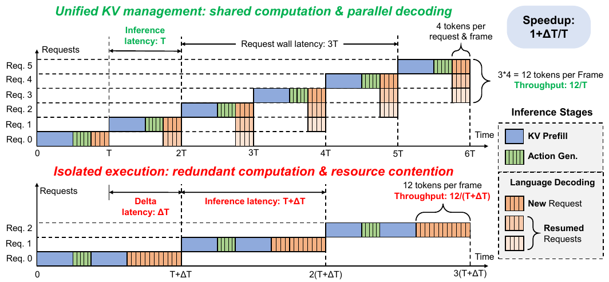






## 1. 问题与背景
{: #problem }

OxyGen 研究同一机器人同时生成动作与语言时的推理效率。动作需要按控制周期及时更新，场景描述、对话或文本记忆可以跨周期完成；这些任务又常常读取同一组观测。若每个任务独立运行整条模型路径，就会重复图像／指令编码，并争用同一张 GPU。

论文将 KV cache 视为跨任务、跨控制周期共享的系统资源，以一次观测预填充服务多个专家，再把尚未完成的语言请求组成批次推进。研究对象是 Mixture-of-Transformers VLA 的执行系统。

## 2. 核心贡献
{: #contributions }

1. 将动作与语言的不同期限纳入多任务推理设计，统一管理共享前缀和独立生成状态。
2. 结合跨任务 KV 共享与跨帧连续批处理，分别减少重复预填充和语言逐请求解码开销。
3. 在 π0.5、Xiaomi-Robotics-0、StarVLA 及机载 Thor 上评价吞吐、延迟、动作质量与资源开销。

## 3. 方法
{: #method }

### 一次观测编码服务两种生成过程

每个控制周期收到图像与指令后，VLM 进行一次 prefill，产生各层 K/V。动作专家读取该前缀，执行流匹配或扩散去噪；语言专家读取同一前缀，自回归扩展自己的 token 与 KV。共享的对象是共同观测前缀，后续生成状态按请求管理。

<figure>
  
  <figcaption><strong>原文 Fig. 2 · 统一 KV 管理的数据流。</strong> 共同前缀复用，语言请求独立保存续写状态，管理器批量读取和更新。 来源：OxyGen，arXiv v5，PDF 第 4 页。 <a href="https://arxiv.org/pdf/2603.14371v5#page=4">原文出处</a>。</figcaption>
</figure>

管理器为每个语言请求保存三部分：KV、已生成文本和结束标志。它提供存储、读取、更新和删除操作。新请求加入当前活跃集合，与此前周期尚未结束的请求沿 batch 维堆叠，统一推进 $$k$$ 个 token；完成的请求释放，其余状态留给下一周期。

### 跨帧批处理如何工作

假设每条语言请求长 12 token，每个周期为每条请求生成 4 token。稳态时，三个不同周期发起的请求组成 batch，每周期共输出 12 token，同时维持每周期一次动作生成。单条语言请求跨三个周期完成。

<figure>
  
  <figcaption><strong>原文 Fig. 3 · 跨控制周期推进语言请求。</strong> 每条请求分三个周期完成；多个请求同时解码以提高总吞吐并缩短每周期耗时。 来源：OxyGen，arXiv v5，PDF 第 6 页。 <a href="https://arxiv.org/pdf/2603.14371v5#page=6">原文出处</a>。</figcaption>
</figure>

设动作块长 $$H$$、周期耗时 $$T$$、活跃语言请求数 $$B$$，论文指标为：

$$
f_{\rm action}=\frac{H}{T},\qquad
f_{\rm replan}=\frac{1}{T},\qquad
\tau_{\rm language}=\frac{Bk}{T}.
$$

因此动作频率统计的是生成动作数，重规划频率统计的是重新读取观测并生成动作块的次数。减小 $$k$$ 会让单条语言请求跨更多周期，同时形成更大的 batch。这个设置在动作更新速度、总体文本吞吐和单条文本完成时间之间分配计算资源。

### 实现与文本记忆示例

OxyGen 基于 openpi 实现 JAX 与 PyTorch 后端，主实验采用 π0.5，默认动作块长 10、去噪 10 步。语言每帧预算测试 1、5、10 token，每条请求总长度测试 5–30 token。共享前缀适用于使用同一骨干 KV 表示的多个专家。

附录 E 的文本记忆应用使用模拟器谓词构建观测—文本对，训练 rank-16 LoRA；adapter 作用于语言续写，共享 prefill 和动作路径使用冻结的 π0.5-LIBERO。生成文本描述已完成步骤，与动作推理同时运行。

## 4. 实验与证据
{: #evidence }

### 平台、基线与主要成绩

硬件为 RTX 4090 和 Jetson AGX Thor。速度实验使用 LIBERO、DROID、ALOHA 对应的视角、分辨率与控制维度。基线包含同 GPU 上顺序独立执行和通过 CUDA MPS 多进程并行执行。

| 比较设置 | 结果 | 原文 |
| :--- | :--- | :--- |
| π0.5 主结果示例 | 动作频率 19.1→70.5 Hz；文本吞吐 57.2→212.9 token/s | Fig. 1 |
| 只启用共享 prefill，RTX 4090、N=5 | 周期延迟 200.3→145.1 ms，约 1.4× | §4.3 |
| 已共享 prefill，再启用批处理，N=30、k=5 | 469.3→175.8 ms，约 2.7× | §4.3 |
| 机载 Thor 三视角部署 | 动作加语言路径 1030→393 ms | §4.7、Fig. 8 |
| LIBERO 动作成功率 | 96.76%，95% CI 为 96.55–96.97%；openpi 报告 96.85% | §4.6 |

LIBERO 动作质量评价使用官方 checkpoint，在 10 个随机种子下共运行 20,000 次。4090 上峰值显存较顺序独立执行增加约 15%；平均功率最多降低 47%，单请求能耗最多降低 78%。

### 多专家、负载与单请求等待

N=30、k=5 时，Xiaomi-Robotics-0 和 StarVLA Qwen3VL-PI_v3 分别加速 3.23× 和 3.60×；StarVLA 扩至三个和四个专家后为 3.53× 和 3.69×（Table 1）。k=1 的更大语言 batch 在这两类骨干上获得更高吞吐收益。

附录 D.4 同时报告单条语言请求的完成时间：π0.5-LIBERO、N=30、k=5 的周期均值为 175.8 ms，一条请求跨六个周期，估计完成时间 1.055 秒，实测中位数 1.057 秒。总体吞吐与单条请求等待描述不同的使用体验。

机载部署中，OxyGen 的动作路径约 198 ms、语言路径约 195 ms；派发动作后，语言计算可以放入 333 ms 的物理执行时间内。附录还以 3,000 个测量周期检查波动负载下的内存与延迟，观察到有界内存使用。

## 5. 相关工作
{: #related-work }

MEM [1] 提供动作执行并行构建文本记忆的应用背景，π0.5 [13] 提供本文主要 VLA。vLLM [31]、SGLang [32] 发展了前缀缓存与连续批处理，OxyGen 将这些系统思想用于动作去噪和语言续写的不同生命周期。异步动作执行工作 [54–57] 则从模型推理与机器人运动的重叠入手，两者可以在调度层组合。

## 6. Insights · 思考与启示
{: #takeaways }

### 批判性阅读：吞吐量提高后，动作依据的信息有多旧？

异步执行将高层语言推理移出动作的关键路径，但动作仍可能使用较早的高层输出。平均推理速度衡量计算效率；从观测采集到该信息真正影响动作的时间，则决定反馈新鲜度。

**区分实验。** 可为观测、请求、语言结果与动作分别记录时间戳，在语言输出变长或请求拥塞时测量信息年龄、P95 动作延迟与任务恢复率。保持底层动作频率相同，比较丢弃过时结果与直接复用缓存，可判断吞吐收益能否转化为有效闭环反馈。

### 进一步的阅读联系

**context 有生成时延。** 多尺度记忆系统中的文本摘要可能晚于当前动作产生。OxyGen 将这种时间差显式纳入执行流程，使记忆更新频率、动作重规划频率和文本吞吐成为可分别理解的量。

**共享的是计算表示。** 同一观测可同时服务动作、语言和其他专家，但每个请求仍保有独立的生成状态。由此可以将“context 的内容与学习方式”和“context 如何在计算系统里被复用”分开讨论。

**对力反馈 context 的联想。** 低延迟的物理反馈与较慢的事件摘要天然处于不同时间尺度。本文的调度视角有助于思考哪些信息需要每次动作更新都读取，哪些历史总结可以异步形成并在后续决策中使用。

## 参考与补充

发表信息：NeurIPS 2026 · 已接收 · Poster。[来源](https://github.com/air-embodied-brain/OxyGen)。

- [arXiv:2603.14371v5](https://arxiv.org/abs/2603.14371v5)，NeurIPS 2026；[项目](https://air-embodied-brain.github.io/OxyGen)；[代码](https://github.com/air-embodied-brain/OxyGen)。
- 统一 KV 管理：§3；吞吐、质量、平台：§4；管理开销及单请求时间：附录 D；文本记忆：附录 E。
- [文本记忆 adapter](https://huggingface.co/xxxxyu/oxygen-pi05-textual-memory-lora)；[文本标注数据](https://huggingface.co/datasets/xxxxyu/libero-textual-memory-annotations)。引用编号沿用原文。

