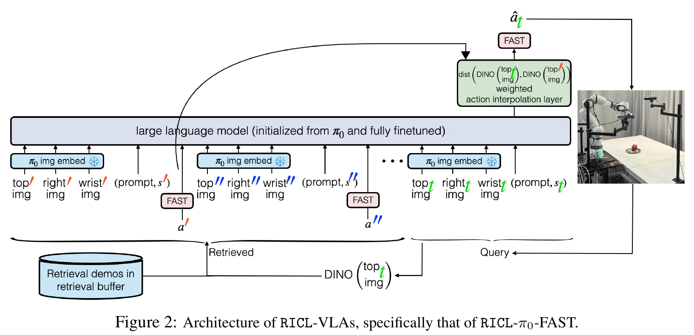
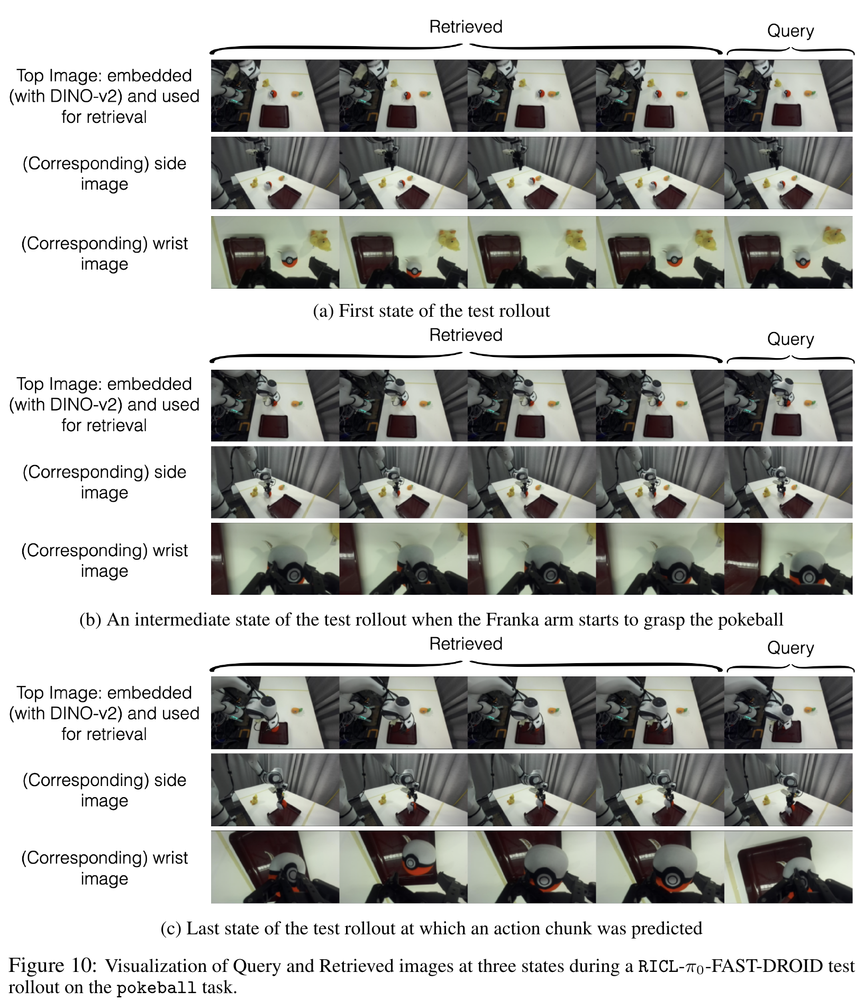
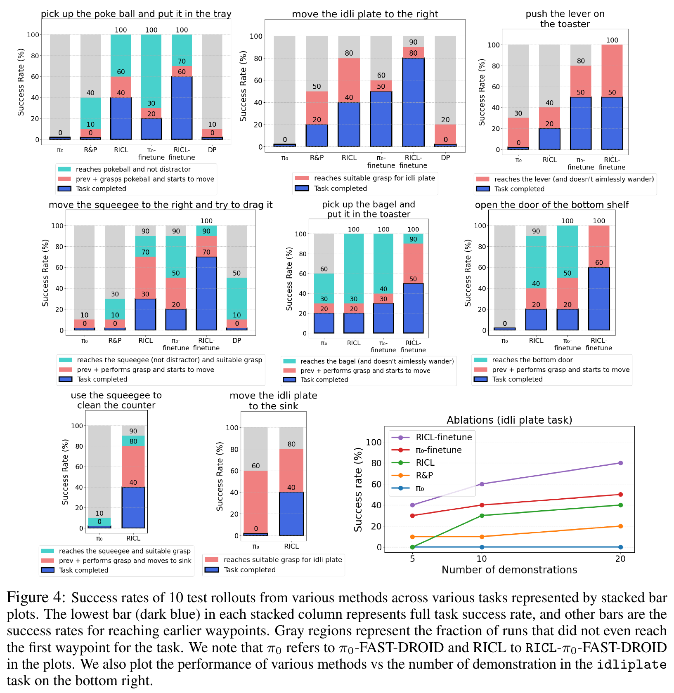






## 1. 问题与背景
{: #problem }

RICL 研究如何给已有 VLA 增加“通过示范上下文学习新任务”的接口。作者从预训练的 π₀-FAST-DROID 出发，用一小批机器人示范完成 post-training，让模型学会读取检索得到的观测—动作示例。用户部署时提供目标任务的 10–20 条示范，模型保持参数固定，通过当前观测检索相关片段并生成动作。论文将这套训练过程称为 **Retraining for In-Context Learning，RICL**。（§1、§4）

这个任务设定包含两种时间尺度：模型开发者先训练通用的“利用上下文”能力；使用者随后通过替换示范库，改变模型在新任务上的行为。机器人既要理解目标物体与语言指令，也要从示范中获得抓取位置、运动方向和任务进度等信息。RICL 将这些信息组织为与当前状态相关的输入—输出示例，让预训练 VLA 的操作知识与新任务数据共同参与动作生成。

## 2. 核心贡献
{: #contributions }

1. **给预训练 VLA 补上 ICL 训练。** 基于 20 个任务、每个任务 20 条示范进行三轮训练，形成 RICL-π₀-FAST-DROID；训练更新语言模型参数，并冻结图像编码器。（§5）
2. **构造检索式动作上下文。** 每次决策取出四组相关观测及其动作块，和当前 query 一起输入模型，再按视觉距离融合最近邻动作 token 与模型输出。（§4、Fig. 2）
3. **在真机目标任务上实现示范驱动适配。** 八个任务中，提供每任务 20 条示范后，完整任务平均成功率从基模的 2.5% 提高到 31.25%；进一步使用目标任务数据微调时，六个任务上的平均成功率达到 61.67%。（§6、Fig. 4）

## 3. 方法
{: #method }

### 整体思路：先学会使用示例，再用示例适配

RICL 采用 π₀-FAST-DROID 作为基模，动作通过 FAST tokenizer [1] 表示为离散 token。整个流程可以分成三个阶段：

| 阶段 | 数据与模型输入 | 训练目标或决策过程 | 产物 |
| :--- | :--- | :--- | :--- |
| ICL priming | 400 条示范；四组检索示例＋当前 query | 监督 query 对应动作 token，更新 LLM | 能利用检索上下文的 VLA |
| 新任务 ICL | 目标任务 20 条示范作为检索库 | 固定参数，每次根据当前观测重新检索并预测动作 | 当前任务的动作块 |
| 可选目标任务微调 | 同一批目标任务示范 | 保持检索增强训练形式，再训练 1000 步 | 继续通过检索执行的任务模型 |

<figure>
  
  <figcaption><strong>原文 Fig. 2 · RICL 的模型结构。</strong> 左侧是带动作标签的检索示例，右侧是当前 query；顶部绿色模块结合最近邻动作与模型预测。来源：RICL，arXiv v1，第 4 页。 <a href="https://arxiv.org/pdf/2508.02062v1#page=4">原文出处</a>。</figcaption>
</figure>

### Context 的粒度与序列组织

一组示例包含三视角图像、语言指令、本体状态和接下来的一段动作。当前 query 包含前三类信息，模型预测其后续动作。四个示例按检索距离排序，最近邻放在最左侧，随后依次放入更远的示例，最后接当前 query：

$$
\begin{aligned}
E_i &= (I_{i,\mathrm{top}},I_{i,\mathrm{side}},I_{i,\mathrm{wrist}},l,s_i,A_i),\\
q_t &= (I_{t,\mathrm{top}},I_{t,\mathrm{side}},I_{t,\mathrm{wrist}},l,s_t),\\
[E_1,E_2,E_3,E_4,q_t] &\longrightarrow A_t.
\end{aligned}
$$

因此，RICL 的 context 基本单元是 **观测—动作块示例**。20 条完整轨迹存放在外部检索库，每次决策由检索器选取其中四个相关时刻。这个组织同时包含“跨示范选样”和“示例内部的未来动作”两个层次。（§4、§5）

检索使用当前俯视图的 DINOv2 [26] 特征，以 L2 距离寻找近邻；选中时刻对应的侧视图、腕部图像、状态和动作一并取回。Fig. 10 展示了抓取球体任务的三个时刻：随着机器人接近、抓取和搬运物体，context 中的示例随 query 更新。

<figure>
  
  <figcaption><strong>原文 Fig. 10 · 每次决策动态选择上下文。</strong> 每行末列为 query，前四列为检索示例；俯视图用于匹配，另外两个视角随示例一起输入模型。来源：RICL，arXiv v1，第 17 页。 <a href="https://arxiv.org/pdf/2508.02062v1#page=17">原文出处</a>。</figcaption>
</figure>

### ICL 能力怎样训练出来

训练时，作者把每条示范中的每个状态作为 query，再从同一任务的其余 19 条示范中检索四个近邻。这样的训练样本要求模型利用其他示范，预测当前 query 的动作。优化目标为 **query 动作 token 的交叉熵**，检索示例中的动作作为上下文提供给模型。数据构造与部署时的检索输入保持一致。（§4–5）

这里的 post-training 同时建立了三项对应关系：每组观测与动作标签的对应、四组示例与 query 的关联，以及动作预测误差对模型参数的监督。多组观测序列由此形成可用于新任务决策的示例上下文。

### 距离加权的动作 token 插值

RICL 还沿用 REGENT [12] 的检索插值思路。令 $$d$$ 为 query 与最近邻俯视图的特征距离，$$a'$$ 为最近邻动作 token 序列，则每个 token 位置的输出分布为：

$$
p_\mathrm{RICL}
=e^{-\lambda d}\operatorname{onehot}(a')
+(1-e^{-\lambda d})\operatorname{softmax}(\pi_\theta(R,q)),
\qquad \lambda=10.
$$

距离越近，最近邻动作的权重越大；距离增大，模型预测的权重随之增加。插值发生在 **动作 token 的概率分布** 上，生成的 token 再经 FAST 解码为连续动作块。（§4，Eq. 1）

### 数据、动作接口与训练设置

实验使用 Franka DROID 平台及俯视、侧视、腕部三路摄像头。本体状态为七个关节角和夹爪位置；每步动作为七个关节速度和夹爪位置。动作块形状为 $$(15,8)$$，数据采集频率为 15 Hz，图像经 padding 后缩放至 $$224\times224$$。（Appendix C）

Priming 数据涵盖抓放、移动物体、倒取，以及勺子和线缆操作。训练使用两张 A100、batch size 16、三个 epoch；余弦学习率采用 300 步 warmup、峰值 $$2.5\times10^{-5}$$、3000 步 decay、终值 $$2.5\times10^{-6}$$。可选目标任务微调运行 1000 步，warmup 为 50 步。

部署采用滚动执行：RICL 最初执行预测动作块的前三步，再重新观测和检索；当动作块末端预测到夹取动作后，执行步数切换为八步。目标任务微调版本相应采用三步与五步。论文报告 FAISS 检索耗时小于 1 ms，完整 rollout 时间约为基模的 1.33 倍。（Appendix C）

## 4. 实验与证据
{: #evidence }

### 实验设置

八个目标任务包括球体放入托盘、移动 idli 蒸盘、移动刮水器、在水槽场景操作蒸盘和刮水器、按下面包机拨杆、打开底层柜门，以及将贝果放入面包机。每个任务提供 20 条目标示范，每种方法每任务测试 10 次，并随机化物体初始位置和朝向。（§5–6）

主要指标是完整任务成功率，同时记录靠近目标、完成抓取等中间节点。比较方法包括 π₀-FAST-DROID、检索后直接执行的 Retrieve-and-Play、从头训练的 Diffusion Policy，以及基模和 RICL 的目标任务微调版本。微调比较使用相同数量的目标示范与训练步数；两个水槽任务用于 ICL 评测，其余六个任务还进行目标任务微调比较。

<figure>
  
  <figcaption><strong>原文 Fig. 4 · 任务完成率与示范数量消融。</strong> 深蓝色表示完整任务成功率，上方颜色表示更早节点的累计完成率；右下角展示 5、10、20 条示范下的结果。来源：RICL，arXiv v1，第 7 页。 <a href="https://arxiv.org/pdf/2508.02062v1#page=7">原文出处</a>。</figcaption>
</figure>

### 主要结果

| 实验问题 | 设置与指标 | 论文结果 | 原文位置 |
| :--- | :--- | :--- | :--- |
| Context 能否支持目标任务适配？ | 八个任务，固定模型参数，完整任务平均成功率 | 基模 2.5%，RICL 31.25% | §6、Fig. 4 |
| Context 对早期动作有什么作用？ | 八个任务，中间节点完成率 | 基模最高 21.25%，RICL 最高 83.75% | §6 |
| 目标任务微调后表现如何？ | 六个任务，使用各自 20 条示范，完整任务平均成功率 | 基模微调 31.67%，RICL 微调 61.67% | §6、Fig. 4 |
| 熟悉任务上的表现如何？ | 三个熟悉任务，RICL 使用随机 priming 示范作为检索库 | 基模和 RICL 均为 80% | §6 |

在蒸盘任务中，RICL 的完整任务成功率为 40%，Retrieve-and-Play 为 20%，基模为 0%。作者还观察到，RICL 有时闭合夹爪，从侧面推动蒸盘；检索库中的示范则通过蒸盘凹槽抓取并搬动。论文将这一行为解释为 context 激发了模型已有的动作知识。（§6、Fig. 4）

### 示范数量消融

蒸盘任务分别使用 5、10、20 条示范。RICL 成功率依次为 **0%、30%、40%**，RICL 目标任务微调版本依次为 **40%、60%、80%**；对应的基模微调结果为 **30%、40%、50%**。增加示范数量扩大了可检索的任务状态覆盖，纯 ICL 与进一步微调两条路径均获得提升。（Fig. 4 右下角）

## 5. 相关工作
{: #related-work }

RICL 将机器人 ICL 的训练思路接到已有 VLA 上。MTT [16] 和 ICRT [18] 把若干完整示范放入 context；REGENT [12] 从示范库检索 state–action 对，在多个环境上训练具备上下文适配能力的策略。RICL 继承 REGENT 的检索序列与距离加权动作插值，再以预训练 π₀-FAST-DROID 为起点，通过 query 动作监督获得真机 ICL 能力。（§2–4）

底层能力由 π₀ [2]、FAST 动作编码 [1] 和 DROID 数据 [25] 支撑；视觉检索使用 DINOv2 [26]。这条技术链将预训练操作能力、外部示范库、上下文训练和动作生成组织到同一流程中。

## 6. Insights · 思考与启示
{: #takeaways }

### 批判性阅读：视觉近邻何时会给出错误的高置信动作？

相似度加权会提高近邻示例的影响。当相同画面出现在相反运动阶段，或接触状态被遮挡时，视觉距离很小也可能对应不同动作。检索距离同时承担“相似程度”和“示例可信度”，是需要检验的假设。

**区分实验。** 可选取当前图像近似、历史方向或接触结果相反的成对片段，固定检索库并切换动作分布插值，比较错误示例的影响。再加入短期历史检索，以区分示例条件化与直接复用动作分布的收益；FAST token 分布插值应在解码后的动作上评估。

### 进一步的阅读联系

**阅读联想：先明确“示例”的语义，再考虑序列长度。** RICL 每组 context 都携带观测与后续动作，因此模型可以学习“在这种状态下如何行动”。对于已有 force-conditioned policy，力位协同 ICL 中一个值得继续追问的单位，是包含动作及其力响应的局部交互片段。这个单位把接触条件的信息来源，与策略接下来需要做出的决策联系起来。

**阅读联想：能力获取与在线适配可以分开设计。** RICL 的 priming 训练负责建立利用 context 的能力，目标示范库负责提供当前任务信息。沿着这一区分，力反馈 ICL 可以进一步梳理：基模已经学会的力条件控制规律是什么，当前交互历史又补充了哪些接触条件信息。

**阅读联想：检索条件决定上下文携带什么经验。** RICL 用视觉相似度选择动作示例，并在每次决策更新它们。围绕力反馈，可以把研究问题表述为：怎样表示动作—力响应，使检索到的片段与当前接触过程相关？这也让 context 的粒度成为建模选择：单步状态、短时响应片段与完整接触过程，各自组织着不同时间范围的信息。

## 参考与补充

发表信息：CoRL · 2025。[来源](https://ricl-vla.github.io/)。

- 本文：Sridhar, Dutta, Jayaraman, Lee. **RICL: Adding In-Context Adaptability to Pre-Trained Vision-Language-Action Models**，CoRL 2025。笔记依据 [arXiv:2508.02062v1](https://arxiv.org/abs/2508.02062v1)，2025-08-04。
- [原文 PDF](https://arxiv.org/pdf/2508.02062v1) · [项目页](https://ricl-vla.github.io) · [DOI](https://doi.org/10.48550/arXiv.2508.02062)。方法见 §4，数据与评测见 §5–6，接口与训练超参数见 Appendix C。
- 原文 [1]：**FAST: Efficient Action Tokenization for Vision-Language-Action Models**，2025。[arXiv](https://arxiv.org/abs/2501.09747)
- 原文 [12]：**REGENT: A Retrieval-Augmented Generalist Agent That Can Act In-Context in New Environments**，ICLR 2025。[OpenReview](https://openreview.net/forum?id=NxyfSW6mLK)
- 原文 [16]：**Generalization to New Sequential Decision Making Tasks with In-Context Learning**，2023。[arXiv](https://arxiv.org/abs/2312.03801)
- 原文 [18]：**In-Context Imitation Learning via Next-Token Prediction**，2024。[arXiv](https://arxiv.org/abs/2408.15980)
- 原文 [25]：**DROID: A Large-Scale In-the-Wild Robot Manipulation Dataset**，2024。[arXiv](https://arxiv.org/abs/2403.12945)
- 原文 [26]：**DINOv2: Learning Robust Visual Features without Supervision**，2023。[arXiv](https://arxiv.org/abs/2304.07193)

