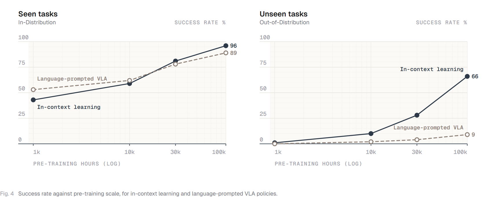
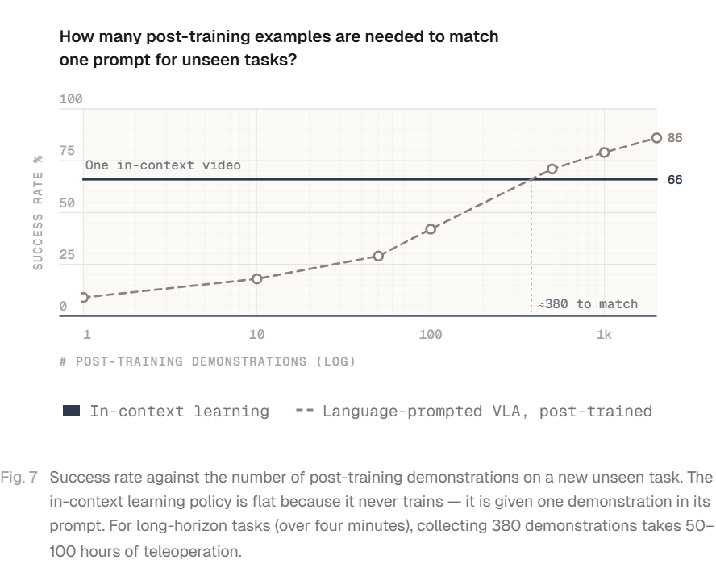






## 1. 问题与背景
{: #problem }

S1 是 Skild AI 于 2026 年 8 月介绍的机器人基础模型，官方文章聚焦其通过视频示范获取任务的能力。用户提供一个示范，模型将其中的目标、步骤和操作关系映射到自己的机器人与当前场景，以固定权重执行任务。

文章沿两个轴讨论 ICL：任务是否出现在预训练中，以及任务是 5–25 秒的原子操作还是持续数分钟的复杂流程。演示包括约十分钟的种植、煎饼、手冲咖啡和套件装配，涉及新动作与已有技能的新组合。

## 2. 核心贡献
{: #contributions }

1. 将任务视频放入策略上下文，在 episodic 训练中学习从示范推断意图、功能对应关系和执行进度。
2. 比较 1k–100k 小时预训练规模下，视频示范提示和语言提示对已见／未见任务的表现。
3. 从场景偏移、示范偏移、任务级适配数据量三个角度分析视频 context 的作用，并展示新长任务部署过程。

## 3. 方法
{: #method }

### 示范作为任务接口

公开的高层训练配方以 episode 为单位，任务由 context 中的示范指定。示范可以来自不同场景、视角或本体，模型预测适合自身观测和身体的动作。任务多样性使模型需要读取示范，才能在同类场景中区分当前要执行的目标。

在元学习表述中，预训练是学习“如何从 context 学习”的外循环，部署时的视频提示承担任务适配的内循环。文章中的任务展示共用同一组权重。正文把训练机制介绍到数据组织与条件接口这一层，具体模型模块和训练配方安排在后续系列文章中介绍。

### 多源数据与质量控制

文章将数据选择组织为硬件接近程度、任务多样性和采集可扩展性三个维度。遥操作最贴近部署机器人，第一视角视频易于覆盖广泛人类行为，UMI 与仿真提供其他采集方式。训练数据组合这些来源，质量检查覆盖低层动作精度、任务连贯性及标注准确性。

### 新任务部署与两个分布距离

种植案例的公开时间线为：20:54 物品到位，21:16 开始录制，21:22 完成一条第一视角示范，21:27 开始自主执行。从录制开始到执行为 11 分钟；示范录制完成到执行为 5 分钟。

文章分别考察部署场景相对训练数据的距离，以及部署场景相对当前示范的距离。两组分析使用相同扰动等级：L1 为匹配场景；L2 将物体移位 15 cm、旋转 30°；L3 为 30 cm、45°；L4 替换为功能相同的物体并增加约 15 cm 高度变化；L5 使约一半动作需要由另一只手臂完成。

## 4. 实验与证据
{: #evidence }

### 数据规模与提示形式

规模实验从预训练池选取子集，让两种策略使用相同数据、计算量和除提示嵌入之外的模型结构。评价包含已见与未见任务两套内部任务集，每项持续 4–8 分钟。指标为跨任务平均的累计逐步成功率；rollout 中通过人工恢复失败，使后续步骤也能获得评价。

<figure>
  
  <figcaption><strong>原文 Fig. 4 · 预训练规模与两类任务表现。</strong> 评价使用人工恢复后的累计逐步成功指标；未见任务在 100k 小时处为 66% 对 9%。 来源：S1，2026 年 8 月官方文章，ICL scaling laws。 <a href="https://www.skild.ai/blogs/s1">原文出处</a>。</figcaption>
</figure>

| 条件 | 视频示范 ICL | 语言提示策略 | 原文位置 |
| :--- | :--- | :--- | :--- |
| 已见任务、1k 小时 | 43% | 53% | ICL scaling laws |
| 已见任务、100k 小时 | 96% | 89% | Fig. 4 |
| 未见任务、100k 小时 | 66% | 9% | Fig. 4 |

100k 小时下未见任务的分数差为 57 个百分点，比例约为 7.3 倍。文章同时展示任务视频，包括调整物体位置、替换工具、重试装配以及根据容器当前状态调整倒液量。

### 单条提示与任务后训练的比较

<figure>
  
  <figcaption><strong>原文 Fig. 7 · 单条 context 示例与任务后训练数量。</strong> 约 380 条为已测点之间的插值交点，2,000 条后训练示范对应 86%。 来源：S1，2026 年 8 月官方文章，ICL demonstration efficiency。 <a href="https://www.skild.ai/blogs/s1">原文出处</a>。</figcaption>
</figure>

作者在未见任务上用 1–2,000 条遥操作示范对语言策略做 post-training，并把单条 context 示范取得的 66% 作为水平参考。两条曲线约在 380 条后训练示范处相交，该数量由已测点插值得到。2,000 条示范的后训练策略达到 86%；长任务采集约 380 条示范对应文中报告的 50–100 小时遥操作。

### 场景与示范偏移

Fig. 5 显示随部署场景偏离训练条件，两种提示方式的成绩均变化；在 L5 需要更换执行手臂时，视频提示提供了与新布局一致的执行计划。Fig. 6 固定训练条件，改变场景相对示范的距离：物体位置与功能相近物体替换仍能迁移，而跨手臂计划变化带来更明显下降。

## 5. 相关工作
{: #related-work }

文章以 Brown et al.（2020）的语言模型 ICL 作为任务提示的背景，并连接 Skild 早期 LocoFormer（Liu et al., 2025）：后者通过实时经验上下文适配运动控制。操作方向的对照讨论包括 RoboTTT（Jiang et al., 2026）与 Generalist AI（2026）。这里保留原文作者—年份引用方式。

S1 强调从外部任务示范获取意图与动作组合；LocoFormer 强调从自身交互经验获取身体与环境信息。两种 context 分别对应任务教学与执行条件适配。

## 6. Insights · 思考与启示
{: #takeaways }

### 批判性阅读：分步得分与整项自主完成，衡量了什么差别？

允许人工恢复后的累计步骤表现，衡量的是系统完成局部阶段的能力。长任务还取决于失败能否自行恢复，以及前一阶段是否给下一阶段留下可用状态；累计分数可能掩盖这些衔接成本。

**区分实验。** 可同时报告整项无干预完成率、人工恢复次数与恢复后的后续表现。比较视频提示和文字提示时，应对齐目标、顺序及空间指代信息；“单条新示范”的部署成本也应与建立该能力的预训练数据预算分开记录。

### 进一步的阅读联系

**训练数据组织决定 context 的用途。** S1 将任务身份放入示范，使策略在训练时持续面对“根据示范确定当前行为”的问题。这个配方提供了理解 ICL 能力来源的直接线索。

**长任务增加了上下文中的结构信息。** 视频同时描述目标、时序、工具使用和子任务衔接。随着任务时长增加，这些信息共同决定后续动作，context 因而可以承担比单个目标标签更丰富的职责。

**与力反馈适配的联系。** 外部示范主要回答“要完成什么、怎样组织步骤”，自身动作—力响应主要回答“当前对象和接触条件怎样响应”。两类信息可以分别从任务意图与物理条件理解，其学习目标和时间粒度也应各自明确。

## 参考与补充

- Skild AI，2026 年 8 月，[Introducing S1: In-Context Learning for Robotics](https://www.skild.ai/blogs/s1)。本条目为官方技术博客。
- 训练概述：S1: An In-Context Learner；数据：The Data Engine；规模和指标：ICL scaling laws；分布偏移与示范效率：Emergent Properties。
- 图来自官方网页 Figs. 3、4、7；其他视频与扰动图可在原网页查看。

