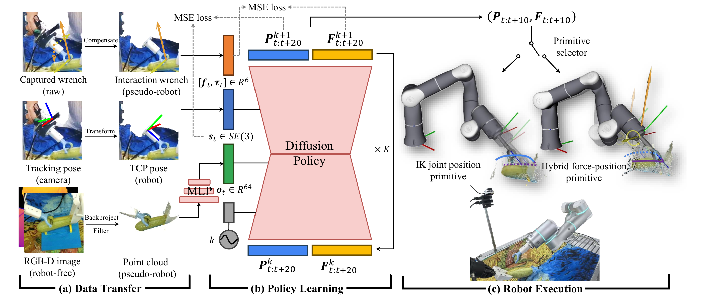
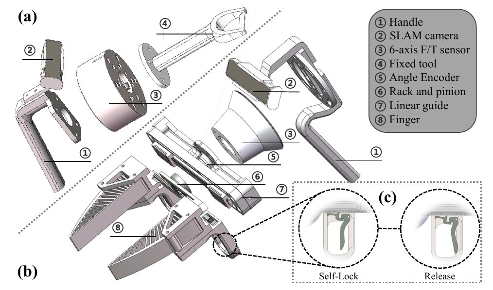
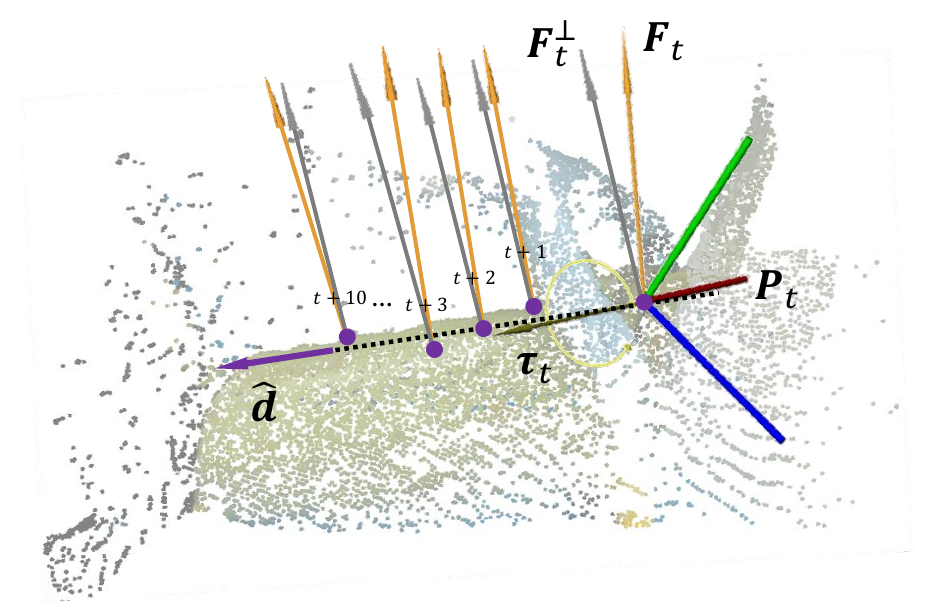
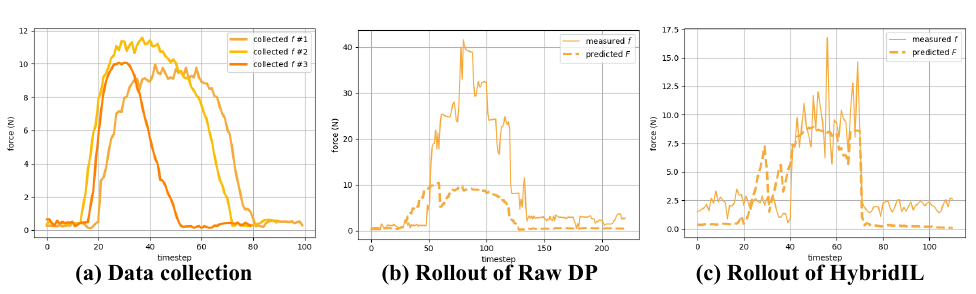






## 1. 问题与背景
{: #problem }

削皮同时要求刀具沿表面前进并保持合适的接触力。视觉描述蔬菜的几何形状，接触力则反映刀具是否贴住表面、是否压得过深。ForceMimic 将这项技能表示成一段共同变化的位姿与 wrench 轨迹，研究如何从人的自然操作中采集它，再让机器人通过混合力位控制执行它。（§I）

系统由两个相连的部分组成：**ForceCapture** 记录手持工具的运动和六轴力／力矩；**HybridIL** 学习未来的位姿与目标 wrench，并将预测送入控制原语。论文用西葫芦削皮贯穿数据采集、学习和真机执行，使力信号在整条流程中的含义保持明确。（§III）

## 2. 核心贡献
{: #contributions }

1. 设计手持式 ForceCapture，将六轴传感器、SLAM 相机和工具集成，让操作者直接接触物体并记录力—运动示范。
2. 通过重力补偿、工具坐标变换和点云过滤，把手持数据转换成对应机器人 TCP 与交互力的数据。
3. 让扩散策略联合预测位姿和 wrench，由运动方向确定正交力控平面，并依据预测力切换控制原语。
4. 在真机削皮中，连续削皮超过 10 cm 的成功率达到 85%，纯视觉位姿策略为 55%，提高 30 个百分点。（Table I）

## 3. 方法
{: #method }

### 整体思路与信号分工

<figure>
  
  <figcaption><strong>原文 Fig. 2 · 数据、学习与执行流程。</strong> 点云与位姿作为条件，位姿和 wrench 作为预测目标，控制器实现对应的物理运动。 来源：ForceMimic，arXiv v3，PDF 第 3 页。</figcaption>
</figure>

HybridIL 的学习条件是**点云特征与 TCP 位姿信息**。MLP 将点云编码为 64 维特征，与位姿及扩散时间步嵌入共同驱动扩散策略。模型预测未来 20 个时间步的位姿与 wrench，图中执行接口取出相应的短动作段，再由原语选择器连接机器人控制器。（§III-C，Fig. 2）

HybridIL 从视觉与位姿决定要施加怎样的力，底层混合控制器根据实测力追踪这一目标。论文另设 Force DP 与 Force+Hybrid DP，研究把实测力直接加入学习策略输入后的表现。（§IV-B）

| 信号或模块 | 数据含义 | 在系统中的作用 |
| :--- | :--- | :--- |
| 点云 | 工具与物体的三维观测 | 提供几何条件 |
| TCP 位姿 | 工具末端的运动状态 | 提供当前运动与历史条件 |
| 示范 wrench | 补偿后的三维力与三维力矩 | 作为力轨迹监督 |
| 策略输出 | 未来位姿与目标 wrench 序列 | 指定运动与接触要求 |
| 实测接触力 | 机器人执行时的反馈 | 进入底层力控闭环 |

### ForceCapture：把人的施力记录为可转移数据

<figure>
  
  <figcaption><strong>原文 Fig. 3 · 手持式力—运动采集装置。</strong> 六轴传感器连接手柄与工具，SLAM 相机记录运动，夹爪通过自锁机构保持抓取。 来源：ForceMimic，arXiv v3，PDF 第 3 页。</figcaption>
</figure>

ForceCapture 有固定工具和可动夹爪两个版本。六轴 F/T 传感器位于工具与手柄之间，T265 记录设备运动；夹爪版本通过齿轮齿条同步两指，用编码器记录开度。单向自锁结构让夹爪合拢后保持夹持，操作者通过释放杆松开，从结构上分离持续夹持和环境交互的载荷来源。（§III-A）

采集设备包括 1000 Hz 力传感器、200 Hz T265、30 Hz 外置 L515 RGB-D 相机，以及夹爪版本中的 30 Hz 编码器。预处理将各路时间序列对齐到 L515 的观测频率。开始时把 T265 固定在 L515 支架上确定相对位置，随后转移到手持装置，以追踪其运动并转换成机器人 TCP 位姿。（§III-B）

力预处理采用准静态假设。操作者先在多种姿态下记录无接触的位姿与 wrench，通过超定线性方程和最小二乘估计工具重量、质心，再从原始读数中减去重力贡献。RGB-D 反投影为点云，过滤与训练和部署一致性无关的区域，保留工具、物体等相关点，并处理为 10,000 点的输入。这一步同时统一了力的物理含义、位姿的坐标系和视觉中的可见对象。（§III-B）

设备打印件与编码器成本约 50 美元；夹爪版本总重约 0.8 kg，其中传感器约 0.5 kg，配件约 0.3 kg。（§III-A）

### 从联合预测到正交混合力位控制

<figure>
  
  <figcaption><strong>原文 Fig. 4 · 预测与控制的接口。</strong> 轨迹确定运动方向，力投影确定对应的正交接触目标。 来源：ForceMimic，arXiv v3，PDF 第 4 页。</figcaption>
</figure>

位姿轨迹给出局部运动方向，目标力规定维持接触的要求。HybridIL 根据预测轨迹求运动单位方向 $\hat d$，再把预测力投影到与运动方向正交的平面。用向量形式表达 Fig. 4 中的投影关系：

$$
f_t^{\perp}=\left(I-\hat d\hat d^{\mathsf T}\right)f_t.
$$

控制器沿运动方向执行轨迹，在正交方向跟踪相应力目标。削皮时，这对应沿蔬菜表面推进与维持贴合压力的分工。正交关系由执行接口处理，网络联合学习位姿和 wrench 序列。（§III-C）

预测力低于 6 N 时使用基于逆运动学的关节位置控制；连续多个时间步超过 6 N 时，切换到混合力位控制。首次进入混合控制而刀具尚在空中时，系统先施加朝向接触面的压入运动以建立接触。两类原语通过 Flexiv RDK 实现，6 N 是论文采用的经验阈值。（§III-C）

### 数据与训练

作者处理 15 根西葫芦，采集 438 段削皮技能，形成 30,199 个动作序列。训练把动作相对于感知提前 3 个时间步；HybridIL 与各基线均训练 500 个 epoch。Diffusion Policy 的学习目标扩展到位姿和 wrench 两组预测量，Fig. 2 分别展示其 MSE 监督。（§IV-B、Fig. 2）

## 4. 实验与证据
{: #evidence }

### 实验设置

真机采用 Flexiv Rizon 4。左臂按规则稳定西葫芦，右臂安装与采集装置一致的固定削皮刀，并执行学习策略；外置 L515 在采集与部署时保持一致位置。任务从蔬菜上方、后方的初始 TCP 位姿开始。评价分别统计“成功削下任意长度且未损伤蔬菜”和“形成超过 10 cm 的连续皮条”。（§IV-B）

| 方法 | 策略输入 | 策略输出 | 运动正确率 | 连续皮条 >10 cm |
| :--- | :--- | :--- | ---: | ---: |
| Raw DP | 视觉、位姿 | 位姿 | 80% | 55% |
| Force DP | 视觉、位姿、力 | 位姿 | 60% | 10% |
| Force+Hybrid DP | 视觉、位姿、力 | 位姿、wrench | 80% | 20% |
| HybridIL | 点云、位姿 | 位姿、wrench | **100%** | **85%** |

数据来自 Table I。Raw DP 与 HybridIL 各评价 20 次，另两种方法各评价 10 次。85% 相对于 55% 的变化为 30 个百分点，或约 54.5% 的相对提升。两种成功指标对应不同的动作质量要求。（§IV-B）

### 力曲线解释了什么

<figure>
  
  <figcaption><strong>原文 Fig. 7 · 示范与执行中的力响应。</strong> HybridIL 实际力随目标力变化，曲线同时呈现了数据与部署时的接触力分布。 来源：ForceMimic，arXiv v3，PDF 第 6 页。</figcaption>
</figure>

采集示范中的交互力约为 10 N；Raw DP 的执行力平均约 20 N，部分时刻超过 40 N；HybridIL 的平均交互力约 9 N，接近其目标力。原图将示范力、预测力和机器人实际力放在一起，使策略输出与物理执行之间的关系可以直接比较。（§IV-B，Fig. 7）

作者把 Force DP 和 Force+Hybrid DP 的表现联系到采集与部署中的力分布变化：人的自然施力和机器人底层控制器产生不同的接触响应，策略接触后收到的输入因而偏离示范分布。HybridIL 的结果体现了目标力监督与底层力控配合的效果。论文同时记录了提前结束接触段、切回位置控制导致皮条中断的案例，使切换时机与连续作业质量的联系更加具体。（§IV-B）

采集效率实验中，Fig. 5 给出直接人工、ForceCapture、力反馈遥操作完成一根西葫芦的时间分别约为 2.9、4.5、13 分钟。遥操作过程中出现 3 次由操作错误导致的中断；ForceCapture 保留直接操作工具的体验。（§IV-A）

## 5. 相关工作
{: #related-work }

UMI [5] 和 DexCap [6] 提供了可移动、手持式机器人示范采集路线；ForceCapture 在这一结构中加入交互 wrench 的采集和补偿。Diffusion Policy [27] 提供动作序列生成框架，3D Diffusion Policy [28] 与 RISE [29] 展示三维观测用于操作学习的路径，HybridIL 将三维条件与力—位姿联合输出连接起来。（§II）

MOMA-Force [34] 根据视觉相似度检索动作和 wrench，再通过控制器执行；ForceSight [37] 从文本与 RGB-D 生成力相关目标。ForceMimic 通过监督学习生成连续的 wrench—位姿序列，再使用正交混合控制原语完成接触技能。它在数据、预测目标和控制执行三个环节共同定义了“学会施力”的含义。（§II）

## 6. Insights · 思考与启示
{: #takeaways }

**阅读联想：力信号的角色决定模型要学习的关系。** ForceMimic 把力放在监督目标和执行闭环中；以力为条件的策略还将力响应作为决策条件。这两种接口可以用“观测力、目标力、控制器实际响应”三条时间序列来统一理解，分别回答发生了什么、希望发生什么，以及执行系统如何实现。

**阅读联想：动作—力历史包含控制器的作用。** 相同的工具轨迹在人工示范与机器人执行中产生不同的力分布，提示接触上下文同时携带物体属性、工具几何和底层控制器特征。面向 ICL 的接触条件推断，可以把这些因素视为共同决定响应的条件，从而更具体地理解上下文中哪些信息能够跨执行系统复用。

**阅读联想：控制原语给上下文提供了自然分段。** 自由运动、建立接触、持续削皮和退出接触对应清楚的操作阶段。原文的力阈值切换展示了阶段与物理响应的关系，也为理解“上下文是一帧状态、一段接触轨迹，还是一次完整尝试”提供了直观参照。

## 参考与补充

发表信息：ICRA · 2025。[来源](https://forcemimic.github.io/)。

Wenhai Liu 等，**ForceMimic: Force-Centric Imitation Learning with Force-Motion Capture System for Contact-Rich Manipulation**，ICRA 2025。笔记依据 [arXiv:2410.07554v3](https://arxiv.org/abs/2410.07554v3)，2025-03-03；[项目与硬件、代码、数据入口](https://forcemimic.github.io/)；[会议 DOI](https://doi.org/10.1109/ICRA55743.2025.11128061)。方法与控制接口见 PDF 第 3–5 页，实验见第 5–6 页。文中方括号编号沿用原论文 References。

