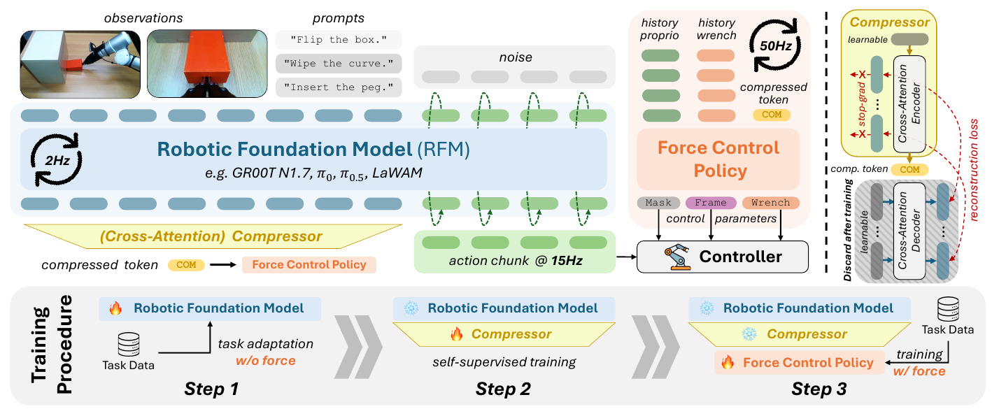
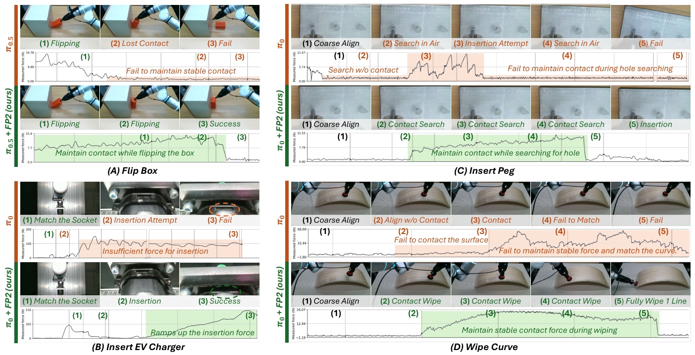






## 1. 问题与背景
{: #problem }

机器人基础模型已经能够从视觉与语言生成复杂操作轨迹。接触任务还要求机器人持续调节施力：翻盒时保持接触，插充电枪时逐渐增加推力，插销时贴着表面搜索，擦拭时沿曲面维持压力。FP2 将这些需求归纳为 **action–regulation decomposition：基础策略生成任务动作，力控策略调节动作执行中的物理交互**。[^paper]

这一分工把预训练模型的视觉理解和动作生成能力，与高频物理反馈连接起来。基础模型按照原有接口完成任务适配；下游轻量策略读取其任务上下文以及近期 wrench、本体状态，输出可以直接交给混合力位控制器的参数。

## 2. 核心贡献
{: #contributions }

1. **在基础策略下游接入显式力控。** 基础策略负责参考动作，力控策略预测交互坐标系、力位选择掩码与目标 wrench，形成职责明确的控制接口。
2. **用单个压缩 token 传递操作上下文。** 自监督重建训练把基础模型的上下文序列压缩为紧凑表示，供 50 Hz 力控策略持续使用。
3. **验证不同基础模型上的收益。** 在四种基础模型、四项真机任务中，FP2 均提高综合平均得分；消融进一步展示任务上下文与物理反馈的互补作用。

## 3. 方法
{: #method }

### 整体结构：动作路径与力控路径汇合

<figure>
  
  <figcaption><strong>原文 Fig. 2 · 动作生成与交互调节的分工。</strong> 上方展示两条执行路径，下方依次对应任务适配、上下文重建压缩和力控策略训练。 来源：FP2，arXiv v1，PDF 第 3 页。 原图许可：<a href="https://creativecommons.org/licenses/by-nc-sa/4.0/">CC BY-NC-SA 4.0</a>；单图摘录，保留原图内容。</figcaption>
</figure>

基础模型接收观测与语言指令，输出动作块。并行的力控策略读取压缩上下文与近期物理反馈：

$$
(\Sigma_t,S_t,\widehat W_t)
=\pi_F\bigl(z_t,W_{t-H:t},P_{t-H:t}\bigr).
$$

其中，$$z_t$$ 概括当前操作意图；$$W_{t-H:t}$$ 是实测六轴 wrench 历史；$$P_{t-H:t}$$ 是本体状态历史。三个输出共同规定交互方式：

| 输出 | 物理含义 | 执行中的作用 |
| :--- | :--- | :--- |
| 交互坐标系 $$\Sigma_t$$ | 描述接触与运动方向的局部坐标系 | 在合适的方向上分解力控制和位置控制 |
| 选择掩码 $$S_t$$ | 各方向采用力控制还是位置控制 | 例如保持法向接触，同时沿切向运动 |
| 目标 wrench $$\widehat W_t$$ | 希望施加的力与力矩 | 为力控方向提供目标值 |

实测 $$W_t$$ 描述已经发生的接触响应，目标 $$\widehat W_t$$ 描述接下来希望实现的交互。参考动作则继续由基础策略提供。这三个量分别对应反馈、目标和运动计划。

### 三个训练阶段分别学什么

**Stage 1：任务适配。** 使用任务示教，按各基础模型原生的视觉运动接口训练任务策略。此阶段的输入为该模型原有观测，力信号留给下游策略学习。完成后冻结基础模型。

**Stage 2：上下文压缩。** 将基础模型的上下文 token 序列 $$C_t\in\mathbb R^{S\times D}$$ 投影到较低维度，再用一个可学习 query 通过交叉注意力读取整段序列，得到 $$z_t\in\mathbb R^{1\times d}$$。训练时，解码器通过这个单 token 重建原始序列：

$$
z_t=f_{\mathrm{enc}}(Q,\operatorname{Proj}(C_t)),\qquad
\widehat C_t=f_{\mathrm{dec}}(z_t),
$$

$$
\mathcal L_{\mathrm{comp}}
=\mathcal L_{\mathrm{MSE}}(C_t,\widehat C_t)
+\lambda\mathcal L_{\mathrm{cos}}(C_t,\widehat C_t).
$$

重建所需信息全部经过压缩瓶颈。MSE 约束数值重建，余弦距离约束表示方向；训练后保留编码器，解码器完成其训练用途。

**Stage 3：力控策略学习。** 冻结基础模型与压缩器，使用示教中的 wrench、本体历史及恢复出的控制参数标签训练 $$\pi_F$$。控制参数恢复沿用 Force Policy［19］的方法。力控策略学习的是“当前操作上下文和接触状态下，应该如何调节交互”。这使视觉运动任务适配、表征压缩、力控学习分别拥有明确的训练目标。[^method]

### 2 Hz、15 Hz、50 Hz 与 1 kHz 如何对齐

基础模型以 **2 Hz** 进行推理，动作块内部按 **15 Hz** 表示参考动作；上下文 token 同步更新，并缓存在两次推理之间。力控策略以 **50 Hz** 读取持续更新的 wrench 和本体历史，同时复用最近的上下文。

参考动作进入控制器前，先通过 waypoint dropout 与动态时间规整，将新动作块起点对齐到最近运动并丢弃过时路点；随后用五次样条重采样到 **50 Hz**，保持位置、速度和加速度连续。50 Hz 参考轨迹与 50 Hz 力控参数汇合，交给内部 **1 kHz** 的混合力位控制环执行。

因此，2 Hz 表示基础模型的决策刷新频率，15 Hz 表示动作块的时间采样，50 Hz 表示下游调节与参考轨迹更新，1 kHz 表示底层控制闭环。原文报告的 **4.48 ms** 是 RTX 5090 上力控策略单次推理延迟。[^control]

### 数据与真机配置

实验使用 Flexiv Rizon 4、GN-02 夹爪、法兰处 FT-03S 六维力传感器，以及全局和腕部 RealSense D415。示教通过带力反馈的双臂主从遥操作采集。Flip Box、Insert EV Charger、Wipe Curve 各 50 条，Insert Peg 为 200 条，共 350 条。

四种基础模型为 GR00T N1.7、LaWAM、$$\pi_0$$ 和 $$\pi_{0.5}$$。主表采用 $$\pi_0$$ LoRA、$$\pi_{0.5}$$ 全量微调；与 TA-VLA、ForceVLA 的配套比较使用相同 $$\pi_0$$ 训练数据和配置。视觉输入由基础模型处理，下游力控策略使用压缩上下文和物理历史。[^experiments]

## 4. 实验与证据
{: #evidence }

### 四项任务与指标

翻盒考察持续接触，充电枪插入考察较大推力，插销考察 0.02 mm 公差下的接触搜索，曲面擦拭考察沿曲面运动时的力调节。通常每项任务评估 25 次，各方法共享预先生成的任务配置。

前三项记录成功率，擦拭记录完成比例。下表“平均得分”是这四项百分比的平均值。NFE（Normalized Force Error）衡量实际力曲线相对示教力分布的偏离：先按归一化时间建立示教均值与标准差，允许均值上下一个标准差的变化，再累计超出该区间的标准化误差。NFE 使用三维力；统计范围为成功轨迹，擦拭采用有效连续擦拭段。[^experiments]

### 主结果

| 方法 | 翻盒成功率 | 充电枪成功率 | 插销成功率 | 擦拭完成比例 | 平均得分 |
| :--- | ---: | ---: | ---: | ---: | ---: |
| GR00T N1.7 | 12% | 36% | 0% | 1% | 12% |
| GR00T N1.7 + FP2 | 76% | 76% | 0% | 3% | 39% |
| LaWAM | 32% | 0% | 4% | 64% | 25% |
| LaWAM + FP2 | 48% | 20% | 24% | 65% | 39% |
| $$\pi_0$$ LoRA | 44% | 0% | 12% | 4% | 15% |
| TA-VLA | 32% | 72% | 4% | 51% | 40% |
| ForceVLA | 60% | 0% | 36% | 10% | 27% |
| $$\pi_0$$ LoRA + FP2 | 68% | 92% | 76% | 84% | 80% |
| $$\pi_{0.5}$$ 全量微调 | 40% | 0% | 32% | 97% | 42% |
| $$\pi_{0.5}$$ + FP2 | 92% | 56% | 52% | 100% | 75% |

来源：原文 Table I，PDF 第 5 页，平均值按原表取整。对应四种基础模型，平均得分分别增加 **27、14、65、33 个百分点**。同表中的专用力控方法 HybridIL、ACP、Force Policy，平均得分分别为 22%、57%、50%。

力曲线也更接近示教交互：$$\pi_0$$ 插销的 NFE 从 9.112 降至 1.287；$$\pi_{0.5}$$ 翻盒从 3.248 降至 0.899，擦拭从 1.488 降至 0.495。全量微调的插销补充比较中，$$\pi_0$$、TA-VLA、ForceVLA 的成功率分别为 60%、36%、32%，FP2 在 LoRA 与全量微调设置下均为 76%。

<figure>
  
  <figcaption><strong>原文 Fig. 4 · 动作过程与实测力曲线。</strong> 每组同时展示基础策略与加入 FP2 后的动作过程，绿色标注说明持续接触、推力增长与曲面擦拭效果。 来源：FP2，arXiv v1，PDF 第 6 页。 原图许可：<a href="https://creativecommons.org/licenses/by-nc-sa/4.0/">CC BY-NC-SA 4.0</a>；单图摘录，保留原图内容。</figcaption>
</figure>

原文 Fig. 4 将动作过程与实测力曲线并列展示：翻盒与插销搜索过程中持续保持接触，充电枪插入阶段逐渐增加推力，曲面擦拭过程中维持连续压力。这些过程对应 FP2 所学习的交互调节职责。

### 消融：上下文、反馈和动作分工

消融使用 $$\pi_{0.5}$$ 的翻盒任务。训练物体成功率与四类新物体平均成功率分别揭示模块在原任务和变化条件下的作用：

| 力控策略配置 | 训练物体成功率 | 新物体平均成功率 | 推理延迟 |
| :--- | ---: | ---: | ---: |
| 仅压缩上下文 $$z$$ | 4% | 5% | 2.27 ms |
| 仅 wrench、本体历史 | 36% | 18% | 4.28 ms |
| 平均池化上下文＋物理历史 | 84% | 75% | 4.49 ms |
| 动作专家 latent＋物理历史 | 88% | 80% | 4.46 ms |
| 压缩上下文＋历史＋额外腕部视觉 | 92% | 73% | 5.97 ms |
| 压缩上下文＋历史，同时重新生成动作 | 76% | 53% | 13.03 ms |
| 上一配置再加入腕部视觉 | 88% | 73% | 14.44 ms |
| FP2 完整配置 | **92%** | **88%** | **4.48 ms** |

新物体分别改变颜色、纹理、刚度和几何，每类 10 次测试；完整 FP2 的成功次数为 10、9、9、7。上下文提供任务意图，物理历史提供正在发生的交互，两者结合获得最高成绩。学习式压缩相较平均池化和动作专家 latent 进一步提高新物体表现。将参考动作生成保留在基础策略中，同时让下游专注调节，兼顾了性能与延迟。[^ablation]

## 5. 相关工作
{: #discussion }

**Force Policy［19］提供结构化力控接口。** FP2 继承其交互坐标系、力位选择和目标 wrench 表达，并将任务动作交给基础模型。HybridIL［39］、ACP［24］与 Force Policy 构成专用接触操作方法的比较组。

**ForceVLA［59］和 TA-VLA［61］代表向基础策略引入力信息的路线。** FP2 将力反馈放在下游调节环，利用基础模型上下文传递操作意图。论文用配套的 $$\pi_0$$ 实验比较这两类设计。

**上下文压缩连接大模型表示与实时控制。** 压缩瓶颈设计借鉴 RLToken［57］；与同时重新生成动作的设计［27］相比，FP2 的下游网络集中输出控制参数。动态时间规整［42］负责动作块与实际运动的时间对齐。

## 6. Insights · 思考与启示
{: #takeaways }

### 批判性阅读：成功轨迹上的力误差，会遗漏哪类失败？

NFE 在成功 rollout 上比较示范力范围，反映的是成功条件下的力行为。若高峰值力或失去接触的轨迹提前失败，它们退出该统计后，较小 NFE 仍可能伴随危险或低成功率；材料变化时，完成任务所需的力也可能偏离旧示范。

**区分实验。** 可将全部试次的峰值力、安全停止与成功率并列，并按材料分别设置目标力范围。固定基础参考轨迹，再改变力控路径，可检验接触调节的边际贡献；对定位错误另设测试，评估保留原动作路径给力控模块留下了多大纠正空间。

### 进一步的阅读联系

**这篇论文把“context”分成了两个时间尺度。** 基础模型 token 以低频概括操作意图，wrench 与本体历史以高频反映物理状态。对力交互 ICL 的阅读联想是：任务上下文回答“正在做什么”，动作—响应历史回答“当前环境怎样响应操作”。FP2 的接口为这两种信息提供了明确位置。

**接触适配拥有结构化输出空间。** 交互坐标系、选择掩码和目标 wrench 分别控制方向、约束类型和施力目标。沿着此前关注的“从历史交互推断接触条件”思路，适配可以体现为这些物理量随经验更新。这里的研究延伸是让历史承担环境识别与经验积累的作用；论文自身训练的是条件化的高频交互调节策略。

**输入输出对齐值得按物理角色理解。** 参考动作、实测响应和目标力共同描述一次交互的因果过程。把它们保留为不同字段，有助于阅读模型究竟利用了哪类信息，也让后续讨论 ICL 的粒度落到具体时间序列上。

作者在结尾提出共享多任务力控策略，并考虑将交互摘要反馈给基础模型。这条方向进一步把局部力调节与上层动作决策连接起来。[^future]

## 参考与补充

正文中的［编号］沿用 FP2 原文参考文献编号。

[^paper]: Fang et al. *FP2: Equipping Robotic Foundation Models with Force Control*. arXiv:2609.37433v1，2026。[论文](https://arxiv.org/abs/2609.37433v1) · [项目](https://force-policy.github.io/fp2)。
[^method]: 原文 §III-A–C，公式 (1)–(4)，PDF 第 3–4 页；训练流程见 Fig. 2。
[^control]: 原文 §III-D、§IV-A，PDF 第 4–5 页；下游推理延迟见 Table II，PDF 第 7 页。
[^experiments]: 原文 §IV-A–B、Table I，PDF 第 4–6 页；NFE 定义与实验配置见该节。
[^ablation]: 原文 §IV-D、Table II，PDF 第 7 页。
[^future]: 原文结尾 Limitations and Future Work，PDF 第 7–8 页。

