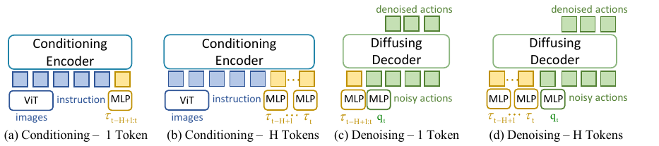
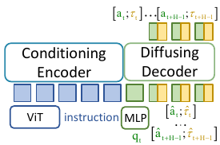
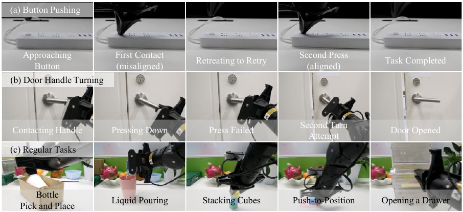






## 1. 问题与背景
{: #problem }

TA-VLA 研究关节力矩如何进入预训练 VLA，使策略利用接触变化完成按钮按压、插接和门把手转动。关节电机反馈同时包含机器人自身动力学与外部接触造成的响应，因此即使图像中接触区域被遮挡，力矩时间曲线仍能提供交互进展信息。

论文沿三个轴组织设计空间：**在哪里融合**（编码器或动作解码器）、**如何表示时间**（当前帧或历史、单 token 或多 token）、**怎样使用未来信号**（动作与未来力矩联合预测）。这三个问题构成全文的方法主线。

## 2. 核心贡献
{: #contributions }

1. 系统比较力矩接入位置，并以表征统计依赖与输入扰动实验解释解码器接入的表现。
2. 将短期力矩历史汇聚为一个动作解码器 token，在两项接触任务上取得更高成功率。
3. 使用共享生成模型联合预测动作与未来力矩，将力矩作为观测和训练目标两种信息来源结合。

## 3. 方法
{: #method }

### 信号与动作的语义

平台为 Cobot Magic ALOHA 双臂机器人，每臂的记录通道包括 6 个机械臂关节与夹爪，总计 14 维关节位置和 14 维 effort。力矩由电机电流与电流—力矩常数换算。三台 D435 提供正面及双腕图像，策略同时接收语言指令。

正文用 $\tau_{\rm ext}=J(q)^\top F_{\rm ext}$ 说明末端外力如何投影到关节。实际输入采用各关节反馈，按训练集统计量归一化；机器人自身运动也会改变这些反馈。动作语义为关节位置与夹爪控制，未来 effort 则承担辅助预测目标。

### 即时力矩：接入位置

| 方案 | 处理方式 |
| :--- | :--- |
| Enc | 将 14 维 effort 经 MLP 编码，加入视觉语言条件序列 |
| DePre | 把 effort 放入原 32 维状态向量的空余槽位，再统一投影 |
| DePost | 单独编码 effort，在动作专家中增加一个 token |

DePost 将力矩与本体状态放在同一动作生成侧处理。论文在按钮任务中抽取第 12 层隐藏表示，使用归一化 HSIC 衡量统计依赖：力矩与关节角的数值为 0.957。扰动实验向编码器 token 或解码器状态 token 加入标准差 0.1 的高斯噪声，观察到解码器侧扰动对任务表现的影响更大。

### 历史：两秒反馈压成一个 token

模型从过去 2 秒均匀采样 10 帧，包含当前帧。每帧为 14 维 effort。单 token 方案将它们展平成 140 维向量，通过两层 MLP 投影至动作专家的 1024 维；多 token 方案分别编码各帧。

<figure>
  
  <figcaption><strong>原文 Fig. 4 · 历史力矩的四种编码方式。</strong> 主方案将十帧历史展平后经 MLP 编成一个 token，接入动作解码器。 来源：TA-VLA，arXiv v1，PDF 第 6 页。</figcaption>
</figure>

单 token 汇聚保留固定长度历史的联合模式，同时使动作专家新增的输入序列长度保持较小。论文还比较了 MLP、RNN 和 attention 汇聚器，主方案使用 MLP。

### 未来：动作与力矩联合生成

动作块 $A_t$ 与未来力矩块 $T_t$ 在特征维度拼接，共享加噪、生成网络和输出投影。动作与力矩切片分别计算损失：

$$
\mathcal L_{\rm joint}=\mathcal L_{\rm action}+\beta\mathcal L_{\rm torque}.
$$

两种输出的时间长度均为 50 步。扩展投影层时，原动作维度继承预训练权重，新力矩维度以较小数值初始化。只增加预测目标的版本使用 $\beta=1$；同时加入历史观测的版本使用 $\beta=0.1$。推理产生联合序列，机器人执行其中的动作部分。

<figure>
  
  <figcaption><strong>原文 Fig. 5 · 动作与未来力矩联合生成。</strong> 动作与力矩沿特征维拼接，共享生成网络，分别计算损失。 来源：TA-VLA，arXiv v1，PDF 第 6 页。</figcaption>
</figure>

### 数据与训练

附录报告各任务采集 400 条遥操作示范。π0 的编码器和解码器采用 LoRA 微调，使用 4 张 NVIDIA L20 训练 30k 步；RDT 全参数训练 40k 步；ACT 训练 600 个 epoch。推理使用 RTX 4090，π0 动作块长度 50，RDT 为 64。跨本体实验另用 ROKAE SR 的 200 条充电接口插入示范训练 50k 步。

## 4. 实验与证据
{: #evidence }

### 接入方式与历史消融

每个任务测试 20 次。下表直接保留成功次数，便于比较同一评价设置。

| 方案 | 按钮按压 | 充电器插接 | 原文 |
| :--- | :--- | :--- | :--- |
| π0 | 5/20 | 0/20 | Table 1 |
| 即时力矩 Enc | 7/20 | 8/20 | Table 1 |
| 即时力矩 DePre | 8/20 | 11/20 | Table 1 |
| 即时力矩 DePost | 10/20 | 12/20 | Table 1 |
| 历史 Dec-H，多 token | 9/20 | 7/20 | Table 3 |
| 历史 Dec-1，单 token | 15/20 | 16/20 | Table 3 |
| 历史观测与未来预测联合 | 18/20 | 17/20 | Table 5 |

### 十项任务与迁移结果

五项接触任务依次为按钮、充电器、USB、拔插头、转门把手。最终模型成功次数为 18、17、17、19、15；π0 为 5、0、0、16、2，均以 20 次为分母。五项普通任务包括瓶子搬运、倒液体、堆方块、推物体和开抽屉，最终模型为 19、17、17、18、18 次成功。

<figure>
  
  <figcaption><strong>原文 Fig. 7 · 接触后的调整与任务执行。</strong> 上两行呈现接触、退回与再次尝试的时间顺序，下行展示普通操作任务。 来源：TA-VLA，arXiv v1，PDF 第 8 页。</figcaption>
</figure>

RDT 接入同一思路后，按钮从 4/20 提高至 16/20，充电器插接从 1/20 提高至 15/20，瓶子搬运从 17/20 提高至 19/20（Table 6）。ROKAE 实验展示了针对该机器人训练后的充电器插入，以及更换接口后的执行过程。

### 汇聚、权重与效率

按钮任务中，历史观测加未来预测配置采用 MLP、RNN、attention 汇聚时分别为 18/20、10/20、17/20。损失权重 $\beta=0.1$ 或 0.2 时为 18/20，增至 1 时为 12/20。RTX 4090 上平均推理时间从 π0 的 90.70 ms 变为最终模型的 93.96 ms；统计来自 10 次运行（附录 A.8–A.10）。

## 5. 相关工作
{: #related-work }

π0 [6] 和 RDT [7] 分别提供流匹配与扩散式动作生成基座，ACT [11] 提供动作块模仿学习基线。TA-VLA 在已有生成结构上扩展观测和预测维度。关节力矩接触估计工作 [1–3] 提供物理信号的背景；自动驾驶中的联合预测与规划 [10] 则启发了未来力矩辅助目标。

## 6. Insights · 思考与启示
{: #takeaways }

**历史 context 的粒度。** 本文将两秒内十帧反馈压缩成一个 token，展示了短期物理历史与预训练动作接口之间的具体连接方式。这个 token 同时承载响应变化与接触阶段信息。

**观察与预测的互补。** 观测历史描述刚刚发生的交互，未来 effort 监督要求内部表征兼顾接下来可能出现的响应。两者联合的结果，为理解力条件策略如何形成物理相关表征提供了直接材料。

**与动作—力 ICL 的联系。** 阅读时可以进一步区分“从历史识别当前阶段”与“从此前动作及其响应推断接触条件”。TA-VLA 的历史接口和预测目标分别对应了这条思路中的感知与响应建模环节；把它们连接到跨接触条件的 context 学习，是由本文引出的研究问题。

## 参考与补充

发表信息：CoRL · 2025。[来源](https://github.com/ZZongzheng0918/TA-VLA)。

- [论文 arXiv:2509.07962v1](https://arxiv.org/abs/2509.07962v1)，CoRL 2025；[项目页](https://zzongzheng0918.github.io/Torque-Aware-VLA.github.io/)。
- 方法：§§3–5、Figs. 2–5；实验：Tables 1–6；历史、训练、汇聚与信号预处理：附录 A.3–A.11。
- [1–3]、[6]、[7]、[10]、[11] 沿用原论文参考文献编号。

