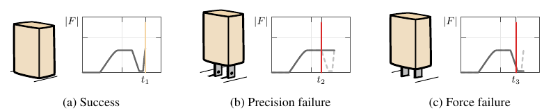
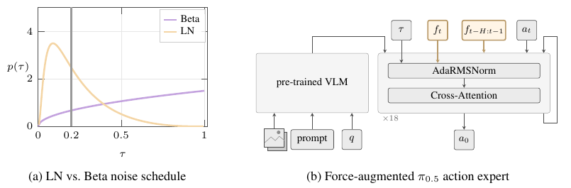
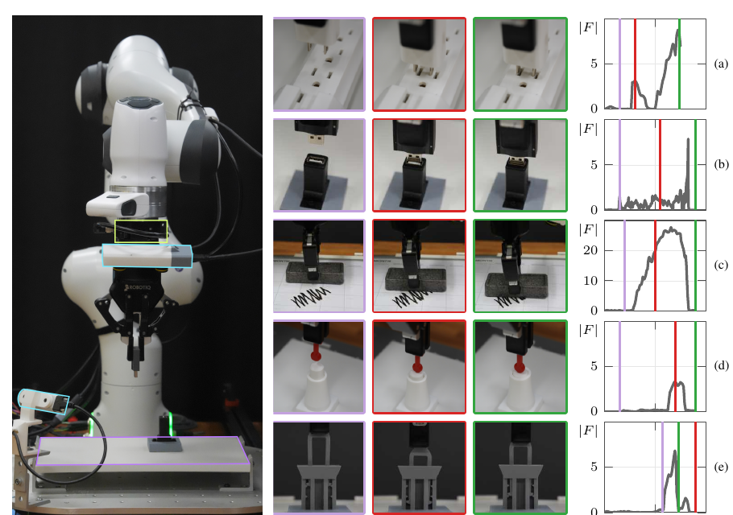






## 1. 问题与背景
{: #problem }

接触操作同时要求机器人完成微小位姿修正，并从力变化判断接触过程。FACT 将 VLA 的失败分为两类：**precision failure** 是接触时无法产生足够精细的纠正动作；**force failure** 是未能依据接触力决定继续、调整或停止。插头在孔口顶住属于前者，已经进入插孔却提前停止、没有完全就位属于后者。〔§4，Fig. 2〕

<figure>
  
  <figcaption><strong>原文 Fig. 2 · 插头成功执行与两类失败。</strong> 成功轨迹经历接触探索、进入插孔与完全就位的力峰；孔口顶住与进入后提前停止对应不同失败过程。来源：FACT，arXiv:2608.01402v2，PDF 第 4 页。</figcaption>
</figure>

接触前的动作位移较大，接触后的位移接近零，此时视觉又容易被连接器遮挡。作者据此检查 flow-matching 的训练噪声分布；另一方面，力信号具有接触稀疏性和时间结构，同一个当前力值需要结合此前的力积累与瞬态才能解释。FACT 的切入点是联合调整训练采样与力信息进入动作专家的方式。〔§4，Fig. A.3〕

## 2. 核心贡献
{: #contributions }

1. **把接触失败拆成动作精度与力响应两个问题。** 用失败轨迹、动作幅值分析与针对性实验组织诊断。
2. **用 Logit-Normal（LN）调整后训练的噪声时间步采样。** 增加近干净动作区域的训练覆盖，沿用已有 VLA 主干和 flow-matching 目标。
3. **让当前力调制计算、历史力提供上下文。** 当前腕部 F/T 通过 AdaRMSNorm scale 修正进入动作专家，短时历史通过 tokens 进入 attention；接触梯度门控使力编码学习集中在有效接触段。

FACT 全称为 Force-Aware Contact-rich manipulation via Timestep Modulation。核心可记为：**LN 学细动作，当前力调制计算，历史力解释过程，门控聚焦有效接触。**〔§5〕

## 3. 方法
{: #method }

### 整体接口与信息流

FACT 以预训练 π₀.₅ 为主要基础模型，保留视觉、语言和本体状态条件，扩展 action expert 的力条件化通路。动作端输出末端笛卡尔位置增量与角度增量，由底层控制器执行。力信号来自腕部六维 force/torque 传感器，即三维力与三维力矩。〔§5，附录 B、C、E〕

<figure>
  
  <figcaption><strong>原文 Fig. 3 · LN 训练采样与双通路力条件化。</strong> 左侧增加低噪声训练覆盖；右侧将当前力送入 AdaRMSNorm，将历史力作为动作专家的上下文。来源：FACT，arXiv:2608.01402v2，PDF 第 5 页。</figcaption>
</figure>

| 组成 | 输入与具体处理 | 作用位置 |
| :--- | :--- | :--- |
| LN 采样 | 训练时从 LN 抽取噪声水平 τ | flow-matching 训练样本构造 |
| 当前力调制 | 最近 27 个 F/T 读数取均值，经两层 MLP 与投影得到 Δγ | action expert 各层 AdaRMSNorm 的 scale |
| 历史力上下文 | 前 30 个策略步的传感器窗口，经共享因果 TCN 编码 | 作为前缀 tokens，供动作侧 attention 使用 |
| 接触门控 | 接触阈值 δ=0.5 N；无接触步阻断力编码组件的梯度 | 力分支的训练更新 |

### LN 改的是训练采样分布

论文采用如下噪声约定：

$$
a_\tau=(1-\tau)a_0+\tau\epsilon,\qquad \epsilon\sim\mathcal N(0,I).
$$

因此 τ=0 对应干净动作，τ=1 对应纯噪声。训练预测速度场，监督目标为 ε−a₀：

$$
\mathcal L_{\mathrm{FM}}=\mathbb E_{a_0,\epsilon,\tau}\left[\|v_\theta(o,a_\tau,\tau)-(\epsilon-a_0)\|_2^2\right].
$$

FACT 将训练噪声水平改为

$$
\tau=\sigma(sz-m),\qquad z\sim\mathcal N(0,1),\quad m=1.5,\ s=1.
$$

相较 Beta(1.5, 1.0)，LN 在 τ<0.2 区域分配约 6 倍的采样概率，使模型更频繁地学习从小扰动恢复动作。推理从 τ=1 向 τ=0 积分生成动作块。官方主页的交互图也按“clean action → pure noise”标注 τ 轴，默认设置显示约 6.1 倍。〔§3、§5.1；官网 Approach〕

### 当前力通过归一化尺度改变计算

传感器以 400 Hz 采样，策略以 15 Hz 更新。每个策略步对应 H_w=27 个六维读数。§5.2 将当前窗口均值记为 f̄ₜ，再经两层 MLP 与投影生成调制向量：

$$
\Delta\gamma(\bar f_t)=W_\gamma\phi_{\mathrm{force}}(\bar f_t).
$$

该向量加到原本由噪声时间步决定的 scale 上，即 γ_l(τ) → γ_l(τ)+Δγ(f̄ₜ)。同一个 Δγ 在各层共享；原有时间步条件化的其他项保留。这样，当前接触状态直接改变动作特征的归一化缩放。附录 E 说明新增 γ 投影的权重采用零初始化。〔Eq. 4–5，附录 E〕

### 历史力以窗口序列进入上下文

历史长度 H=30，对应 15 Hz 下约 2 秒；每个策略步保留 27 个原始传感器读数。历史编码器是共享因果 TCN，包含 4 个 dilated blocks，hidden width 为 64，约 0.2M 参数。编码后的历史 tokens 前置到 action expert 输入，让 attention 读取此前接触的建立、积累与变化。当前力条件化头约 2.1M 参数，新增模块合计约 2.2M。〔§5.2，Table A.2〕

例如钥匙插入，当前窗口可以反映是否出现到位的 hard-stop 力峰；历史则提供该峰之前的推进过程。对按钮任务，力的累积与变化帮助判断按压是否达到锁定条件。这是单次执行内的短时感知上下文。〔附录 A，Table 3〕

### 接触梯度门控

自由空间里的近零力读数占据大量时间步。FACT 使用 δ=0.5 N 的接触阈值，在未检测到接触的步骤阻断所有力编码组件的梯度，避免力编码器主要拟合无信息读数。门控作用于力分支的学习，其他策略训练仍使用这些时间步。〔§5.2，Table A.2；官网 Approach〕

### 数据、训练与部署

每项任务采集 100 条 Haply Inverse 3 力反馈遥操作示范。目标位置在 32×20 cm 区域均匀随机化，机器人初始位置在 5 cm 立方体内随机化。图像和本体观测为 15 Hz，400 Hz F/T 经 one-euro filter [27] 预处理后与观测同步。所有主要比较方法使用相同示范、π₀.₅ 预训练权重和 LoRA，训练 20,000 步；共享 LoRA 可训练参数约 50M。〔§6，附录 B、E〕

部署时，15 Hz 策略产生末端位姿增量；轨迹生成器插值得到 1 kHz 参考轨迹，笛卡尔阻抗控制与 operational-space torque computation 将其转换为关节力矩。因此，FACT 是**用实测力条件化位姿动作的策略**，其动作接口是位姿增量，接触柔顺性也受到下层控制器影响。〔附录 C〕

## 4. 实验与证据
{: #evidence }

### 平台、任务与指标

硬件为 Franka Research 3、腕部 Bota SensONE 六轴 F/T、外部 RealSense D435 与腕部 ZED Mini。五项任务覆盖插头、USB、按钮、擦板和钥匙插入。钥匙任务通过视觉外观相同、长度不同的钥匙制造视觉歧义，要求依据接触力判断就位。〔§6，附录 A–B〕

<figure>
  
  <figcaption><strong>原文 Fig. A.2 · 机器人平台、五项任务与力曲线。</strong> 右侧从上到下为插头、USB、擦板、按钮和钥匙。紫、红、绿标记接近、主要失败时刻和成功时刻；钥匙锁的开背视图用于可视化。来源：FACT，arXiv:2608.01402v2，PDF 第 13 页。</figcaption>
</figure>

每种方法每项任务评估 40 次独立 rollout，在 60 秒内完成记为成功；测试初始状态从与训练相同的分布抽取。总计近 2,500 次 rollout 包括主实验与其他条件。指标 SR 是成功率；增益用百分点表示。ForceVLA [8] 与 TA-VLA [9] 被重新实现到 π₀.₅ 上，共享腕部 F/T、训练数据、位姿动作接口与控制器，力融合结构和参数量各自保留。〔§6，附录 E〕

### 主结果

| 方法 | 插头 | USB | 按钮 | 擦板 | 钥匙 | 平均 SR |
| :--- | ---: | ---: | ---: | ---: | ---: | ---: |
| π₀.₅ | 30.0% | 37.5% | 12.5% | 100.0% | 15.0% | 39.0% |
| π₀.₅ + LN | 50.0% | 47.5% | 57.5% | 87.5% | 37.5% | 56.0% |
| FACT | 57.5% | 47.5% | 75.0% | 90.0% | 60.0% | 66.0% |
| ForceVLA | 32.5% | 37.5% | 12.5% | 77.5% | 42.5% | 40.5% |
| TA-VLA | 30.0% | 25.0% | 20.0% | 97.5% | 15.0% | 37.5% |

来源：Table 1，PDF 第 7 页；官网 Results 提供相同任务表，概览卡片将 40.5% 四舍五入为 41%。

FACT 比最佳既有力增强基线 ForceVLA 高 **25.5 个百分点**。单独 LN 将平均成功率从 39% 提升到 56%；在 LN 基础上加入完整力条件化，再提升到 66%。按钮和钥匙分别进一步增加 17.5、22.5 个百分点。擦板的 π₀.₅ 已达 100%，FACT 为 90%；作者将该任务的持续接触主要归因于柔顺控制器，少数失败来自视觉对齐与擦除覆盖不足。〔§7〕

Table 1 的单侧 Fisher 检验均以 π₀.₅ 为参照。FACT 在插头、按钮、钥匙上的 p 分别为 .012、<.001、<.001；USB 为 .249。LN 单独用于插头的 p=.055。附录 H 使用未做多重比较校正的 p 值与 α=.05。

### 力模块消融

| 配置 | 插头 | 钥匙 | 按钮 |
| :--- | ---: | ---: | ---: |
| 完整 FACT | 57.5% | 60.0% | 75.0% |
| 去掉接触梯度阈值 | 42.5% | 27.5% | 57.5% |
| 去掉当前力调制 | 60.0% | 35.0% | 50.0% |
| 去掉力历史 | 30.0% | 20.0% | 12.5% |

来源：Table 3，PDF 第 8 页。**历史力在这组三任务消融中的影响最大**：钥匙下降 40 个百分点，按钮下降 62.5 个百分点。去掉当前力调制使钥匙和按钮分别下降 25 个百分点，而插头为 60%；模块收益随任务而变。去掉梯度门控使钥匙下降 32.5 个百分点，说明聚焦有效接触对这项任务尤其重要。

### 其他分析与迁移结果

| 实验 | 关键结果 | 证据位置 |
| :--- | :--- | :--- |
| 用高斯噪声替换实测 F/T，并重新训练与评估 | FACT 插头 57.5→40.0%，钥匙 60.0→5.0%，按钮 75.0→17.5%；后两项 p<.001，插头 p=.090 | Table A.1，附录 D、H |
| LN 加到已有力架构 | TA-VLA 的插头/钥匙/按钮由 30/15/20% 升至 47.5/32.5/42.5%；ForceVLA 插头与按钮改善，钥匙由 42.5% 降至 30% | Table 2 |
| 迁移至 π₀ | FACT 在插头/钥匙/按钮为 70/50/60%，对应 π₀ 为 32.5/45/47.5% | Table 4 |
| 迁移至 GR00T N1 | 插头加入 LN：40→65%；钥匙基线/LN/FACT：15/12.5/35% | §7 |
| 小动作预测诊断 | 20 条留作评估的插头示范中，<5 mm 动作的低噪声 flow error 降低 8–13%，重建误差降低 5–13% | 附录 G |
| 标准叠碗任务 | 15 条示范、5K 训练步，π₀.₅ 70%，FACT 75% | §7 |

LN 的参数采用固定 m=1.5、s=1，接触阈值采用 0.5 N，历史长度为 2 秒；论文的实验重点是模块移除、噪声替代和跨主干验证。官网交互图展示不同 LN 参数下的采样概率分布。

## 5. 相关工作
{: #related-work }

**Flow-matching VLA。** π₀ [1]、π₀.₅ [2] 和 GR00T N1 [4] 提供动作生成基础。FACT 沿用 flow matching [24]，将既有 Logit-Normal 采样方法 [25] 用于接触操作后训练，针对小动作恢复重新分配训练覆盖。

**力增强 VLA。** ForceVLA [8] 在视觉语言与动作专家之间引入力感知 MoE；TA-VLA [9] 将历史读数编码成动作侧 token。FACT 将当前力与历史力分配给归一化调制和上下文两条通路。本文统一实现中，新增参数分别约为 FACT 2.2M、ForceVLA 45M、TA-VLA 2.1M。FA-VLA [10] 还关注快慢模块解耦，CRAFT [11] 与 FD-VLA [12] 分别从课程微调和力蒸馏角度利用力信息。〔§2，Table A.2〕

**接触控制与多模态学习。** Operational-space control [14] 提供底层运动与力交互基础；FoAR [19] 研究力感知反应策略，FACTR [23] 关注力与视觉融合中的模态使用。FACT 在此脉络中强调：需要同时检查动作生成训练分布，以及力信号如何影响策略计算。

## 6. Insights · 思考与启示
{: #takeaways }

**工作总览。** FACT 从精度与力响应两类失败出发，把 LN 训练采样、当前力调制、历史力上下文和接触梯度门控组合到已有 VLA 上。在五项真机接触任务中平均成功率达 66%，力历史与有效接触学习对按钮、钥匙任务贡献突出。

**阅读联想一：即时反馈与历史上下文可以承担不同职责。** 当前力决定此刻网络对动作特征的响应，历史力帮助解释当前状态如何形成。“即时反馈走调制，历史信息走上下文”比把所有传感信息压成同一种 token 更明确地表达了信息职责。FACT 的消融支持这一分工在力关键任务上的价值。

**阅读联想二：力感知策略的收益包含动作精度与接触理解两个来源。** LN 单独已带来明显收益，进一步接入力信息又改善按钮与钥匙。理解一个 force-conditioned policy 时，可以分别看它能否生成足够细的纠正，以及它是否利用了力过程中的任务信息。

**与动作—力响应历史适配的联系。** FACT 的历史上下文是单次执行内约 2 秒的 F/T 窗口，参数通过离线后训练获得。面向跨试次 ICL 的研究还涉及历史动作、结果与接触条件之间的关联，以及失败后如何保留和读取经验，可借鉴 FACT 的信息分工。FACT 的输出为位姿增量，显式目标 wrench 控制则需要额外的目标力表示与控制接口。

**继续思考的问题。** 单纯力历史能否区分“物体更硬”和“策略刚刚推进更多”，关系到是否需要联合编码动作—力响应。当前力调制的尺度如何随工具、传感器安装与物体刚度变化而适配，也值得进一步理解。论文 §8 将跨机器人、传感器位置、未见物体和更广泛标准任务列为拓展方向；当前证据来自固定腕部传感器的单机器人平台。

## 参考与补充

- **论文版本：** [arXiv:2608.01402v2](https://arxiv.org/abs/2608.01402v2)，[PDF](https://arxiv.org/pdf/2608.01402v2)。依据 17 页版本整理。
- **官方主页：** [FACT](https://stanford-iprl-lab.github.io/fact/)，核对 Diagnosis、Approach、Results；访问日期 2026-11-03。主页含失败演示、可交互 LN 分布图与方法分组件说明。
- **官方代码入口：** [stanford-iprl-lab/fact](https://github.com/stanford-iprl-lab/fact)，来自项目主页。
- **关键位置：** §3–5 方法；Table 1–4 主结果与消融；附录 A–C 任务、硬件和控制器；附录 D–H 噪声替代、架构对比、动作诊断与统计方法。
- **原文参考编号：** [1] π₀；[2] π₀.₅；[4] GR00T N1；[8] ForceVLA；[9] TA-VLA；[10] FA-VLA；[11] CRAFT；[12] FD-VLA；[14] Khatib，Operational Space Formulation；[19] FoAR；[23] FACTR；[24] Flow Matching for Generative Modeling；[25] Scaling Rectified Flow Transformers for High-Resolution Image Synthesis；[26] Bai 等，序列建模 TCN；[27] 1€ Filter。编号沿用论文 References，区别于官网局部编号。

