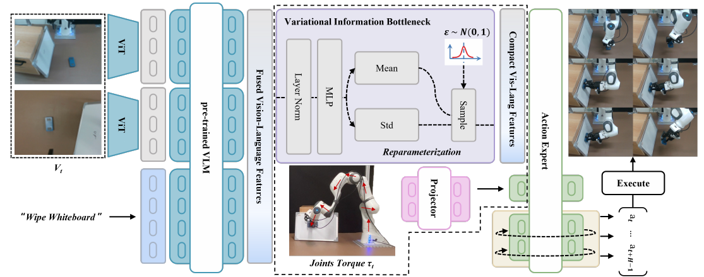
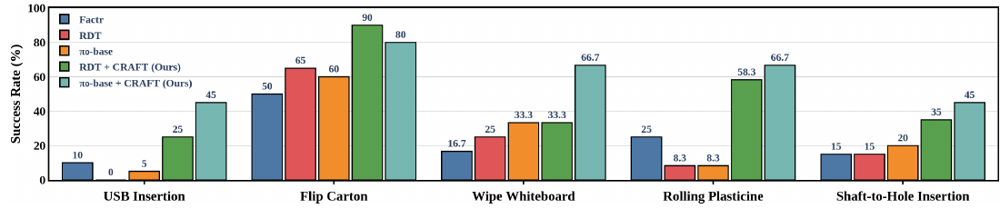
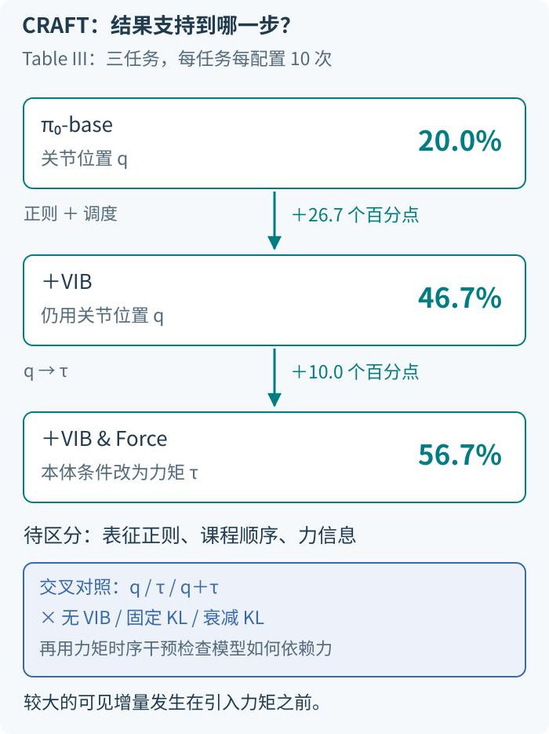






## 1. 问题与背景
{: #problem }

CRAFT 研究如何让预训练 VLA 在微调时真正利用接触信息。插入、擦拭和揉压物体需要精细对齐、持续接触与动态调整；视觉和语言提供丰富语义，关节力矩则反映机器人与环境的物理交互。作者将模型偏向视觉语言、低估力信号的问题解释为模态信息不平衡，并据此设计“先建立力响应，再逐步恢复丰富感知”的训练课程。〔§I、III-B〕

这里的 force modality 是**关节力矩 τ**。它作为本体感知输入，与视觉语言特征共同决定动作。CRAFT 将课程施加到视觉语言编码之后的表征上，用变分信息瓶颈（VIB）控制这一通路的约束强度。〔§III〕

## 2. 核心贡献
{: #contributions }

1. **VIB 力感知课程微调。** 在视觉语言 embedding 后插入可训练的概率瓶颈，前期施加强 KL 正则，后期逐步减弱，推动模型先利用力矩。
2. **关节力矩作为策略条件。** 在 π₀-base 与 RDT 上实现，将力矩接入原有动作生成流程，并保留各自主干的任务损失。
3. **带力反馈的同构主从遥操作。** 使用 Franka Panda 和低成本伺服主臂，采集同步多视角图像、状态、关节力矩和动作示范；验证五项真机任务与四类分布外变体。〔§III–IV〕

**一句话记忆：CRAFT 先收紧视觉语言表征，让力矩参与学习，再逐步松开信息瓶颈。**

## 3. 方法
{: #method }

### 输入、模块与输出

视觉观测 Vₜ 与语言指令 L 经预训练编码器形成特征 F；VIB 将其映射为紧凑随机表征 Fᶜ。关节力矩 τₜ 经 projector 接入动作侧，action expert 联合使用两类条件，预测长度为 H 的未来动作序列。论文在 flow-based π₀ 和 diffusion-based RDT 上分别实现。〔Fig. 2，§III-B–C〕

<figure>
  
  <figcaption><strong>原文 Fig. 2 · VIB 与关节力矩的两条条件通路。</strong> 视觉语言特征通过概率瓶颈，关节力矩经 projector 输入动作专家。课程调节的是瓶颈正则强度。来源：arXiv:2602.12532v1，PDF 第 4 页。</figcaption>
</figure>

| 模块 | 具体操作 | 训练中的职责 |
| :--- | :--- | :--- |
| 视觉语言编码 | 使用原有 VLA 的感知与语义表征 | 提供场景、物体和指令信息 |
| VIB | 预测均值与标准差，采样紧凑特征 | 用 KL 正则限制感知表征携带的信息 |
| 力矩通路 | 将关节力矩投影为策略可用条件 | 提供物理交互信息 |
| 课程权重 | 随训练步数指数减小 λ_VIB | 从强压缩过渡到更丰富的多模态融合 |
| 动作专家 | 沿用基础模型的动作预测目标 | 根据条件生成未来动作块 |

### VIB 如何限制视觉语言信息

CRAFT 将条件后验建模为高斯分布，其均值和标准差由两个线性预测头产生：

$$
p(F^c\mid F)=\mathcal N(\mu(F),\operatorname{diag}(\sigma^2(F))),\qquad q(F^c)=\mathcal N(0,I).
$$

训练时通过重参数化取样：

$$
F^c=\mu+\sigma\odot\epsilon,\qquad\epsilon\sim\mathcal N(0,I).
$$

KL 损失为

$$
\mathcal L_{\mathrm{VIB}}=\frac12\sum_i\left(\mu_i^2+\sigma_i^2-\log\sigma_i^2-1\right).
$$

较强的 KL 惩罚推动后验靠近标准正态先验，减少视觉语言表征对具体输入的依赖；动作监督同时推动表征保留完成任务所需的信息。力矩通路不经过这一视觉语言瓶颈，因此前期成为模型可利用的重要条件。〔Eq. 1–4〕

### 课程改变的是 KL 权重

整体训练目标和调度为：

$$
\mathcal L_{\mathrm{total}}=\mathcal L_{\mathrm{task}}+\lambda_{\mathrm{VIB}}(s)\mathcal L_{\mathrm{VIB}},\qquad
\lambda_{\mathrm{VIB}}(s)=\lambda_{\mathrm{init}}e^{-s/T_{\mathrm{decay}}}.
$$

这里 s 表示训练步数；论文 Eq. 9 使用 t。λ_init 决定初始约束，T_decay 控制释放速度。前期强压缩，使模型学习依赖力矩的动作关系；后期降低正则，允许视觉语言信息重新发挥更大作用。这个过程是同一次微调内的连续调度。〔Eq. 8–9〕

与 FACTR 的联系在于，两者都改变**训练期间不同模态的可用信息量**。FACTR 逐步减弱图像或视觉 token 的平滑；CRAFT 学习高斯隐变量，并逐步减弱对其分布的 KL 约束。CRAFT 的瓶颈同时针对视觉和语言，任务损失则随基础 VLA 保留。

### 力矩为何作为本体感知

论文用阻抗控制关系解释力矩携带的任务信息：力矩受到目标与实际运动偏差、动力学以及外部交互的共同影响。对插入或擦拭而言，这些信息帮助策略区分受阻、接触和自由运动状态。消融中的“+VIB”仍以关节位置作为本体感知；完整“+VIB & Force”改用关节力矩。〔§III-B，Table III〕

关节力矩与末端六维 wrench 的表达坐标和所含动力学成分不同。论文把力矩作为动作预测条件；下层机器人采用阻抗控制。公开的 8 页版本以通用动作块 Aₜ 表述策略输出，未进一步给出统一的动作坐标、策略频率及 λ_init、T_decay 数值。

### 数据采集与训练设置

主臂由可驱动低成本伺服电机构成，从臂为 Franka Emika Panda。操作者移动主臂，从臂跟随；从臂交互反馈传回主臂，使操作者感到接触。系统使用腕部和外部两路相机，时间同步图像、本体状态、力矩和动作。〔§III-A，Fig. 1〕

每项任务采集 50 条示范，并随机化物体位姿。分别将 π₀-base 与 RDT 微调到对应任务。训练沿用各基础模型的 imitation-learning 目标。公开版本未列出具体优化器和训练步数。〔§III-C、IV-A〕

## 4. 实验与证据
{: #evidence }

### 五项任务与比较设置

任务包括 USB 插入、翻纸盒、擦白板、滚橡皮泥、轴孔插入。插入以完全到位为成功；翻盒要求完整翻转且不掉落或损坏；擦板要求覆盖指定区域至少 90%；橡皮泥需形成圆柱形且不破裂或过度变形。USB、翻盒和轴孔各评估 20 次，擦板和橡皮泥各 12 次。〔§IV-A〕

比较方法为 FACTR、π₀-base、RDT 及两个 CRAFT 增强版本。FACTR 是 ACT 类策略，CRAFT 的两个版本依托预训练 VLA；这组比较同时包含基础策略差异。课程和力矩输入的作用进一步由 Table III 拆分。〔§IV-A、IV-D〕

<figure>
  
  <figcaption><strong>原文 Fig. 4 · 五项任务的成功率。</strong> CRAFT 提升 π₀-base 与 RDT 的表现；翻纸盒由 RDT+CRAFT 取得最高值，其余四项由 π₀-base+CRAFT 最高。来源：arXiv:2602.12532v1，PDF 第 6 页。</figcaption>
</figure>

| 方法 | USB | 翻纸盒 | 擦白板 | 滚橡皮泥 | 轴孔插入 |
| :--- | ---: | ---: | ---: | ---: | ---: |
| FACTR | 10.0% | 50.0% | 16.7% | 25.0% | 15.0% |
| RDT | 0.0% | 65.0% | 25.0% | 8.3% | 15.0% |
| π₀-base | 5.0% | 60.0% | 33.3% | 8.3% | 20.0% |
| RDT + CRAFT | 25.0% | 90.0% | 33.3% | 58.3% | 35.0% |
| π₀-base + CRAFT | 45.0% | 80.0% | 66.7% | 66.7% | 45.0% |

来源：Fig. 4，PDF 第 6 页。Table I 的五任务平均值为 π₀-base **25.32%→60.68%**，增加 **35.36 个百分点**；RDT 为 **22.66%→48.32%**，增加 **25.66 个百分点**。两类基础模型均受益，翻盒任务由 RDT+CRAFT 取得最高值。

### 分布外测试

| 任务变体 | π₀-base | π₀-base + CRAFT |
| :--- | ---: | ---: |
| USB 插座高度与视觉变化 | 1/10（10%） | 4/10（40%） |
| 不同纸盒 | 10/20（50%） | 15/20（75%） |
| 白板摆放角度变化 | 2/10（20%） | 6/10（60%） |
| 不同颜色橡皮泥 | 2/20（10%） | 12/20（60%） |

来源：Table II、Fig. 6。每个变体评估 5 次，表中按任务合并多个变体。四任务宏平均为 22.50%→58.75%，增加 36.25 个百分点。这里的任务级泛化对应已有任务的布局或视觉变体。

### VIB 与力矩的贡献

| 配置 | 三任务平均成功率 |
| :--- | ---: |
| π₀-base | 20.0% |
| +VIB，使用关节位置 | 46.7% |
| +VIB & Force，使用关节力矩 | 56.7% |

来源：Table III。USB、擦板、滚橡皮泥每项每配置评估 10 次。加入 VIB 带来 26.7 个百分点的提升，进一步采用力矩带来 10.0 个百分点。该表支持信息约束与力矩条件的组合收益；“力矩输入但无 VIB”和“固定 KL 权重”两个条件未单独评估。

## 5. 相关工作
{: #related-work }

**FACTR [30] 是直接前置工作。** 它通过逐渐减弱视觉退化改变模态学习顺序，并提供低成本带力反馈遥操作系统。CRAFT 将课程迁移到预训练 VLA 的视觉语言隐空间，用 VIB [10] 和 Information Bottleneck [31] 组织可学习的信息约束。

**π₀ [6] 与 RDT [5] 提供两种动作生成基础。** CRAFT 的额外正则施加在条件表征上，因此可分别与 flow matching 和 diffusion 任务损失结合。ForceVLA [9] 主要通过 MoE 结构融合力，RDP [7] 与 VLA-Touch [8] 关注视觉触觉响应和感知增强；CRAFT 的重点是微调过程中如何分配模态学习机会。遥操作设计还借鉴 HACTS [40]。〔§II、III〕

## 6. Insights · 思考与启示
{: #takeaways }

**工作总览。** CRAFT 在已有 VLA 的视觉语言表征之后添加 VIB，并以指数衰减的 KL 权重实现力优先课程。关节力矩作为本体条件参与动作生成，π₀ 与 RDT 的五任务平均成功率分别提高 35.36 和 25.66 个百分点。

### 最大的归因问题：压缩表征的收益与力优先机制

<figure>
  
  <figcaption><strong>阅读重构 · 把消融结果与机制解释分开。</strong> 数字来自 Table III，三任务各 10 次；增量为相邻配置的百分点差。底部列出区分正则、课程和力利用的对照设计。</figcaption>
</figure>

Table III 中，保留关节位置、只加入 VIB 的配置已经从 20.0% 升到 46.7%；在 VIB 上将本体感知换成力矩，再升到 56.7%。**较大的可见增量发生在引入力矩之前。** 因而，压缩表征改善泛化或优化过程，是与“课程促使模型先学力”并存的解释。后一步还同时改变了本体信息的内容：位置被力矩替换。两项增量都依赖所在配置，不能视为可任意相加的独立贡献。

更直接的检验是交叉比较本体输入（q、τ、q＋τ）与瓶颈设置（无 VIB、固定权重、衰减权重），保持数据、训练预算一致，并让固定与衰减条件具有可比的累计正则强度。随后按接触阶段打乱力矩时序，同时记录闭环成功率和动作变化。若衰减课程对时序破坏更敏感且闭环表现更好，就更支持它学到了任务相关的力依赖；若固定权重也获得相近收益，解释重心会转向表征正则。时序打乱会改变输入分布，因此应在全部配置中采用相同扰动，并结合真实反馈下的表现判断。

### 信息量论证需要关注任务相关性

§III-B 用 $$H(\tau)\ge H(q)$$ 解释力矩的信息优势。多变量的确定性函数关系本身给不出这个下界：以离散变量为例，令 $$z=-q$$，则 $$\tau=q+z=0$$，即使 $$H(q)>0$$，仍有 $$H(\tau)=0$$。这个反例指出的是推理步骤的缺口。对于连续物理量，微分熵的数值还随单位与坐标缩放变化。

更贴近接触任务的问题是：给定视觉、语言和已有状态后，力矩还提供多少与正确动作有关的信息？关节力矩同时含有动力学和接触成分；实证应考查接触状态变化时它是否帮助选择动作。Table III 支持所测条件下的性能改善，而“高熵模态压制低熵模态”这一解释需要单独的表征或干预证据。

### 与已有阅读思路的联系

**阅读联想：训练顺序本身是一种模态融合设计。** 如果模型先形成视觉捷径，增加一个力 token 可能不足以改变动作依据。CRAFT 与 FACTR 都先降低视觉通路的优势，再恢复视觉细节；与 FACT 的结构化力注入互为补充的研究角度。

**对动作—力响应历史的启发。** CRAFT 通过训练课程促进模型利用力矩信息。若目标是根据历史动作与力响应适配不同接触条件，课程可帮助历史通路被利用，而跨试次信息如何组织仍是另一层设计问题。

比较 [FACTR]() 与 [FACT]() 时，可分别追踪训练课程、力通路和动作训练分布。三者改变的是不同环节，这也决定了各自消融应当控制哪些变量。

## 参考与补充

- [arXiv:2602.12532v1](https://arxiv.org/abs/2602.12532v1)，8 页，本文方法与图表依据此版本；[PDF](https://arxiv.org/pdf/2602.12532v1)。
- [ICRA 2026 正式出版页](https://ieeexplore.ieee.org/document/11697097/)，DOI：10.1109/ICRA57385.2026.11697097。会议元信息来自 Zotero 与 IEEE；作者列表按本笔记所读 arXiv 版本保留。
- 项目与代码：本次未定位到作者独立项目页或官方代码仓库；补充核对使用 arXiv 官方条目与 IEEE 出版页。
- 原文参考编号：[5] RDT-1B；[6] π₀；[7] Reactive Diffusion Policy；[8] VLA-Touch；[9] ForceVLA；[10] Deep Variational Information Bottleneck；[12] ACT/ALOHA；[30] FACTR；[31] Information Bottleneck；[40] HACTS。

