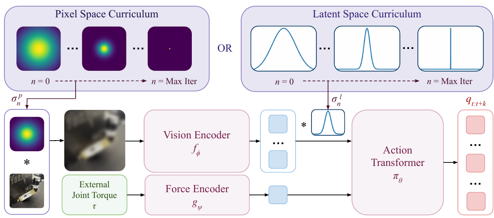
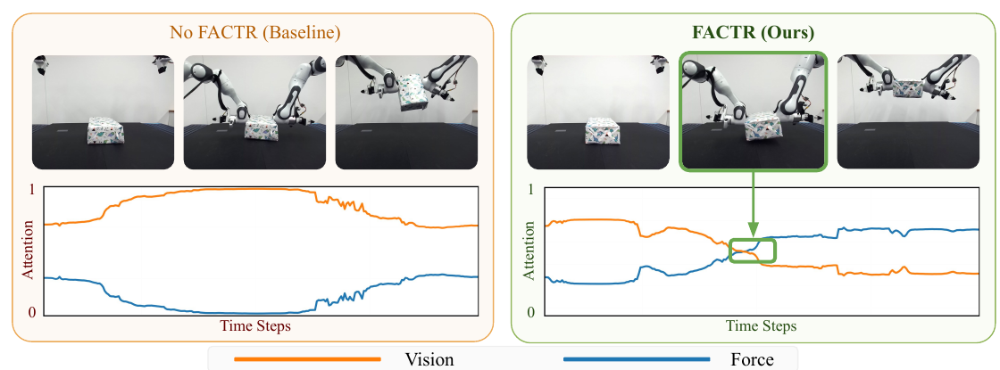






## 1. 问题与背景
{: #problem }

FACTR 关注接触任务中的模态使用问题：机器人已经能够读取外部关节力矩，但把力加入策略输入后，模型仍可能主要依赖视觉。自由空间的力读数长期接近零，视觉更容易提供可区分的训练线索；换成颜色、形状不同的新物体后，视觉捷径会影响接触后的动作选择。〔§I、IV〕

论文提出 Force-Attending Curriculum Training：**先模糊视觉，让模型学会用力，再逐步恢复视觉细节。** 同时提供带双向力反馈的主从遥操作系统，使操作者在采集示范时也能感受到接触。策略学习和遥操作硬件是两项相互配合的贡献。

## 2. 核心贡献
{: #contributions }

1. **视觉退化课程。** 在图像像素或视觉 latent 上施加平滑/下采样，并随训练减弱退化，改善力模态利用。
2. **视觉＋力的动作分块策略。** 使用 ViT 与力编码器生成 tokens，再由 encoder-decoder transformer 回归未来关节位置目标。
3. **低成本双向遥操作。** 将从臂外部力矩传回主动主臂，结合重力补偿、冗余自由度调节与夹爪力反馈。
4. **物体泛化和接触恢复证据。** 在抬箱、绕支点翻转、柔软水果抓放、滚面团上比较有无力输入、有无课程，并分析接触时的 attention 变化。〔§III–V〕

## 3. 方法
{: #method }

### 策略输入输出与训练目标

图像 Iₜ 经预训练 ViT 变为多个视觉 tokens；当前外部关节力矩 τₜ 经 MLP 变为一个力 token。拼接后的序列由 transformer encoder 编码，decoder 的动作 queries 通过 cross-attention 读取条件，输出未来动作块。训练以专家未来关节位置为监督，采用 MSE。〔§IV-A，Eq. 6〕

$$
z_t^V=f_\phi(I_t),\qquad z_t^F=g_\psi(\tau_t),\qquad
\hat q_{t:t+k}=\pi_\theta([z_t^V;z_t^F]),
$$

$$
\mathcal L_{\mathrm{BC}}=\operatorname{MSE}(\hat q_{t:t+k},q_{t:t+k}).
$$

<figure>
  
  <figcaption><strong>原文 Fig. 4 · 像素空间与隐空间的视觉课程。</strong> 训练初期使用强退化，再逐渐恢复视觉；外部关节力矩经独立编码器形成 token，与视觉共同生成关节位置动作块。来源：arXiv:2502.17432v2，PDF 第 5 页。</figcaption>
</figure>

动作是**绝对关节角目标**：抬箱对应双臂，翻转和滚面团对应单臂，水果抓放包括单臂与夹爪。附录 X 还说明输入包含手部关节角，并排除当前机械臂关节角，以减少模型直接预测接近当前臂状态的动作。

### 课程如何改变视觉输入

FACTR 支持两种位置：先对图像做退化再送入视觉编码器，或先提取视觉 tokens 再对 latent 做退化。力输入保持可用，训练早期较弱的视觉区分能力使力更容易参与动作预测。〔§IV-B–C，Algorithm 1〕

| 退化位置 | Gaussian blur | Downsampling |
| :--- | :--- | :--- |
| 像素空间 | 图像与二维高斯核卷积 | MaxPool2D 后用 nearest interpolation 恢复尺寸 |
| latent 空间 | 视觉 tokens 与一维高斯核卷积 | MaxPool1D 后插值恢复尺寸 |

以 latent Gaussian blur 为例：

$$
\tilde z_t^V=z_t^V*g_{\sigma_n},\qquad
\sigma_n=\sigma_0(1-n/N).
$$

n 是训练迭代，N 是总迭代数；σ 控制退化强度。课程前期可保持 σ₀ 一段时间，给随机初始化的力编码器提供 warm-up；随后减小 σ，让视觉细节逐步恢复。主实验采用 **latent-space Gaussian blur＋linear scheduler**。〔§IV-D、V-C〕

训练流程为：抽取图像、力矩与专家动作；按当前训练步确定 σ；在像素或 latent 上应用算子；编码力矩；预测动作块并计算 MSE；更新视觉编码器、力编码器和 transformer。推理使用正常视觉和实时力信息，课程发生在训练过程。

### 力信号与动作阶段切换

对滚面团任务，左右往复运动的图像可能相似，力矩却形成周期性峰谷；力读数帮助策略区分运动阶段。抬箱时，建立接触是从接近切换到抬升的线索。作者用第一层 decoder 的 cross-attention 可视化显示，FACTR 在接触时提高对力 tokens 的注意。〔Fig. 8–9〕

<figure>
  
  <figcaption><strong>原文 Fig. 9 · 接触前后的视觉与力 attention。</strong> 抬箱轨迹中，FACTR 在接触阶段提高对力的 attention；这是作者对模式切换行为的可视化解释。来源：arXiv:2502.17432v2，PDF 第 9 页。</figcaption>
</figure>

附录 VII 使用简化模型与 Neural Tangent Kernel 分析平滑视觉的作用：在视觉输入趋于相同的极限假设下，其核矩阵趋向低秩，视觉通路难以单独区分样本。该分析为课程提供直觉；真机策略中的收益由行为与消融实验展示。

### 遥操作系统中的力反馈

同构主从结构将主臂关节位置映射为从臂目标，并将从臂测得的**外部关节力矩**缩放后传回主臂电机：

$$
\tau_{\mathrm{feedback}}=\mu_fK_{f,p}\tau_{\mathrm{ext}}-K_{f,d}\dot q.
$$

反馈重点是环境接触，避免把从臂内部摩擦与惯性作为操作者主要感受到的信号。夹爪利用电机电流提供反馈，并以 EMA 平滑，α=0.1。主臂还加入零空间关节调节、重力补偿、摩擦补偿和关节限位处理。论文材料表估算一个主臂与主夹爪设备约 1,229.95 美元，属于发表时成本，不包含从臂机器人。〔§III，附录 VIII–IX〕

### 训练设置

视觉编码器由 Soup 1M 预训练权重初始化，ViT 为 12 层、hidden dimension 768；动作 transformer 的 encoder/decoder 各 6 层、hidden dimension 512、8 个 attention heads，action chunk 为 100。优化器 AdamW，学习率 3×10⁻⁴、batch size 128、cosine LR decay，训练 20K–50K 步；RTX 4090 上约 2–6 小时。优化器的学习率 warm-up 为 500 步；课程 warm-up 则保持初始视觉退化强度。〔附录 X，Table IV〕

§V-C 报告采集 50 条示范，并以相同训练超参数比较各方法；每个物体评估 5–10 次。任务使用 Franka Panda 与 OpenManipulator-X 夹爪，根据任务选用前置 ZED2 或腕部 RGB 相机。机器人策略使用当前感知条件产生动作块。

## 4. 实验与证据
{: #evidence }

### 任务、成功条件与基线

抬箱要求双臂抬起并平衡至少 2 秒；非抓持翻转要求物体绕支点转动 90° 并稳定站立；水果抓放要求将柔软水果放入碗中；滚面团要求持续滚动成圆柱至少 8 秒。比较包括视觉 ACT、视觉＋力 ACT（无课程）与完整 FACTR。〔§V-A、V-C〕

### 未见物体上的任务结果

下表按任务汇总附录中的逐物体成功次数，分母为各任务的实际试次数。

| 未见物体任务 | Vision-only | Vision＋Force，无课程 | FACTR |
| :--- | ---: | ---: | ---: |
| 抬箱 | 19/60（31.7%） | 35/60（58.3%） | 55/60（91.7%） |
| 非抓持翻转 | 13/50（26.0%） | 21/50（42.0%） | 38/50（76.0%） |
| 水果抓放 | 4/15（26.7%） | 11/15（73.3%） | 14/15（93.3%） |
| 滚面团 | 0/15（0%） | 11/15（73.3%） | 12/15（80.0%） |

来源：Tables VII–X，PDF 第 15 页。抬箱和翻转最清楚地体现了“提供力输入”与“通过课程学会利用力”之间的差距。训练物体上的多数组合表现接近，视觉独占在滚面团上则完全失败。

**原文统计口径。** §V-C 报告总体 21.3%、61.2%、87.5%，摘要与官网的约 43% 对应后两值的相对提升，差值为 26.3 个百分点。附录上述逐项计数重新计算的四任务宏平均约为 21.1%、61.8%、85.3%，与正文汇总不同；Table X 还将无课程滚面团 Test Avg 印为 70%，而列出的计数合计 11/15。具体任务比较采用上表的逐物体计数。

### 接触恢复与扩展物体测试

抬箱恢复实验先让策略成功抬起，再人为打落箱子，观察第二次尝试。未见物体上，视觉策略为 4/30，视觉＋力为 16/30，FACTR 为 **27/30**。作者将这一行为联系到失去接触后外部力矩回到接近抬升前的状态。这里评估的是执行过程中受扰后的恢复。〔Table I，§V-C；官网 Recovery Behavior〕

扩展测试增加了物体数量，并与 Bi-ACT 比较：抬箱 68/120→105/120，翻转 76/130→101/130，滚面团 41/60→46/60。该组采用扩展测试集。〔Table VI，Fig. 10〕

### 课程算子与调度消融

在翻转任务的 5 个测试物体上各进行 5 次，共 25 次：

| 调度 | 像素 Blur | 像素 Downsample | Latent Blur | Latent Downsample |
| :--- | ---: | ---: | ---: | ---: |
| 固定强度 | 16/25 | 15/25 | 17/25 | 16/25 |
| Linear | 19/25 | 18/25 | 19/25 | 18/25 |
| Cosine | 20/25 | 19/25 | 17/25 | 19/25 |
| Exponential | 19/25 | 21/25 | 20/25 | 19/25 |
| Step | 19/25 | 18/25 | 20/25 | 19/25 |

来源：Table II。总体上，逐步恢复视觉优于一直固定退化强度；不同位置和算子之间没有统一占优的组合，latent blur 的 cosine 与固定强度均为 17/25。论文主配置取 latent blur＋linear。

附录 XI 还比较 force-conditioned AdaNorm 与视觉噪声增强：翻转任务训练/测试成功率分别为 FACTR 90.0%/77.7%、AdaNorm 25.0%/6.1%、NoiseAug 85.0%/65.0%。〔Table V〕

### 遥操作用户实验

与未驱动主臂、机械关节调节的主从基线相比，论文报告任务完成率相对提高 64.7%、完成时间降低 37.4%、主观易用性提高 83.3%。这些指标衡量示范采集端的人机操作表现。〔§V-B，Fig. 7〕

## 5. 相关工作
{: #related-work }

**ACT [32] 提供动作分块框架，ViT [7] 与预训练表征 [6] 提供视觉基础。** FACTR 采用视觉＋力的 behavior-cloning 策略，CRAFT 后续将相近的课程思路用于预训练 VLA 微调。

**GELLO [29] 与 ALOHA [32] 提供低成本主从遥操作脉络。** FACTR 进一步驱动主臂电机，传递外部接触力并主动补偿重力。相比基于主从位置误差形成反馈的 Bi-ACT 相关工作 [13]，其设计强调向操作者呈现外部交互。FoAR [8] 研究接触感知融合，FACTR 则通过训练课程改善力利用。〔§II–III〕

## 6. Insights · 思考与启示
{: #takeaways }

**工作总览。** FACTR 同时改善示范采集与策略训练：操作者通过力反馈采集接触行为，策略通过视觉退化课程学习使用外部关节力矩，再逐步融合完整视觉。泛化和恢复实验表明，接触信号可以帮助策略在新物体上完成动作阶段切换。

**阅读联想一：课程改变了模型形成捷径的顺序。** 关键是早期先建立力与动作的联系，再恢复视觉区分能力。CRAFT 将这条思路变成可学习的表征压缩；FACT 则进一步关注力的即时作用、历史过程和小动作训练覆盖。

**阅读联想二：从反应式恢复到跨试次学习。** 箱子掉落后重试，展示的是当前力感知触发的恢复行为。对于动作—力响应历史适配，值得借鉴的是让接触信号决定阶段切换，同时需要另外定义经验如何保留和更新。

**继续思考。** 模态课程应根据什么判断“力已经学会、可以恢复视觉细节”？固定训练步调度提供了简单实现，任务相关的自适应调度是论文讨论的方向。外部关节力矩的噪声与分辨率也决定了可用的接触精度；§VI 将更高分辨率触觉与不同传感器配置列为后续拓展。

## 参考与补充

- [官方主页](https://jasonjzliu.com/factr/)：含课程机制、任务演示、恢复行为、遥操作设计及代码入口；访问日期 2026-11-05。
- [arXiv:2502.17432v2](https://arxiv.org/abs/2502.17432v2)，[PDF](https://arxiv.org/pdf/2502.17432v2)，15 页；[RSS 2025 正式 PDF](https://www.roboticsproceedings.org/rss21/p079.pdf)。统计差异在两个版本第 8、15 页均可见。
- [训练代码](https://github.com/RaindragonD/factr/)、[遥操作代码](https://github.com/RaindragonD/factr_teleop/)、[硬件设计](https://github.com/JasonJZLiu/FACTR_Hardware)。
- §IV-D 的指数调度印为 σ₀αⁿ 且 α>1，与减小 σ 的描述不符；主配置为 linear。实现指数衰减时应核对代码与参数约定。
- 原文参考编号：[4] Diffusion Policy；[6] An Unbiased Look at Datasets for Visuo-Motor Pre-Training；[7] ViT；[8] FoAR；[11] NTK；[13] Bi-ACT 相关工作；[29] GELLO；[32] ACT/ALOHA。

