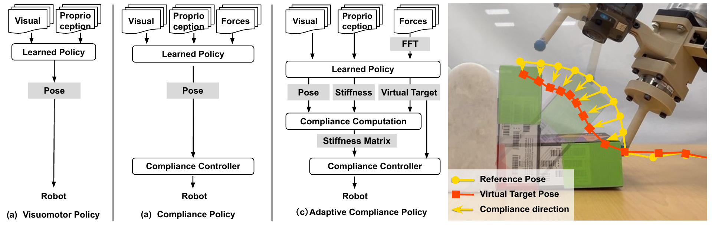
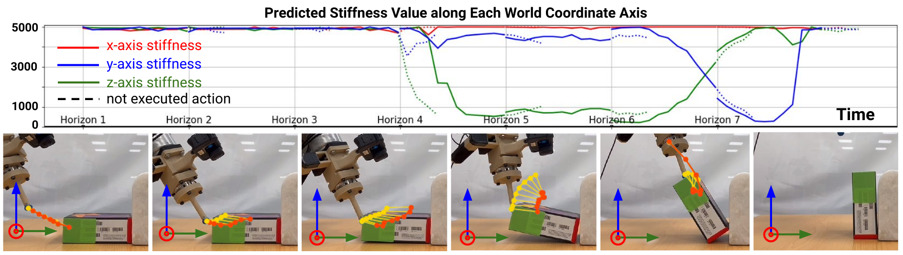
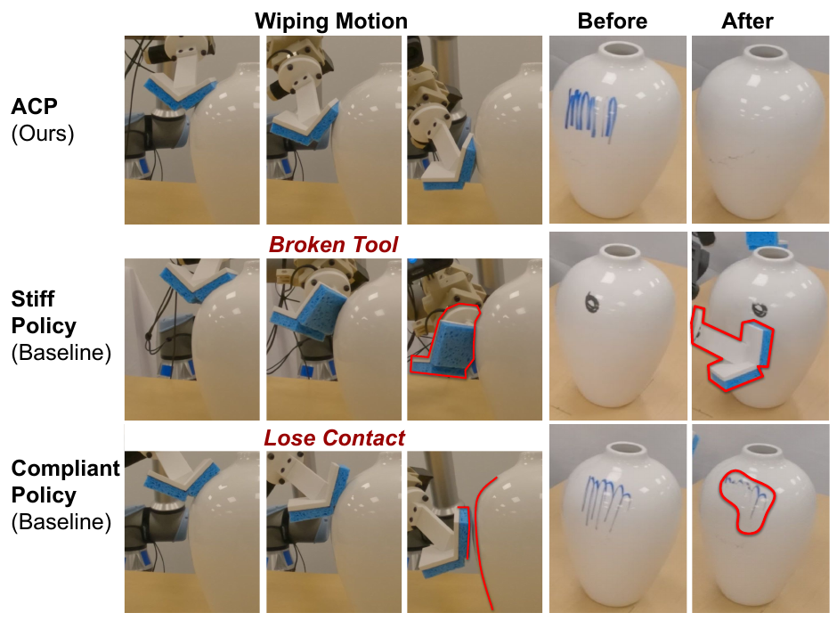






## 1. 问题与背景
{: #problem }

接触操作需要同时维持运动轨迹和合适的接触力。全部方向保持高刚度，位置预测误差可能转化为过大的接触力；全部方向保持低刚度，机器人又容易被摩擦或扰动带离期望轨迹。翻起物体时，手指应沿推动方向柔顺，同时准确跟随其他方向的弧线；擦花瓶时，也需要在接触法向与擦拭方向上采用不同刚度。（§I，Fig. 1）

ACP 将这种随方向、时间和任务变化的柔顺性加入策略输出。完整刚度辨识需要各方向充分的力—位移变化。针对示范中的有限观测，作者构造具有实用性质的**近似柔顺标签**，再用扩散策略学习这些标签与运动目标。（§III-C）

## 2. 核心贡献
{: #contributions }

- **扩展动作表示：** 每臂输出参考位姿、虚拟目标位姿和一个低刚度标量，将运动、接触作用与各向异性柔顺统一到 19 维表示中。
- **从示范构造柔顺标签：** 沿反馈力方向降低刚度，其余方向保持高刚度，并用力幅值连续调节柔顺程度。
- **学习策略与底层控制分工：** 扩散策略根据视觉、本体与力历史预测动作块，高频导纳控制器依据实时力反馈执行预测的虚拟目标和刚度矩阵。
- **动觉示教与真机验证：** 以带直接触觉反馈的示教系统采集数据，在翻物体和双臂擦花瓶中检验接触维持、扰动适应与位置跟踪。（§III–IV）

## 3. 方法
{: #method }

### 整体流程：把柔顺性变成可以监督学习的动作

| 阶段 | 输入与处理 | 产物／作用 |
| :--- | :--- | :--- |
| 动觉示教 | 人直接引导低刚度、低阻尼、低虚拟质量的机器人；记录 RGB、末端位姿与 F/T | 保留运动与接触信息的示范 |
| 离线标注 | 平滑整段 wrench；按方向和幅值构造刚度；用弹簧关系计算虚拟目标 | 参考位姿＋虚拟目标＋低刚度标签 |
| 策略训练 | 视觉、位姿与力历史作为条件 | 扩散模型学习 19 维／臂的动作轨迹 |
| 在线执行 | 由预测的两个位置差恢复柔顺方向，重建刚度矩阵 | 底层导纳控制器跟踪虚拟目标并响应实时力 |

<figure>
  
  <figcaption><strong>原文 Fig. 2 · 参考位姿、虚拟目标与刚度共同决定柔顺行为。</strong> 左侧比较位置策略、固定柔顺策略与 ACP；右侧两个目标间的方向差编码柔顺方向。来源：arXiv:2410.09309v2，PDF 第 2 页。</figcaption>
</figure>

### 近似刚度：只让一个方向柔顺

论文用弹簧—质量—阻尼系统描述柔顺性：

$$
f=M\ddot x+K(x-x_{\mathrm{ref}})+K_D\dot x.
$$

质量 $$M$$ 和阻尼 $$K_D$$ 预先设定，ACP 学习的是随状态变化的刚度相关动作表示。示教时低质量和低阻尼便于人移动机器人，人的手还提供额外稳定作用；自主运行时提高质量和阻尼以维持导纳控制稳定性。（Eq. 1，§III-A–C）

设非零反馈力方向为 $$u=f/\|f\|$$，取以 $$u$$ 为第一列的正交基 $$S$$，则

$$
K=S\,\operatorname{diag}(k_{\mathrm{low}},k_{\mathrm{high}},\ldots)S^\top
=k_{\mathrm{high}}I+(k_{\mathrm{low}}-k_{\mathrm{high}})uu^\top.
$$

第一种形式来自 Eq. 6，第二种是其等价展开：沿 $$u$$ 的刚度为 $$k_{\mathrm{low}}$$，正交方向为 $$k_{\mathrm{high}}$$。这里的“一维柔顺”沿反馈力方向旋转。小力时使用各向高刚度；随着力幅值从 $$f_{\min}$$ 增至 $$f_{\max}$$，低刚度由 $$k_{\max}$$ 线性降至 $$k_{\min}$$，两端饱和。这些阈值和刚度范围由硬件确定。（Eq. 7）

**理论假设：** 接触力主导，各已建立接触的法向力非零，且不存在过度夹制的 pinching 接触。令接触约束为 $$Jv\ge0$$，反馈力为 $$f=J^\top\lambda$$。如果沿 $$f$$ 放开速度分量，就可以写成 $$v=v_0+\alpha f$$；在上述几何条件下，可选择足够大的 $$\alpha$$ 使其满足接触约束。于是其他方向可以保留高刚度，提高跟踪精度。（Theorem 1，Eqs. 2–5，Fig. 4）

该论证给出上述假设下的接触约束可行性。实际控制器采用有限刚度、实测反馈与离散更新，其力峰值和闭环稳定性还取决于控制参数、测量误差和执行时序。

### 虚拟目标：用位置偏移表达接触作用

每个机械臂的动作是 **9＋9＋1＝19 维**：

| 输出 | 含义 |
| :--- | :--- |
| 9D reference pose | 希望机器人实际处于的位姿；3D 位置＋旋转矩阵前两行的 6D 表示 |
| 9D virtual target pose | 底层柔顺控制器实际追踪的平衡目标 |
| 1D stiffness | 柔顺方向上的刚度幅值 |

两个目标可以不同：机器人实际停在参考位置时，虚拟目标仍通过“弹簧拉力”产生期望接触作用。为直观解释，若把机器人施加给环境的力记为 $$f_{\mathrm{push}}$$，准静态弹簧关系可写为 $$f_{\mathrm{push}}\approx K(p_{\mathrm{virtual}}-p_{\mathrm{ref}})$$；若使用环境施加给机器人的反馈力，符号相反。该关系说明 §III-D.2 中虚拟目标如何编码接触作用。

在线由 $$p_{\mathrm{virtual}}-p_{\mathrm{ref}}$$ 的方向替代 Eq. 6 中的反馈力方向，恢复完整刚度矩阵，再将**矩阵与虚拟目标**下发给控制器。方向反号不改变 $$uu^\top$$，但虚拟目标位于哪一侧仍决定接触作用方向。实验的自适应柔顺作用于 **3D 平移空间**；六维 wrench 用于观测，九维位姿表示位置与姿态。（§III-D.2，§IV）

### 标签处理与多模态扩散策略

离线标注对整段 wrench 使用 **1 秒窗口的移动平均**，先构造刚度，再按照三维弹簧关系计算虚拟目标。作者明确指出，这种平滑让目标更连续，并向标签引入即将接触的 hindsight 信息，帮助策略提前平滑地进入接触。它属于离线标签构造，在线输入仍来自过去观测。（§III-D.2）

视觉输入为过去两帧 RGB，调整至 224×224 并随机裁剪，经 CLIP 预训练 ViT-B/16 编码。力编码有两个版本：主方法将过去 1 秒、7000 Hz 的六维 F/T 数据转为 $$6\times30\times17$$ 的频谱图，使用带 CoordConv、六输入通道的 ResNet-18；无 FFT 版本使用过去 32 帧、250 Hz 的 wrench，经五层因果卷积输出 768 维特征。（§III-D.1，§IV）

图像与力特征经 Transformer encoder 的 self-attention 融合，拼接过去三帧末端位姿，作为 Diffusion Policy [6] 动作头的条件，以滚动时域方式预测和执行动作轨迹。扩散模型生成上述扩展动作序列。动作时域、去噪步数和策略推理频率在正文中未报告。（§III-D）

## 4. 实验与证据
{: #evidence }

### 平台、比较设置与指标

平台使用 UR5e、GoPro RGB 相机和 ATI Mini45 F/T 传感器。相机 60 Hz，机器人笛卡尔位姿接口及反馈 500 Hz，F/T 最高 7000 Hz。四种策略在对应任务上用相同数据、相同训练 epoch 数比较：ACP、因果卷积力编码的 ACP w.o. FFT、加入力输入但仅输出位置的 Stiff Policy，以及底层统一刚度为 500 N/m 的 Compliant Policy。（§IV）

**翻物体：** 15 种物体、230 条示范，各方法训练 300 epochs。训练物体、未见物体、先推 5 cm 再翻、改变支撑夹具位姿、不稳定轻夹具五种条件各测 20 次，共 100 次／方法；物体旋转超过 70° 算成功。（§IV-A）

**擦花瓶：** 双臂分别扶持与擦拭，200 条示范覆盖不同瓶位、标记形状与颜色，每条包含 1–5 次擦拭。测试分别为小标记 5 次、大标记 5 次、接触前扰动 4 次、接触后扰动 2 次。三次擦拭内剩余标记局限于 1 cm×1 cm 算成功；主页补充判据不计擦拭自身留下的痕迹。（§IV-B；主页 Experiments）

### 主结果

| 翻物体方法 | 训练物体 | 未见物体 | 推后翻 | 夹具位姿 | 不稳定夹具 | 总计 |
| :--- | ---: | ---: | ---: | ---: | ---: | ---: |
| ACP | 90% | 95% | 95% | 100% | 100% | **96/100** |
| ACP w.o. FFT | 90% | 100% | 100% | 95% | 90% | 95/100 |
| Compliant Policy | 80% | 15% | 15% | 5% | 0% | 23/100 |
| Stiff Policy | 20% | 0% | 5% | 35% | 10% | 14/100 |

来源：Table I，p. 5。ACP 相对统一低刚度提高 **73 个百分点**，相对 Stiff Policy 提高 **82 个百分点**。FFT 与因果卷积在本任务只差一次成功；作者认为翻物体的高频力成分较少。（§IV-A）

<figure>
  
  <figcaption><strong>原文 Fig. 6 · 翻物体过程中的刚度与目标变化。</strong> 上方显示预测刚度的世界坐标分量，下方显示参考位姿、虚拟目标及柔顺方向随动作阶段变化；非执行段以虚线区分。来源：arXiv:2410.09309v2，PDF 第 6 页。</figcaption>
</figure>

| 擦花瓶方法 | 小标记（5 次） | 大标记（5 次） | 接触前扰动（4 次） | 接触后扰动（2 次） | 总计 |
| :--- | ---: | ---: | ---: | ---: | ---: |
| ACP | 5/5 | 4/5 | 4/4 | 2/2 | **15/16，93.75%** |
| ACP w.o. FFT | 5/5 | 3/5 | 3/4 | 2/2 | 13/16，81.25% |
| Compliant Policy | 3/5 | 1/5 | 1/4 | 2/2 | 7/16，43.75% |

来源：Table II，p. 6；计数由原百分比和明确的测试次数换算。ACP 相对统一低刚度提高 **50 个百分点**，相对无 FFT 提高 **12.5 个百分点**。Stiff Policy 在第四次测试时损坏工具，作者将其排除出该表。（§IV-B）

<figure>
  
  <figcaption><strong>原文 Fig. 8 · 擦花瓶的三种控制行为。</strong> ACP 保持接触并跟随擦拭轨迹；刚性策略出现过大力导致工具损坏；统一低刚度策略受到摩擦影响，轨迹偏移并失去接触。来源：arXiv:2410.09309v2，PDF 第 6 页。</figcaption>
</figure>

### 控制行为与力编码消融

统一低刚度能缓解过大接触力，却让擦拭受到摩擦拖拽、偏离路径甚至失去接触；Stiff Policy 更易将位置误差转换为过大力；ACP 在接触方向保持柔顺，同时在运动方向维持足够刚度。图示解释与两项任务的结果一致。（Figs. 6–8）

无 FFT 对比同时改变了表示形式、采样率和历史时长：约 0.128 秒的卷积输入，对比 1 秒的高频频谱输入。擦拭结果因此反映整套力编码配置的差异；FFT 运算本身的贡献还需在匹配采样率与历史长度后比较。刚度方向、力幅值映射和 hindsight 平滑的独立贡献及参数敏感性，正文未分别评估。接触后扰动条件中，ACP、无 FFT 和统一低刚度策略均为 2/2；该结果对应两次测试。

## 5. 相关工作
{: #related-work }

| 相关路线与原文引用 | 与 ACP 的关系 |
| :--- | :--- |
| Diffusion Policy [6,7] | 继承条件动作扩散与滚动时域执行；ACP 扩展力输入及可供底层执行的柔顺动作表示。 |
| 阻抗／导纳／混合控制 [14,32,34,39] | 提供位置、力和柔顺性的控制基础；ACP 在位置接口的 UR5e 上选用导纳控制，将低频策略预测与快速物理响应分开。 |
| 接触模型驱动的混合力—速度控制 [17,18] | 继承约束几何的分析思路；ACP 的标签规则避免显式求解接触 Jacobian 和完整接触模型。 |
| 示范中的刚度估计 [4,11–13,25] | 重复轨迹统计或动力学辨识需要更充分的变化／已知参数；ACP 按反馈力方向与幅值构造满足控制需求的近似刚度。 |
| 多模态接触策略 [23,26] | 使用力反馈与底层柔顺；ACP 进一步让柔顺方向和幅值随动作一起预测。 |
| ForceMimic [29] | 论文列为并行工作，按人工划分任务阶段的启发式构造柔顺配置；ACP 以逐时刻反馈力方向和幅值构造标签。 |

引用编号沿用原文 References（pp. 7–8）。

## 6. Insights · 思考与启示
{: #takeaways }

**论文结果：动作空间与控制接口是核心。** ACP 的提升来自一套“柔顺标签—动作表示—底层控制”设计。无 FFT 版本在翻物体中达到 95/100，表明这套控制设计在两种力编码下均取得了较高成功率。

**阅读联想一：刚度预测的用途取决于执行链路。** 前一篇 ForceWAM 的虚拟位姿与刚度属于训练辅助目标，推理后丢弃；ACP 的虚拟目标和刚度则实际进入低层控制器，直接决定受力后的运动响应。这组跨论文对照说明，同样预测虚拟位姿和刚度，其作用取决于这些输出在训练与执行中的使用方式。

**阅读联想二：近似标签可以表达控制偏好。** 近似标签将“哪些方向应柔顺、哪些方向应保持高刚度”的控制偏好写入学习目标。这里用一个低刚度方向减少标签与预测难度；若任务需要多个独立柔顺方向，或存在夹紧、摩擦主导接触，便需要重新检查这个简化是否够用。

**阅读联想三：接触预判与接触反馈承担不同职责。** 离线平滑标签帮助策略提前准备接触，底层导纳控制在接触发生后快速响应。后续可比较因果与非因果标签、控制延迟及突发接触，确认性能有多少来自预判、有多少来自反馈。

**值得追问的实验。** 在相同力历史长度、相同采样预算下比较频谱与时域编码，可以更清楚隔离编码贡献；在相同参考轨迹下逐项固定柔顺方向或幅值，可以分辨各向异性与时变刚度的收益。完整六维柔顺与高动态接触也是进一步验证的方向。

## 参考与补充

- **论文：** Hou et al., *Adaptive Compliance Policy: Learning Approximate Compliance for Diffusion Guided Control*，[arXiv:2410.09309v2](https://arxiv.org/abs/2410.09309v2)，2025-03-07，8 页；本笔记以 Zotero 内该版本 PDF 为正文依据。
- **官方主页：** [adaptive-compliance.github.io](https://adaptive-compliance.github.io/)，查阅日期 2026-11-06。主页给出 ICRA 2025，pp. 4829–4836 的书目信息，并标注 ICRA 2025 Contact-rich Manipulation **Workshop** 最佳论文奖。方法、翻物体结果与正文一致。
- **代码与数据入口：** [yifan-hou/adaptive_compliance_policy](https://github.com/yifan-hou/adaptive_compliance_policy)，由主页链接。正文还提到“位置＋力预测策略”对比；本笔记中的定量结果采用 Tables I–II。
- **原图：** Fig. 2（p. 2）、Fig. 6 与 Fig. 8（p. 6），从原论文渲染后裁切。图注中的机制说明来自相应章节。
- **Zotero：** item `PZ7QIMFC`；PDF attachment `Y54KCZXR`；citation key `houAdaptiveCompliancePolicy2025`。

