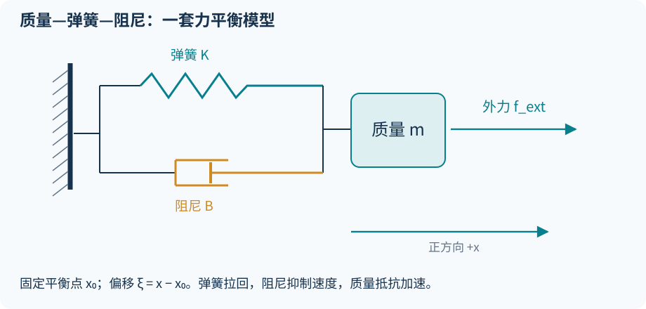
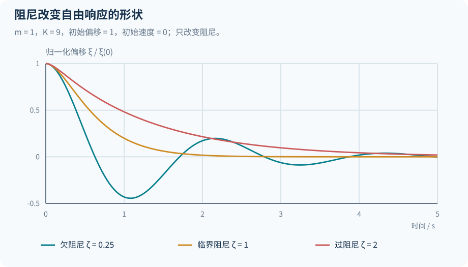
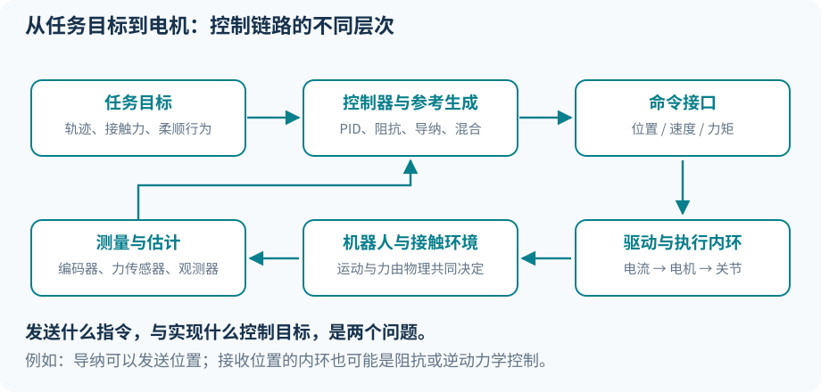
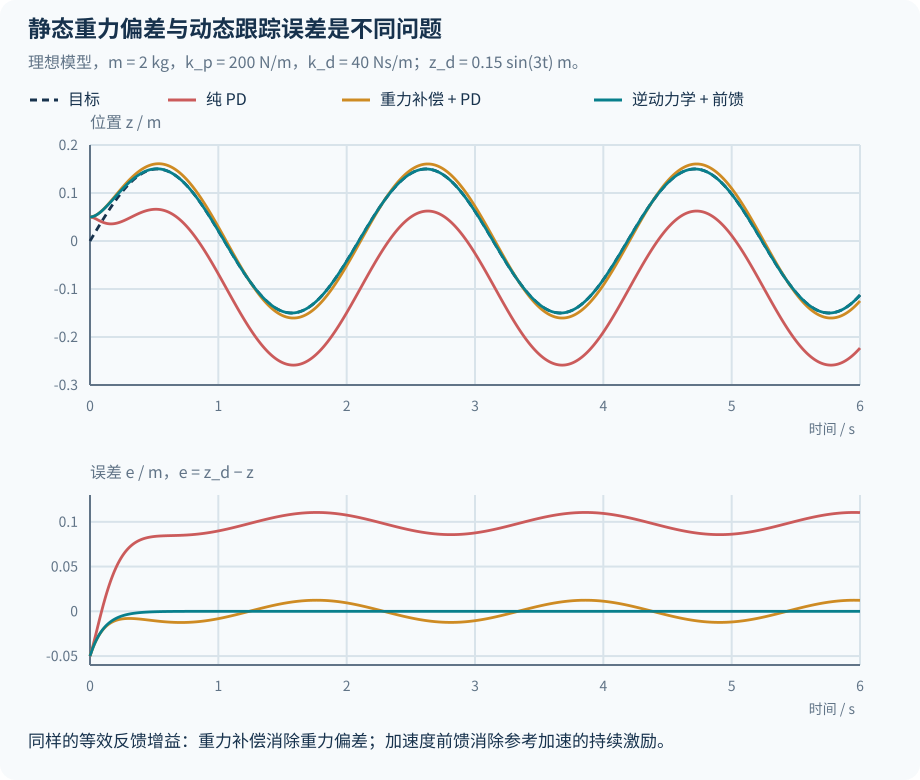
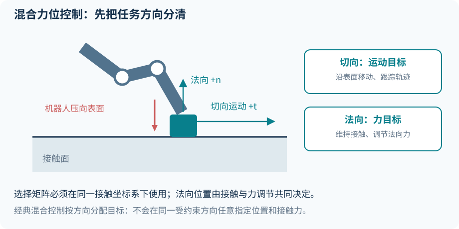
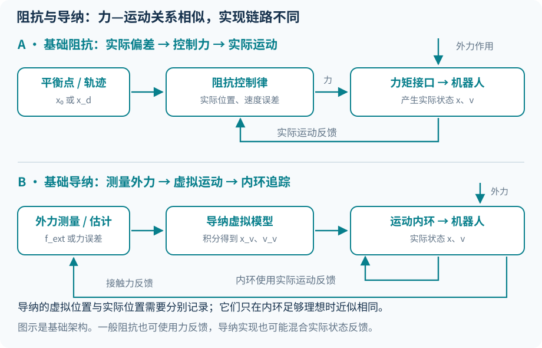

<link rel="stylesheet" href="/assets/css/interaction-note.css">

本文从质量—弹簧—阻尼模型出发，逐步推导 **PD、重力补偿、逆动力学、力控制、阻抗与导纳控制**，再结合 Franka、UR 和 Flexiv 的接口说明实现方法。

每类控制器按四个层次展开：模型假设、控制律、代入后的闭环动力学，以及实际执行所需的反馈和接口。重点理解控制器如何设计、各项参数怎样影响运动，以及接触力如何进入闭环。

<nav class="chapter-nav" aria-label="阅读路线">
<a href="#ch1"><small>01 · 物理模型</small>力怎样引起运动</a>
<a href="#ch2"><small>02 · 轨迹跟踪</small>从 PD 到逆动力学</a>
<a href="#ch3"><small>03 · 接触交互</small>阻抗与导纳如何实现</a>
<a href="#ch4"><small>04 · 机器人接口</small>Franka、UR 与 Flexiv</a>
</nav>

首次阅读按四章展开；已有控制基础可从[阻抗与导纳](#ch3)开始，查接口可直接读[第四章](#ch4)。文末附[公式索引与自测](#recall)，推导中的进阶解释和答案可点击展开。

<aside class="callout" markdown="1">
**控制器分析的三个要点**

1. **输入：** 实测状态、目标轨迹，还是内部虚拟状态？
2. **输出：** 力／力矩、加速度要求，还是位置／速度参考？
3. **闭环：** 把控制律代回物理模型后，机器人怎样响应外力？
</aside>

## 第一章　先把物理量和模型认清
{: #ch1 }

### 1.1 位置、速度、加速度：描述运动的三个层次

对一维位置 $$x(t)$$：

$$
v(t)=\dot x(t),\qquad a(t)=\ddot x(t).
$$

它们分别回答“在哪里”“变化多快”“速度变化多快”。位置、速度、加速度的单位分别是 $$\mathrm m$$、$$\mathrm{m/s}$$、$$\mathrm{m/s^2}$$。在机械臂中，$$q\in\mathbb R^n$$ 通常表示关节坐标；旋转关节使用弧度，移动关节使用米。

**恒定角速度运动也有向心加速度。** 杆以恒定角速度转动时，杆端有指向圆心的加速度。这为后文理解速度相关惯性项提供了基础。

### 1.2 力、力矩和力旋量

力改变平动；力矩改变转动。力对某个参考点产生的力矩为：

$$
\boldsymbol\tau=\mathbf r\times\mathbf f.
$$

$$\mathbf r$$ 是参考点到施力点的位置向量。长度 $$0.5\,\mathrm m$$ 的水平杆，端点受到垂直杆的 $$10\,\mathrm N$$ 力，对根部的力矩大小为 $$5\,\mathrm{N\,m}$$。沿杆轴线施力时，对根部的力矩可以为零。

机械臂关节收到的 $$\tau_j$$ 是相应转轴上的力矩分量。一个末端力可以同时对多个关节产生力矩，两者通过接触点的雅可比联系。

六维**力旋量**（wrench）包含三维力和三维力矩。本笔记在六维例子中约定：

$$
w=\begin{bmatrix}f\\ \mu\end{bmatrix},\qquad
V=\begin{bmatrix}v\\ \omega\end{bmatrix},\qquad
w^\top V=f^\top v+\mu^\top\omega.
$$

有些库采用相反的排列顺序。对接 SDK 时要同时核对：排列顺序、表达坐标系、力矩参考点、作用力方向。只旋转坐标轴与改变力矩参考点，是两种不同的变换。

### 1.3 质量、转动惯量与惯量矩阵

一维质点满足 $$F=ma$$。质量 $$m$$ 描述平动时抵抗加速的程度。绕固定轴的简单刚体满足 $$\tau=I\alpha$$，$$I$$ 是转动惯量，单位为 $$\mathrm{kg\,m^2}$$，与质量如何分布有关。

多关节机械臂使用 $$M(q)$$，即**关节空间惯量矩阵**：

$$
T=\frac12\dot q^\top M(q)\dot q.
$$

$$T$$ 是动能。非对角元素描述关节运动的耦合；伸直手臂与收拢手臂，通常具有不同的惯量分布。对于全旋转关节，$$M$$ 的元素具有转动惯量的单位，整体描述各关节的惯性与耦合。

“虚拟质量 $$M_d$$”是期望交互模型中的参数；“真实惯量 $$M(q)$$”是机器人本体的属性。实现目标惯量需要相应的反馈与动力学补偿。

### 1.4 弹簧、阻尼与质量—弹簧—阻尼模型

**模型假设：** 一维运动，质量、刚度和阻尼为常数，平衡位置 $$x_0$$ 固定。令偏移 $$\xi=x-x_0$$，线性弹簧和黏性阻尼的力为：

$$
f_K=-K\xi,\qquad f_B=-B\dot\xi.
$$

$$K$$ 是刚度，平移时单位为 $$\mathrm{N/m}$$；$$B$$ 是阻尼系数，单位为 $$\mathrm{N\,s/m}$$。关节空间对应 $$\mathrm{N\,m/rad}$$ 和 $$\mathrm{N\,m\,s/rad}$$。

加入外力 $$f_{\mathrm{ext}}$$，得到：

$$
\boxed{m\ddot\xi+B\dot\xi+K\xi=f_{\mathrm{ext}}.}
$$

质量储存动能，弹簧储存势能，阻尼消耗能量。没有外力输入时，系统按初始位置和速度产生自由响应。

<figure>

<figcaption>图 1：弹簧和阻尼器并联。软件可以让末端呈现相似的力—运动关系，而不必真的安装一根弹簧。</figcaption>
</figure>

当 $$m>0,K>0$$ 时：

$$
\omega_n=\sqrt{K/m},\qquad
\zeta=\frac{B}{2\sqrt{mK}}.
$$

| 阻尼比 | 典型响应 | 理解方式 |
|---|---|---|
| $$0<\zeta<1$$ | 衰减振荡 | 会越过平衡位置 |
| $$\zeta=1$$ | 临界阻尼 | 二阶模型中不振荡的一种典型快速收敛配置 |
| $$\zeta>1$$ | 过阻尼 | 不振荡，但通常更慢 |

逐元素使用 $$B=2\sqrt K$$ 的临界阻尼解释，要求相应方向已解耦且惯量归一化。一般多自由度系统需要结合惯量与耦合计算各模态的阻尼。

<figure>

<figcaption>图 2：理想模型的数值响应：m = 1 kg、K = 9 N/m，阻尼比为 0.25、1、2。初始偏移 1 m、初速为零；采用 RK4、步长 1 ms。纵轴为归一化偏移。</figcaption>
</figure>

### 1.5 刚度、柔顺性、阻抗、导纳

**刚度**描述静态或局部的力—位移关系。线性一维情况下，柔顺性是刚度的倒数 $$1/K$$。柔顺控制允许外力按指定关系引起运动偏移。

**机械阻抗**通常以力与速度之比定义。对上面的线性模型，零初始条件下：

$$
Z(s)=\frac{F_{\mathrm{ext}}(s)}{\dot\Xi(s)}
=ms+B+\frac Ks.
$$

**机械导纳**是相应的速度／力关系：

$$
Y(s)=\frac{\dot\Xi(s)}{F_{\mathrm{ext}}(s)}
=\frac1{Z(s)}.
$$

如果使用位移／力，则：

$$
\frac{\Xi(s)}{F_{\mathrm{ext}}(s)}
=\frac1{ms^2+Bs+K}.
$$

这是动态柔顺传递函数，和“速度／力”的导纳差一个 $$s$$。文献有时对这些术语使用得较宽泛，读公式时要先确认输出是位置还是速度。

**阻抗控制和导纳控制对应不同的实现架构。** 在线性理想模型中，阻抗与导纳互为倒数；实际响应还取决于各自的传感器、内环带宽、延迟和执行器。[R3](#r3)[R4](#r4)[R5](#r5)

### 1.6 力从哪来：电机力、外力、接触力

本笔记采用两套明确分开的记号：

| 记号 | 定义 |
|---|---|
| $$u$$ 或 $$\tau$$ | 执行器对机器人施加的控制力／力矩 |
| $$f_{\mathrm{ext}}$$ | 环境作用于机器人的有符号外力 |
| $$F\ge0$$ | 推墙例子中，机器人推环境的力大小 |
| $$F_d$$ | 同一例子中的期望推力大小 |

推墙方向取正，则环境反力为 $$f_{\mathrm{ext}}=-F$$。补偿重力后：

$$
\boxed{m\ddot x=u-F.}
$$

只有当惯性和其他未补偿作用可忽略时，才能近似认为 $$u=F$$。例如 $$u=10\,\mathrm N,m=2\,\mathrm{kg},\ddot x=3\,\mathrm{m/s^2}$$ 时，接触力是 $$4\,\mathrm N$$。

<aside class="callout" markdown="1">
<strong>重力符号约定</strong>

后文标准机械臂方程把重力放在左边，记为 $$g(q)$$。MIT 讲义把实际重力广义力放在右边，记为 $$\tau_g(q)$$，两者满足 $$\tau_g=-g$$。所以标准写法中的补偿 $$+g$$，对应讲义中的 $$-\tau_g$$。厂商 SDK 还可能用 $$\tau_g$$ 表示“补偿力矩”，对接时以其物理定义确定符号。

</aside>

### 1.7 本文统一符号

| 符号 | 含义 | 容易混淆的地方 |
|---|---|---|
| $$q,\dot q,\ddot q$$ | 实际关节位置、速度、加速度 | 来自实际状态反馈 |
| $$q_d,\dot q_d,\ddot q_d$$ | 规划／给定轨迹 | 是同一条轨迹的导数 |
| $$e=q_d-q$$ | 轨迹跟踪误差 | 本文统一“目标减实际” |
| $$\xi=x-x_0$$ | 阻抗模型相对平衡点的偏移 | 与跟踪误差方向不同，定义会显式写出 |
| $$x_v,v_v$$ | 导纳内部的虚拟运动状态 | 由内部模型积分得到 |
| $$K,B$$ | 刚度、阻尼 | $$B$$ 表示耗散，$$C$$ 描述速度相关惯性 |
| $$\alpha,\beta$$ | 加速度反馈增益 | 与直接产生力的 PD 增益单位不同 |
| $$J(q)$$ | 接触点／末端雅可比 | 位置、表达坐标系和排列顺序须匹配 |

## 第二章　运动学控制、动力学控制与基础控制律
{: #ch2 }

### 2.1 控制目标、算法与接口是三个维度

“位置控制”通常指跟踪位置目标；“PID”指一种误差反馈算法；“关节位置接口”指你发送给下层的指令类型。它们分别属于目标、算法和接口三个层次。

例如，一个上层导纳控制器最终可以发送关节位置；接收关节位置的内环可能是 PID、逆动力学控制，也可能是厂商的关节阻抗控制。

<figure>

<figcaption>图 3：同样的任务目标，可以经过不同实现链路。是否支持混合力位模式，也不自动说明底层开放哪些接口。</figcaption>
</figure>

### 2.2 运动学层：先决定该怎样运动

正运动学给出末端位置 $$p=f(q)$$；微分运动学给出：

$$
\dot p=J(q)\dot q.
$$

一类运动学跟踪控制器先计算末端速度要求：

$$
v_{\mathrm{cmd}}=\dot p_d+K_e(p_d-p),
$$

再通过雅可比伪逆等方法求关节速度：

$$
\dot q_{\mathrm{cmd}}=J^\#v_{\mathrm{cmd}}.
$$

这一步主要使用几何关系，不直接计算质量、惯性和关节力矩。它假定下层能够足够好地跟踪运动指令。奇异位形、速度限制和冗余关节会影响求解，实际常使用阻尼伪逆或约束优化。

### 2.3 力／力矩层：决定用多大作用力实现运动

动力学描述“给定力之后如何运动”；逆动力学计算“希望这样加速，需要什么力”。

**输出力矩的 PD 工作在力矩层。** 普通 PD 从误差直接计算力矩；基于动力学模型的控制还使用 $$M,C,g$$ 等信息计算补偿或前馈。

### 2.4 PID：当前误差、积累误差、误差变化率

对一个关节，$$e=q_d-q$$：

$$
u=K_Pe+K_I\int_0^t e(\lambda)\,d\lambda+K_D\dot e.
$$

| 项 | 使用的信息 | 作用 |
|---|---|---|
| P | 当前偏差 | 偏得越远，纠正作用越大 |
| I | 误差随时间的积累 | 补偿持续偏差 |
| D | 速度误差 $$\dot q_d-\dot q$$ | 调整动态响应；目标固定时表现为阻尼 |

PID 的输出单位由应用决定。在这里若 $$u$$ 是关节力矩，P、I、D 的增益就必须把各自误差换算成力矩。PID 也可生成速度或加速度要求；增益数值应随输入输出的单位重新确定。

当位置被环境阻挡而不可达时，积分会继续累积，这叫 **integral windup（积分饱和／积累）**。接触操作中常采用 PD、积分限幅或 anti-windup。

### 2.5 质点 PD：控制律与闭环方程分开写

取竖直向上为正，物体质量为 $$m$$：

$$
\underbrace{m\ddot z=-mg+u}_{\text{物理模型}},
\qquad
\underbrace{u=k_p(z_d-z)+k_d(\dot z_d-\dot z)}_{\text{PD 控制律}}.
$$

代入后才得到闭环：

$$
\boxed{m\ddot z=-mg+k_p(z_d-z)+k_d(\dot z_d-\dot z).}
$$

右边有三项，但控制器只有 P、D 两项；$$-mg$$ 来自物理重力。

固定目标、没有额外外力、达到静止时：

$$
0=-mg+k_p(z_d-z)
\quad\Rightarrow\quad
e_{\mathrm{ss}}=\frac{mg}{k_p}.
$$

PD 必须保留一个位置偏差，才能产生托住物体的力。

### 2.6 重力补偿＋PD：关节刚度控制的入口

加入已知的重力补偿：

$$
u=mg+k_pe+k_d\dot e.
$$

闭环变成：

$$
\boxed{m\ddot z=k_pe+k_d\dot e.}
$$

物体不再需要靠位置偏差抵抗重力。固定目标、补偿准确且没有其他外力时，正的刚度和阻尼使稳态误差趋向零。

这仍是力平衡方程。除以 $$m$$ 就得到加速度：

$$
\ddot z=\frac{k_p}{m}e+\frac{k_d}{m}\dot e.
$$

刚度控制中的 $$k_p$$ 具有弹簧刚度的单位；$$k_d$$ 是阻尼。Drake 的 JointStiffnessController 以此为核心，并可补偿模型中定义的其他力元素；其闭环保留原本的惯量与科氏作用。[R1](#r1)[R6](#r6)

### 2.7 为什么运动目标仍然跟不准？

假设目标在加速，而某个瞬间位置和速度都准确，即 $$e=\dot e=0$$。重力补偿＋PD 此时只输出 $$mg$$，净力为零，实际加速度为零；它没有提前提供目标加速所需的惯性力。

更明确地，把 $$\ddot z=\ddot z_d-\ddot e$$ 代入：

$$
\boxed{m\ddot e+k_d\dot e+k_pe=m\ddot z_d.}
$$

右边的参考加速度持续激励误差系统。重力补偿处理静态负载，加速度前馈则用于处理参考运动引起的动态跟踪误差。

### 2.8 加速度前馈与逆动力学

先计算“希望实际产生的加速度”：

$$
a_{\mathrm{cmd}}=\ddot z_d+\alpha e+\beta\dot e,
$$

再根据模型转换成力：

$$
\boxed{u=mg+m\,a_{\mathrm{cmd}}.}
$$

三个部分分别是：托住物体、提供参考加速度所需的力、纠正已有误差。若 $$m=2\,\mathrm{kg}$$、$$\ddot z_d=3\,\mathrm{m/s^2}$$，仅参考加速就需要额外 $$6\,\mathrm N$$。

代入物理模型：

$$
\ddot z=\ddot z_d+\alpha e+\beta\dot e,
\qquad
\boxed{\ddot e+\beta\dot e+\alpha e=0.}
$$

误差本身像一个归一化的质量—弹簧—阻尼系统：弹簧把误差拉向零，阻尼使它衰减。归一化来自方程除以质量 $$m$$。

**增益的单位变了。** 这里 $$\alpha$$ 的单位为 $$\mathrm{s^{-2}}$$，$$\beta$$ 为 $$\mathrm{s^{-1}}$$；括号内的 PD 项是加速度修正量。等效的力域刚度、阻尼为 $$m\alpha,m\beta$$。如果取 $$\alpha=k_p/m,\beta=k_d/m$$，PD 部分的力与原来相同；新增的 $$m\ddot z_d$$ 是加速度前馈。

**成立条件：** 模型准确、执行器实现所需指令，且外力为零。外力存在时会重新进入误差方程，详见第三章。[R1](#r1)[R6](#r6)

<figure>

<figcaption>图 4：一维竖直质点仿真。m = 2 kg，kp = 200 N/m，kd = 40 N·s/m，目标为 0.15 sin(3t) m；三种控制器匹配等效反馈增益。RK4 步长为 1 ms。无外力且模型准确时，加速度前馈消除了参考运动对误差系统的持续激励。</figcaption>
</figure>

### 2.9 四种控制概念在链路中的位置

| 名称 | 典型输入 | 典型输出 | 核心用途 |
|---|---|---|---|
| 逆运动学 IK | 末端位姿／速度要求 | 关节位置／速度 | 几何求解 |
| PID / PD | 目标和实际误差 | 由应用定义；本章多为力矩 | 反馈修正 |
| 逆动力学 | 状态与期望加速度 | 所需广义力／力矩 | 用模型产生运动 |
| 阻抗 / 导纳 | 交互目标及相应反馈 | 力矩，或运动参考 | 规定力—运动关系 |

自测：为什么“逆动力学控制器里面有 PID”并不矛盾？

PID 可以先产生期望加速度的修正量，再由逆动力学把加速度要求变成力矩。PID 是一个计算环节，逆动力学是后续模型映射；二者可以出现在同一条控制链路中。

## 第三章　从一般机械臂到交互控制器实现
{: #ch3 }

### 3.1 一般机械臂动力学：每一项都是广义力

**模型假设：** 固定基座、完全驱动的刚性机械臂；以下方程省略摩擦等作用，外力通过接触点显式写出。

$$
\boxed{
M(q)\ddot q+C(q,\dot q)\dot q+g(q)
=\tau+\sum_iJ_i^\top(q)f^{c_i}.
}
$$

记 $$c(q,\dot q)=C(q,\dot q)\dot q$$。MIT 讲义使用等价形式 $$M\ddot q+C\dot q=\tau_g+u+\sum J^\top f$$，其中 $$\tau_g=-g$$。全旋转关节情况下，各项都是关节力矩向量。

| 项 | 物理意义 | 计算中需要的信息 |
|---|---|---|
| $$M(q)\ddot q$$ | 关节加速度相关惯性 | 姿态、质量分布、加速度 |
| $$c(q,\dot q)$$ | 速度相关惯性，包含科氏与离心效应 | 姿态与关节速度 |
| $$g(q)$$ | 标准写法中的重力项 | 姿态、连杆／负载参数、重力方向 |
| $$\tau$$ | 执行器施加的关节力矩 | 控制器输出 |
| $$J_i^\top f^{c_i}$$ | 第 $$i$$ 个外力对各关节的等效力矩 | 接触点、坐标系、接触力、姿态 |

**科氏／离心项描述速度相关惯性。** 它通常含有 $$\dot q_j\dot q_k$$ 和 $$\dot q_j^2$$ 等项，来自关节坐标下的运动耦合。全部速度为零时通常消失；恒定关节速度运动中仍可能存在。它描述运动耦合与自由度间的能量交换，黏性阻尼项 $$B\dot q$$ 则描述耗散。

同一个动力学模型的 $$C$$ 矩阵表示不一定唯一；实现时常直接调用库得到确定的速度偏置向量 $$c$$，无需手工构造某一种 $$C$$。

### 3.2 雅可比转置：多关节版本的“力乘力臂”

第 $$i$$ 个接触点的速度：

$$
v_i=J_i(q)\dot q.
$$

同一物理作用在不同坐标中的瞬时功率一致：

$$
(f^{c_i})^\top v_i
=(f^{c_i})^\top J_i\dot q
=(J_i^\top f^{c_i})^\top\dot q.
$$

因此：

$$
\boxed{\tau_{\mathrm{ext},i}=J_i^\top f^{c_i}.}
$$

对七关节机械臂上的三维点力，$$J_i$$ 为 $$3\times7$$，$$J_i^\top f^{c_i}$$ 为 $$7\times1$$。一个接触点的力会对多个关节产生作用。

求和中的 $$i$$ 数的是**接触点**：末端接触桌面、前臂同时被人推动，就需要两个对应点的雅可比。只有一个接触点时无需求和；没有外力时该项为零。六维 wrench 对应六维速度雅可比，二者的坐标和排列必须匹配。

为什么是 J 的转置，而不是 J 的逆？

速度映射来自运动学，力映射来自功率一致性，因此是转置。求逆／伪逆通常用于从末端速度要求求关节速度；那是另一个计算问题。

### 3.3 一般情况下的关节轨迹跟踪

无外力时，逆动力学控制可写为：

$$
\ddot q_{\mathrm{cmd}}
=\ddot q_d+A(q_d-q)+D(\dot q_d-\dot q),
$$

$$
\tau=M(q)\ddot q_{\mathrm{cmd}}+c(q,\dot q)+g(q).
$$

若模型准确，得到：

$$
\ddot e+D\dot e+Ae=0.
$$

外部关节力矩 $$\tau_{\mathrm{ext}}=\sum_iJ_i^\top f^{c_i}$$ 存在时：

$$
\boxed{\ddot e+D\dot e+Ae=-M^{-1}(q)\tau_{\mathrm{ext}}.}
$$

外力通过 $$-M^{-1}\tau_{\mathrm{ext}}$$ 进入跟踪误差动力学。提高反馈增益会改变接触作用，因此接触任务需要同时规定力—运动目标。

任务空间还满足：

$$
\ddot p=J\ddot q+\dot J\dot q.
$$

从关节控制转到末端轨迹控制时，需要通过雅可比映射，并计入 $$\dot J\dot q$$、关节耦合和姿态误差定义。[R1](#r1)[R2](#r2)

### 3.4 直接力控制：明确要求实际接触力达到目标

回到推墙模型 $$m\ddot x=u-F$$。最简单前馈 $$u=F_d$$ 给出：

$$
F=F_d-m\ddot x.
$$

所以“接触力等于指令”需要惯性等影响足够小。接触前 $$F=0$$，该控制会加速机器人；非零接触力目标要求环境在相应方向提供接触约束。

有力测量时，可围绕 $$e_F=F_d-F_{\mathrm{meas}}$$ 构造反馈，例如：

$$
u=F_d+k_{pF}e_F+k_{iF}\int e_F\,dt.
$$

该式给出力前馈与 PI 反馈的基础结构；动态补偿和接触切换需结合具体系统设计。稳定接触时，积分可帮助克服恒定偏差；接触丢失时需要处理持续力误差与积分状态。

**直接力控制以接触力为目标。** 它可以使用实测力反馈，也可以在模型与准静态条件下通过前馈实现。[R2](#r2)

### 3.5 间接力控制：指定交互响应，由接触产生力

固定平衡点 $$x_0$$，基础刚度控制：

$$
u=K(x_0-x)-B\dot x.
$$

闭环为：

$$
\boxed{m\ddot x+B\dot x+K(x-x_0)=-F=f_{\mathrm{ext}}.}
$$

这里保留了惯性项，不要求加速度近似为零。控制器规定“受到外力后怎样偏移和运动”，而不直接要求某个 $$F_d-F$$ 趋向零。

对位置为 $$x_w$$ 的刚性墙，接触稳态：

$$
F=K(x_0-x_w).
$$

对线性软环境 $$F=K_e(x-x_w)$$，且接触保持时：

$$
\boxed{F=\frac{KK_e}{K+K_e}(x_0-x_w).}
$$

例如 $$K=500\,\mathrm{N/m}$$、目标超出初始表面 $$0.02\,\mathrm m$$：刚性墙的静态推力为 $$10\,\mathrm N$$；若环境刚度也为 $$500\,\mathrm{N/m}$$，推力为 $$5\,\mathrm N$$。



**实现机器人自身的柔顺行为，可以不需要精确环境模型；要预先知道最终接触力，则必须考虑环境，或再用力反馈调整参考。** 上面的环境模型用于预测交互结果。

### 3.6 混合力位控制：在不同方向分配目标

擦桌子时，切向跟踪位置／速度，法向保持接触力。这种分配发生在任务空间方向上，各方向的控制作用再共同映射为关节指令。

在接触坐标系 $$C$$ 中，令 $$S_p$$ 选择运动方向，$$S_f=I-S_p$$ 选择力方向：

$$
w_{\mathrm{cmd}}^C
=S_p w_{\mathrm{motion}}^C+S_f w_{\mathrm{force}}^C.
$$

例如三维平移中，$$S_p=\operatorname{diag}(1,1,0)$$，$$S_f=\operatorname{diag}(0,0,1)$$。运动控制器也输出力，所以相加的量具有相同单位。之后才进行坐标变换与关节映射。

<figure>

<figcaption>图 5：接触坐标系随表面定义。wrench 改变参考点时，需同时处理坐标旋转和参考点平移产生的力矩变化。</figcaption>
</figure>

选择矩阵规定各任务方向的控制目标；实际关节动力学、摩擦和曲面几何仍可能耦合这些方向。

### 3.7 阻抗控制器：用实际状态计算施力

对固定平衡点，期望实际交互关系为：

$$
M_d\ddot\xi+B_d\dot\xi+K_d\xi=f_{\mathrm{ext}},
\qquad \xi=x-x_0.
$$

基础实现不改变惯量，用实测状态计算：

$$
u=-B_d\dot x-K_d(x-x_0).
$$

与真实质点 $$m\ddot x=u+f_{\mathrm{ext}}$$ 连接后：

$$
m\ddot x+B_d\dot x+K_d(x-x_0)=f_{\mathrm{ext}}.
$$

这实现了刚度与阻尼，但惯量仍为 $$m$$。多关节中，一类基础实现是：

$$
\tau_{\mathrm{task}}
=J^\top\!\left[K_x(p_d-p)+B_x(v_d-v)\right],
$$

再按接口约定加入重力等补偿。该结构塑造刚度与阻尼，并保留本体的有效惯量。末端有效惯量在满行秩、相应任务坐标成立时为：

$$
\Lambda(q)=\left(JM^{-1}J^\top\right)^{-1},
$$

通常随姿态改变。实际响应还包含速度相关项和坐标变换影响。

~~~text
每个控制周期：
    从实际 q、dq 计算 p、v、J
    用实际位姿／速度误差计算弹簧阻尼作用
    形成任务力矩
    按接口约定加入补偿、零空间任务及指令约束
    输出力矩
~~~

进阶：阻抗控制也使用外力反馈时，为什么还不是导纳？

仍以质点为例，若要实现指定的 $$M_d$$，可以先用实际状态计算

$$
a_{\mathrm{cmd}}=\frac{f_{\mathrm{ext}}-B_d\dot x-K_d(x-x_0)}{M_d},
\qquad u=m a_{\mathrm{cmd}}-f_{\mathrm{ext}}.
$$

代入真实动力学即得到目标关系。外力反馈在这里参与力矩计算，通过动力学作用直接塑造实际运动。导纳架构则将虚拟动力学积分为运动参考，再交给运动内环跟踪。该理想推导依赖质量、外力与执行准确性。

### 3.8 导纳控制器：运行虚拟动力学，再让运动内环执行

令 $$\delta x_v$$ 是相对名义轨迹的虚拟位置修正。基础模型：

$$
M_a\delta\ddot x_v+B_a\delta\dot x_v+K_a\delta x_v=f_{\mathrm{ext}},
$$

$$
x_{\mathrm{cmd}}=x_{\mathrm{nominal}}+\delta x_v.
$$

外力进入虚拟模型，模型状态经过积分更新，再生成位置／速度参考。运动内环读取实际状态，使机器人跟踪参考。[R5](#r5)[R8](#r8)

~~~text
导纳外环：
    读取并处理外力测量／估计
    a_v = solve(M_a, f_ext - B_a*v_v - K_a*delta_x_v)
    v_v       ← v_v       + a_v * dt
    delta_x_v ← delta_x_v + v_v * dt
    发送 x_nominal + delta_x_v、相应速度参考

运动内环：
    读取实际位置和速度
    跟踪外环产生的参考
    计算实际执行指令
~~~

上面的积分是教学用结构示意。实际实现会选择离散化方法、维护坐标一致性，并可在笛卡尔或关节空间积分。部分实现还把实际偏移反馈到虚拟模型。

**关键区别：** 阻抗的基础弹簧作用由实际运动偏差决定；导纳先生成运动参考，真实状态通过内环追踪。导纳内环可以较硬，整体仍然柔顺，因为它追踪的参考会随外力改变。

<figure>

<figcaption>图 6：典型实现结构。外力同时进入测量反馈和机器人的真实动力学。</figcaption>
</figure>

### 3.9 在同一个混合力位任务中比较

只看法向，规定压向表面为正，期望推力 $$F_d$$。带力前馈的基础阻抗为：

$$
u=F_d-K(z-z_0)-B\dot z.
$$

其实际闭环：

$$
m\ddot z+B\dot z+K(z-z_0)=F_d-F.
$$

相应的力误差驱动导纳则在内部运行：

$$
M_a\ddot z_v+B_a\dot z_v+K_a(z_v-z_0)
=F_d-F_{\mathrm{meas}},
$$

再由运动内环跟踪 $$z_v$$。这里以**期望推力减实际推力**驱动虚拟模型；按本节符号，$$f_{\mathrm{ext}}=-F$$。

| 实现层面 | 基础阻抗路径 | 导纳路径 |
|---|---|---|
| 接触响应由谁直接产生 | 真实机器人在控制力下运动 | 虚拟模型生成参考，真实机器人跟踪 |
| 主要输出 | 任务力／力矩 | 运动参考 |
| 本层是否要积分出轨迹 | 基础实现不需要 | 通常需要 |
| 可以用哪些反馈 | 位置、速度；更一般实现也可用力 | 外力以及内外环所需的运动状态 |
| 模型参数如何成为实际表现 | 依赖本体动力学与力矩执行 | 还依赖虚拟模型和运动内环之间的跟踪 |

**保留刚度时，稳态力取决于位置偏移。** 稳态为 $$F=F_d-K(z-z_0)$$。一种基础恒力设计令法向 $$K=0$$，或用力反馈持续调整 $$z_0$$；切向仍可跟踪运动。两者是不同任务方向上的选择。

### 3.10 自由空间中的导纳响应

假设零偏与工具重力已正确处理，且确实无其他外力，则 $$F_{\mathrm{meas}}\approx0$$。固定 $$z_0$$、$$M_a>0,B_a>0$$ 时：

| 设置 | 虚拟模型的无接触行为 |
|---|---|
| $$F_d=0,K_a>0$$ | 位置逐渐回到 $$z_0$$ |
| $$F_d=0,K_a=0$$ | 速度衰减，位置停在与初始状态有关的位置 |
| $$F_d\ne0,K_a=0$$ | 速度趋于 $$F_d/B_a$$，参考位置持续移动 |
| $$F_d\ne0,K_a>0$$ | 虚拟位置趋向 $$z_0+F_d/K_a$$；实际接触力保持为零 |

运动内环始终可以工作。若外环叠加在名义轨迹上，修正量为零时机器人仍正常跟踪名义轨迹。

零刚度时持续的力偏置会变成运动漂移。接触丢失后，任务逻辑决定继续搜索、保持、退出或切换目标。

### 3.11 实现细节：公式之外，哪些量最容易用错？

1. **状态与时间戳：** 力、位姿和速度应对应尽可能一致的时刻；分别记录外环与内环的更新周期。
2. **力信号：** 零偏、工具重力、工具运动惯性、参考点和坐标变换需要分别处理。滤波减少噪声，也会引入相位滞后。
3. **补偿归属：** SDK 已做重力补偿时，再加入一遍会改变实际控制力。第四章逐平台说明。
4. **参考连续性：** 导纳启用时通常让初始参考与当前机器人对齐；切换模式时维护位置、速度与积分状态的连续性。
5. **限制的一致性：** 内环饱和或参考被裁剪时，虚拟状态继续无约束积分会与真实机器人脱节；应记录实际执行值并处理状态恢复。
6. **三维姿态：** 旋转误差需结合旋转矩阵、四元数等表示及对应坐标映射计算。

导纳评价同时考察运动跟踪与接触稳定性，记录虚拟参考、实际状态、外力以及内环误差。[R5](#r5)[R8](#r8)

### 3.12 优势、劣势与选择偏好

在理想模型、充分带宽等条件下，两种路径可实现同一交互目标。现实差异常来自摩擦、实际惯量、传感器与延迟。[R4](#r4)

| 关注点 | 阻抗的典型倾向 | 导纳的典型倾向 |
|---|---|---|
| 硬环境、频繁接触 | 良好力矩执行下通常较适合柔顺交互 | 内外环延迟与硬接触耦合需要仔细设计 |
| 自由空间跟踪 | 低刚度时补偿误差更显著 | 可利用成熟运动内环获得较好跟踪 |
| 力传感器 | 基础实现可不依赖末端力反馈 | 通常需要可靠的外力测量或估计 |
| 摩擦影响 | 会直接影响实际柔顺性 | 内环可在其带宽内主动克服摩擦 |
| 极低虚拟惯量 | 惯量整形受本体与反馈限制 | 数值上容易设定，实际实现仍受内环限制 |
| 典型应用偏好 | 接触探索、插接、低刚度交互 | 拖动示教、力引导运动、运动内环上的交互扩展 |

选型时还需结合接触材料与执行条件。首次碰撞的峰值还受质量、接近速度和机械柔性影响。恒力精度取决于力反馈和闭环设计，两种架构都能加入力反馈。

### 3.13 为什么会讨论无源性？

固定 $$x_0$$、常数 $$m,K>0,B>0$$ 时，理想阻抗系统储能：

$$
E=\frac12m\dot x^2+\frac12K(x-x_0)^2,
$$

$$
\boxed{\dot E=f_{\mathrm{ext}}\dot x-B\dot x^2.}
$$

外界通过功率端口输入能量，阻尼消耗能量。在满足无源互联条件时，这种能量分析可用于证明稳定性；渐近收敛还需要相应的耗散性或可检测性条件。

移动平衡点、时变刚度、采样和延迟都可能改变能量交换。例如固定 $$K$$、移动 $$x_0$$ 会在储能导数中引入 $$-K(x-x_0)\dot x_0$$。因此实际系统的无源性要对完整实现分析。[R5](#r5)[R9](#r9)

自测：为什么导纳内环很硬，外部推起来仍然可以很软？

因为外力会移动它要跟踪的参考。内环持续跟踪随外力更新的参考。若参考更新太慢，实际接触却可能先表现出内环的高刚度，这正是带宽和延迟重要的原因。

## 第四章　真实机器人上的控制器设计样例
{: #ch4 }

本章以 **Franka、Universal Robots、Flexiv** 为例，描述如何把前文模型落实到真实接口。接口事实来自公开官方文档；控制流程和伪代码是教学设计，未连接机械臂执行。文档核对日期为 2026-11-06，实际项目应与安装的机器人系统、驱动和 SDK 版本对应。

### 4.1 先写一张“接口契约”

选择算法之前，确定这些输入输出的具体含义：

| 项目 | 必须明确的内容 | 对公式的影响 |
|---|---|---|
| 命令类型 | 位置、速度、总力矩还是补偿后的增量力矩 | 决定控制律放在哪一层 |
| 内部补偿 | 重力、摩擦、科氏等由谁处理 | 决定是否要在用户输出中加入 $$g,c$$ |
| 力的方向 | 环境作用于机器人，还是机器人作用于环境 | 决定力指令符号 |
| 坐标与参考点 | base、world、TCP、工具端、接触点 | 决定旋转与力矩平移 |
| 位姿表示 | 旋转矩阵、旋转向量、四元数及其顺序 | 决定姿态误差的计算 |
| 时序 | 控制周期、时戳、通信延迟、掉包行为 | 决定离散控制与状态同步 |
| 执行反馈 | 返回的是测量、期望还是裁剪后的指令 | 决定怎样评估内环跟踪 |

**理论控制力矩进入 API 前，要扣除接口已负责的补偿项。** 例如机器人内部已补偿重力时，用户指令应按该接口约定处理 $$g$$。

### 4.2 共用任务：沿表面移动并保持法向接触

设计目标：在接触坐标系中，切向沿 $$p_t(t)$$ 移动，法向保持推力 $$F_n$$。$$F_n$$ 根据任务、工具与接触材料设定。

推荐把任务流程显式表示为：

~~~text
准备与状态确认
    ↓
运动控制接近表面
    ↓  接触条件满足
平滑建立力目标与交互参数
    ↓
切向轨迹 + 法向交互控制
    ↓  任务完成／接触丢失／执行受限
平滑卸载、保持或重新接近
~~~

任务状态机管理阶段切换，高频控制器持续计算执行指令。接触判据综合力信号、持续时间和运动状态，以区分稳定接触与噪声尖峰。

共同记录：目标／实际位姿、速度、目标／测得 wrench、关节力矩、时间戳、指令限制状态。导纳另外记录虚拟参考与实际跟踪误差。

### 4.3 Franka：从力矩接口实现笛卡尔阻抗

**官方接口事实。** FCI / libfranka 支持实时控制回调，公开文档描述 1 kHz 状态与控制交换。用户可获取运动学／动力学模型。外部力矩接口还由机器人加入重力和电机摩擦补偿，用户输出按该补偿约定计算。[R10](#r10)

官方 <code>cartesian_impedance_control.cpp</code> 采用实际位姿误差、雅可比和关节速度计算弹簧阻尼力矩，再加入科氏向量；它明确说明不进行惯量整形。[R7](#r7)

**教学设计：固定末端平衡位姿。** 为对应官方示例，这里把六维误差 $$e_6$$ 定义为“实际相对目标的偏移”：平移部分为 $$p-p_d$$，旋转部分为一致坐标系下、与恢复力矩符号匹配的局部姿态误差。它与前文跟踪误差 $$e=q_d-q$$ 的方向不同，因此下面使用负号。令 $$V=J\dot q$$，控制结构为：

$$
\tau_{\mathrm{user}}
=c(q,\dot q)-J^\top(K_6e_6+B_6V).
$$

所用 FCI 接口在机器人内部补偿重力，因此用户力矩式保留科氏补偿与弹簧阻尼项。

~~~text
初始化：
    读取当前末端位姿，作为连续的初始参考
    配置平移／旋转刚度和阻尼
    准备实时循环所需的固定大小数据

FCI 控制回调：
    读取 q、dq、末端位姿
    取得模型 coriolis 向量与末端 Jacobian
    计算同一表达坐标系中的 e6 和 V
    tau_user = coriolis - J.T * (K6*e6 + B6*V)
    应用与接口一致的指令幅值／变化率约束
    返回用户力矩
~~~

姿态误差应使用与雅可比一致的旋转表示。七自由度还可加入零空间姿态任务；投影、动态解耦和稳定性需结合末端任务共同设计。

**扩展到表面任务。** 切向保留轨迹跟踪，法向可使用较低刚度并加入目标力前馈；如果要求消除稳态力偏差，再用外层力反馈缓慢调整法向平衡点。力反馈外环、基础阻抗与“完整惯量整形”是三个可分别选择的设计环节。

**怎样验证行为。** 固定参考后施加小的准静态外力，检查位移与力的斜率；动态推动时观察速度、恢复过程和振荡；换姿态后重复，检查真实有效惯量与补偿误差的变化。用实测曲线评估设置的 $$K,B$$ 在不同姿态下产生的响应。

### 4.4 Franka 上也可以实现导纳

Franka 的力矩接口也可作为导纳系统的执行层。可在上层使用外力估计或外置传感器运行虚拟模型，再由运动控制器跟踪：

~~~text
外力 → 导纳模型 → 末端运动参考
                         ↓
             运动内环／逆动力学跟踪
                         ↓
                  FCI 用户力矩
~~~

此时应同时观察 $$x_v$$ 与实际 $$x$$。若内环采用有限刚度的阻抗控制，整体是“导纳外环＋阻抗内环”的级联结构；实际响应由两层控制器与机器人共同决定。

### 4.5 UR：厂商内置混合力位模式

URScript 的 <code>force_mode(task_frame, selection_vector, wrench, type, limits)</code> 提供任务坐标系下的力模式。以下参数语义以官方 PolyScope 5.22 文档为依据：[R11](#r11)

| 参数 | 含义 |
|---|---|
| <code>task_frame</code> | 相对基座定义任务／力坐标系 |
| <code>selection_vector</code> | 六维选择，1 表示该轴允许顺应并执行力目标 |
| <code>wrench</code> | **机器人施加给环境**的力／力矩；非顺应轴上对应数值不起作用 |
| <code>type=2</code> | 不自动重定向任务坐标系 |
| <code>limits</code> | 顺应轴是速度上限；非顺应轴是相对程序目标的偏差上限 |

**设计例子：任务坐标系 $$+Z$$ 指向离开表面方向。** 向表面压的机器人作用力为负 $$Z$$，法向选择向量为 $$[0,0,1,0,0,0]$$。概念调用为：

~~~text
force_mode(
    task_frame,
    [0, 0, 1, 0, 0, 0],
    [0, 0, -F_n, 0, 0, 0],
    2,
    limits
)
~~~

这个调用展示法向力模式的参数配置。切向运动由配套运动程序规定，法向由内置力模式调整；具体并发方式和运动命令组合应遵循同版本官方示例。

这个模式提供法向力控制与其他方向运动控制。这里依据公开 API 描述参数和外部行为，内部控制算法未公开。

### 4.6 UR：自定义导纳与直接力矩是不同路径

**自定义导纳路径。** 在拥有合适运动参考接口、可靠 wrench 信号和实时调度能力时，可自行运行力误差驱动导纳，再把法向修正与切向轨迹组合成末端参考，经运动学求解交给运动内环。此时应选择清楚的控制权归属，避免外部力环与已启用的内置法向力环重复调节同一目标。

**直接力矩路径。** 本文核对的官方 ROS 2 驱动文档支持 <code>direct_torque</code> 路径，其中 <code>forward_effort_controller</code> 所述最低版本是 PolyScope 5.25.1 或 PolyScope X 10.12.1。该文档明确说明机器人自动补偿重力，发送的目标力矩不应包含重复的重力补偿。[R12](#r12)

部署时按**所引驱动路径的版本要求**核对兼容性。较新的 URScript 参考也给出了摩擦补偿参数，签名应按部署版本核对。[R13](#r13)

当这条路径可用时，前面的自定义力矩阻抗也能成为 UR 上的设计选项。算法选择应依据实际力矩执行、摩擦、带宽与任务表现，而不只依据品牌。

### 4.7 Flexiv：统一运动—力接口与明确的模式选择

**官方接口事实。** 本文对照了 RDK 1.9 示例和 RDK 2.1 API。官方模式包括实时关节力矩、关节阻抗、关节位置以及笛卡尔运动—力控制；所引实时模式文档描述 1 kHz 指令与状态交换。[R14](#r14)

Flexiv 的一个直接教学价值是：<code>RT_JOINT_IMPEDANCE</code> 和 <code>RT_JOINT_POSITION</code> 都可接收关节运动指令，但内部使用的控制器不同。接口类型与内部控制器因此需要分别说明。

**官方运动—力样例。** RDK 1.9 的 <code>intermediate6_realtime_cartesian_motion_force_control.cpp</code> 将参考系的 Z 轴设为显式力控制，其他轴保持运动控制，可在平面内执行擦拭轨迹。[R15](#r15)

教学配置顺序为：

~~~text
确认版本和控制模式
设置力控制坐标系
设置法向轴为力控、其他轴为运动控制
选择主动闭环力控或目标力前馈
连续发送：切向目标位姿 + 法向目标 wrench
记录实际 wrench、运动跟踪和接触状态
~~~

RDK 2.1 中，<code>SetForceControlAxis</code>、<code>SetForceControlFrame</code> 等接口显式包含 <code>JointGroup</code>；运动命令也使用按关节组组织的数据。迁移 1.9 示例时需同步调整命令签名与数据结构。[R16](#r16)

**目标 wrench 的方向。** 所引 Flexiv API 将目标 wrench 定义为 **TCP 感受到的力**。例如世界 $$+Z$$ 向上时，指定感受到 $$+5\,\mathrm N$$，会使机器人向 $$-Z$$ 方向建立接触。它与 UR 所引 <code>wrench</code> 参数的“机器人施加给环境”定义相反。[R11](#r11)[R16](#r16)

| 同一物理目标：沿世界 $$-Z$$ 压表面 | 参数中的示意 $$F_z$$ |
|---|---|
| UR：机器人作用于环境 | $$-F_n$$ |
| Flexiv 所引接口：TCP 感受到的环境力 | $$+F_n$$ |

上表使用相同的世界坐标方向和参考点；TCP 方向改变后需重新进行坐标变换。

**Active / passive force control 的厂商语义。** RDK 2.1 的 <code>SetPassiveForceControl</code> 区分目标 wrench 前馈与带测量反馈的力控制。这里的 passive 是 API 的前馈模式名称；数学意义的无源性仍需分析完整系统的能量交换。[R16](#r16)

**自定义控制入口。** 也可以使用低层关节力矩模式自行设计控制器。RDK 1.9 的 <code>StreamJointTorque</code> 有 <code>enable_gravity_comp</code> 参数，默认开启。实际代码应按具体版本和模式明确每项补偿的归属。[R17](#r17)

### 4.8 三个平台最值得记住的差别

| 平台与所引路径 | 用户主要设置 | 容易发生的实现错误 |
|---|---|---|
| Franka 外部力矩回调 | 用户力矩、自定义阻抗参数 | 再次加入接口已经补偿的重力 |
| UR 内置 force_mode | 任务坐标系、轴选择、目标 wrench、限制 | 混淆顺应轴速度限制和非顺应轴偏差限制 |
| UR 新版本直接力矩 | 用户关节力矩 | 把旧型号／版本能力与新驱动混为一谈 |
| Flexiv 笛卡尔运动—力模式 | 运动目标、力轴、目标 wrench | 把“TCP 感受到的力”符号当成“机器人施力” |
| Flexiv RDK 跨版本 | 版本匹配的模式与命令结构 | 混用 1.9 单臂签名和 2.1 JointGroup 结构 |

### 4.9 一套可复用的设计步骤

**步骤 A：先确定任务物理。** 标出表面法向、切向、接触点、允许偏移和希望达到的力；区分恒力、跟随外力和保持虚拟弹簧三种目标。

**步骤 B：选择实现层。** 有良好力矩执行时可以直接构造阻抗；有可靠运动内环与力反馈时可采用导纳；已有厂商混合模式时，可直接使用其公开参数实现任务。

**步骤 C：写控制契约。** 对每个信号注明单位、参考系、方向、时戳、真实／虚拟身份。对每项补偿写明执行者。

**步骤 D：先验证各层，再接触。** 验证无接触的运动跟踪与参考连续性；用简单已知接触观察静态力—位移关系和阻尼响应；再进入切向运动＋法向接触。

**步骤 E：用结果评价。** 在相近任务要求下比较峰值力、稳态力误差、轨迹误差、稳定时间、振荡、接触丢失后的参考行为。导纳同时比较虚拟与真实运动；阻抗检查补偿和实际力矩是否符合模型。

<aside class="callout" markdown="1">
<strong>建议保存的实验记录</strong>

机器人与系统版本、SDK／驱动版本、负载与 TCP、坐标约定、控制频率、延迟统计、控制参数、限幅规则、接触材料，以及目标／实测状态曲线。这些记录共同定义实验的控制条件。

</aside>

### 4.10 与机器人学习策略如何连接

上层策略可以输出目标位姿、增量位置、目标力、刚度／阻尼、或模式选择。底层交互控制器在更高频率执行这些目标，处理接触响应。

策略输出的位姿可能用于移动阻抗平衡点；策略中的力反馈与底层控制器的结构也需分别描述。论文和代码应报告：**策略观察、策略动作、动作如何进入控制器、真实机器人开放的接口**。

时间上也要分清：动作 chunk 的更新周期、交互外环周期和驱动内环周期是不同量。上层动作暂时不更新时，底层控制仍然需要连续运行。

## 复习页　十二个容易混淆的问题
{: #recall }

| 问题 | 回忆提示 |
|---|---|
| 发送关节位置就是 PID 吗？ | 位置是接口类型，PID 是算法；底层还可能是逆动力学或阻抗 |
| PD 右边为什么有三项？ | 先分清控制律与闭环方程；重力可能来自物理模型 |
| 为什么左边是 $$m\ddot x$$？ | 方程写成力平衡；除以 $$m$$ 才是加速度形式 |
| 前后 PD 增益为何不一样？ | 力域与加速度域的单位不同，质量系数不能忽略 |
| 重力补偿后轨迹一定准确吗？ | 固定目标的静态误差与加速轨迹的动态误差不同 |
| $$C\dot q$$ 是阻尼吗？ | 是速度相关惯性，包括科氏／离心作用 |
| 为什么接触力乘 $$J^\top$$？ | 空间与关节坐标下功率一致 |
| 求和是在加关节吗？ | 在加不同接触点对全部关节的力矩贡献 |
| 阻抗控制一定不测力吗？ | 基础实现可不测，更一般实现可能需要 |
| 导纳无接触就停止吗？ | 取决于目标力、刚度、阻尼和虚拟状态 |
| 混合力位能同时任意指定同向力与位置吗？ | 经典做法是分方向；同向二者受环境关系约束 |
| 设置虚拟模型就等于实现了吗？ | 还要检查真实本体、内环、时延、传感和执行约束 |

### 一页公式索引

| 用途 | 公式 | 主要假设 |
|---|---|---|
| 运动学速度控制 | $$\dot q_{\mathrm{cmd}}=J^\#(\dot p_d+K_e(p_d-p))$$ | 下层可跟踪，需处理奇异与约束 |
| PD | $$u=K_Pe+K_D\dot e$$ | 输出单位按应用定义 |
| 重力补偿＋PD | $$u=mg+k_pe+k_d\dot e$$ | 一维竖直质点 |
| 加速度前馈 | $$u=mg+m(\ddot z_d+\alpha e+\beta\dot e)$$ | 模型与执行准确 |
| 机械臂动力学 | $$M\ddot q+c+g=\tau+\sum J_i^\top f^{c_i}$$ | 本文固定基座，外力按约定 |
| 简单力前馈 | $$u=F_d,\ F=F_d-m\ddot x$$ | 推墙方向为正，重力已补偿 |
| 基础阻抗 | $$m\ddot\xi+B\dot\xi+K\xi=f_{\mathrm{ext}}$$ | 固定平衡点，保留真实质量 |
| 基础导纳 | $$M_a\delta\ddot x_v+B_a\delta\dot x_v+K_a\delta x_v=f_{\mathrm{ext}}$$ | 生成虚拟参考，另有运动内环 |
| 力误差驱动导纳 | $$M_a\ddot z_v+B_a\dot z_v+K_a(z_v-z_0)=F_d-F$$ | 力方向定义与上一行不同 |
| 混合方向选择 | $$w^C=S_pw_p^C+S_fw_f^C$$ | 同一参考系、参考点和分量顺序 |

### 五个自测题

1. 2 kg 物体竖直悬停，纯 P 刚度 200 N/m。没有重力补偿时偏差多大？

$$e=mg/k_p=2\times9.81/200=0.0981\,\mathrm m$$，约 9.81 cm。加入准确重力补偿后，该原因引起的静态偏差消失。

2. 目标正在加速，但位置、速度误差都为零。重力补偿＋PD 会输出目标加速需要的力吗？

不会。PD 两项为零，只剩重力补偿。需要参考加速度前馈 $$m\ddot z_d$$，或等待误差出现后再由反馈纠正。

3. 导纳测得 0 N，目标 10 N，虚拟阻尼 100 Ns/m，法向刚度为零。长期会怎样？

在这个理想模型中虚拟速度趋向 $$10/100=0.1\,\mathrm{m/s}$$，位置参考持续移动。停止搜索需由任务逻辑切换目标或约束参考。

4. 一个末端点接触力与一个前臂点接触力，能用同一个末端 Jacobian 直接相加吗？

应使用各自接触点的 $$J_i$$ 得到 $$J_i^\top f_i$$ 后相加，或先把作用正确等效到相应空间 wrench 表示，再用匹配的映射。

5. UR 与 Flexiv 都要向世界 -Z 压 5 N，wrench 参数能直接复制吗？

在本文引用的接口中，UR 指机器人对环境施力，Flexiv 指 TCP 感受到的环境力；相同世界坐标下分别是 -5 N 与 +5 N。还要核对版本、坐标方向和力矩参考点。

## 参考资料与接口依据
{: #references }

基础推导参考以下教材、论文与官方实现。厂商条目注明所引文档版本，第四章的教学设计据此组织。

**[R1](#r1) Russ Tedrake — Robotic Manipulation / Manipulator Control.** 主学习路线：质点 PD、补偿、逆动力学、接触、一般机械臂。
[免费讲义](https://manipulation.mit.edu/force.html)

**[R2](#r2) Lynch & Park — Modern Robotics.** 用于运动学、动力学和直接／混合力控制。
[11.5 力控制](https://modernrobotics.northwestern.edu/nu-gm-book-resource/11-5-force-control/) · [11.6 混合力位控制](https://modernrobotics.northwestern.edu/nu-gm-book-resource/11-6-hybrid-motion-force-control/)

**[R3](#r3) Hogan, 1985 — Impedance Control: An Approach to Manipulation.**
[Part I: Theory](https://doi.org/10.1115/1.3140702) · [Part II: Implementation](https://bpb-us-e1.wpmucdn.com/sites.mit.edu/dist/5/1384/files/2025/02/1985-impedance-control-an-approach-to-manipulation-part-II-implementation.pdf) · [Part III: Applications](https://newmanlab.mit.edu/wp-content/uploads/2017/09/1985-impedance-control-an-approach-to-manipulation-part-III-applications.pdf)

**[R4](#r4) Ott, Mukherjee & Nakamura, 2010 — Unified Impedance and Admittance Control.**
两种架构的性能与稳定性比较，包含一维研究和轻量机械臂实验。
[论文 PDF](https://fileadmin.cs.lth.se/ai/Proceedings/ICRA2010/MainConference/data/papers/1462.pdf) · [DOI](https://doi.org/10.1109/ROBOT.2010.5509861)

**[R5](#r5) Keemink, van der Kooij & Stienen, 2018 — Admittance control for physical human–robot interaction.**
重点看力滤波、虚拟惯量、内环带宽和交互稳定性。
[开放论文](https://journals.sagepub.com/doi/full/10.1177/0278364918768950)

**[R6](#r6) Drake 官方控制器定义。**
[PidController](https://drake.mit.edu/doxygen_cxx/classdrake_1_1systems_1_1controllers_1_1_pid_controller.html) · [JointStiffnessController](https://drake.mit.edu/doxygen_cxx/classdrake_1_1systems_1_1controllers_1_1_joint_stiffness_controller.html) · [InverseDynamicsController](https://drake.mit.edu/doxygen_cxx/classdrake_1_1systems_1_1controllers_1_1_inverse_dynamics_controller.html)

**[R7](#r7) Franka 官方笛卡尔阻抗示例。** 不做惯量整形；基础控制结构与实际接口补偿需结合 R10 阅读。
[源码](https://github.com/frankarobotics/libfranka/blob/main/examples/cartesian_impedance_control.cpp)

**[R8](#r8) ROS 2 Admittance Controller。** 文档为 Jazzy；所引源码为 Rolling 页面，具体字段以安装版本为准。
[配置与接口](https://control.ros.org/jazzy/doc/ros2_controllers/admittance_controller/doc/userdoc.html) · [计算与积分实现](https://control.ros.org/master/doc/api/admittance__rule__impl_8hpp_source.html)

**[R9](#r9) Abu-Dakka & Saveriano, 2020 — Variable Impedance Control and Learning—A Review.**
衔接时变阻抗、学习与能量管理。
[开放综述](https://www.frontiersin.org/journals/robotics-and-ai/articles/10.3389/frobt.2020.590681/full)

**[R10](#r10) Franka FCI / libfranka 官方 Overview。** 控制回调、状态、内部重力与摩擦补偿。
[官方说明](https://frankarobotics.github.io/docs/doc/libfranka/docs/overview.html)

**[R11](#r11) URScript force_mode，PolyScope 5.22。** 参数、力方向与不同轴的 limits 语义。
[官方 API](https://www.universal-robots.com/manuals/EN/HTML/SW5_22/Content/prod-scriptmanual/all_scripts/force_mode_task_frame_selection_vector.htm)

**[R12](#r12) UR ROS 2 Driver — Force and Torque Control，Rolling 文档。** 所引 effort 路径版本要求与自动重力补偿。
[官方驱动说明](https://docs.universal-robots.com/Universal_Robots_ROS_Documentation/rolling/doc/ur_robot_driver/ur_robot_driver/doc/usage/force_torque_control.html)

**[R13](#r13) URScript direct_torque，PolyScope X 10.12.1。**
[官方 API](https://www.universal-robots.com/manuals/EN/HTML/SW10_12_1/Content/prod-scriptmanual/all_scripts/direct_torque.htm)

**[R14](#r14) Flexiv RDK — Control Modes。** 实时／非实时、运动／力矩／统一运动—力模式。
[官方模式说明](https://www.flexiv.com/software/rdk/manual/control_modes.html)

**[R15](#r15) Flexiv RDK 1.9 — 实时笛卡尔运动—力控制示例。**
[官方示例](https://www.flexiv.com/software/rdk/api/intermediate6_realtime_cartesian_motion_force_control_8cpp-example.html)

**[R16](#r16) Flexiv RDK 2.1 — Robot API。** JointGroup、力轴、坐标、目标 wrench 方向及 active/passive 命名。
[官方 API](https://www.flexiv.com/software/rdk/api/v2.1/classflexiv_1_1rdk_1_1_robot.html)

**[R17](#r17) Flexiv RDK 1.9 — Robot API。** StreamJointTorque 的重力补偿开关。
[官方 API](https://www.flexiv.com/software/rdk/api/classflexiv_1_1rdk_1_1_robot.html)

### 进一步阅读

- Siciliano 等，<em>Robotics: Modelling, Planning and Control</em>：主教材，第 9 章 Force Control。[出版社](https://link.springer.com/book/10.1007/978-1-84628-642-1)
- Christian Ott，<em>Cartesian Impedance Control of Redundant and Flexible-Joint Robots</em>，2008：任务空间阻抗、冗余与无源性。[出版社](https://link.springer.com/book/10.1007/978-3-540-69255-3)

### 图示与写作参考

六张图示来自本笔记附件中的原创绘图脚本；两组响应曲线按理想模型数值积分生成。[下载图示生成脚本](/assets/notes/robot-interaction-control/figures.mjs)，可复算参数与曲线。将脚本保存为 `figures.mjs` 后，在同目录运行：

~~~bash
node --input-type=module -e "import { buildFigures } from './figures.mjs'; console.log(buildFigures(process.cwd()));"
~~~

文章组织参考 Distill 的 [Why Momentum Really Works](https://distill.pub/2017/momentum/) 与 Red Blob Games 的 [Introduction to the A* Algorithm](https://www.redblobgames.com/pathfinding/a-star/introduction.html)：围绕简单模型展开推导，把图解和可调参数例子放在相关论证旁。

