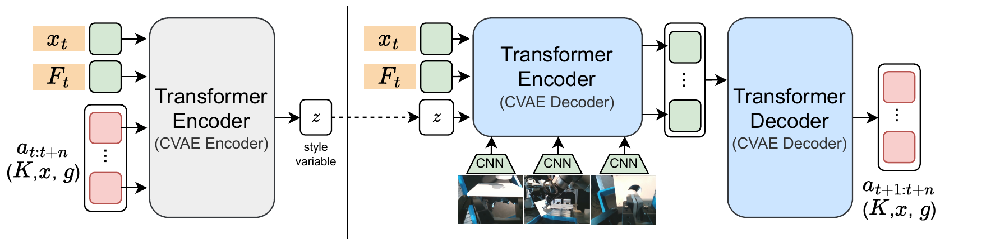
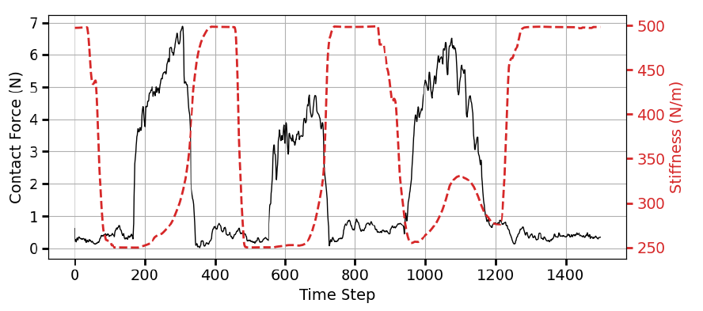






## 1. 问题与背景
{: #problem }

位置／速度接口的工业机器人会把环境阻力当成跟踪误差；接触中很小的位置偏差就可能产生很大作用力。柔顺控制能缓和这一问题，但不同阶段需要不同刚度：自由运动强调跟踪，插入端需要让位，另一只扶持臂又要保持稳定。（§I、III）

CompACT 将人操作时选择的刚度模式与参考轨迹一起记录，再用 ACT 学习何时切换。论文关注的“少量示范”是每项任务 20–30 条数据、各自训练策略；核心链路是**人工示范柔顺模式 → 同时预测轨迹和刚度 → Cartesian 柔顺控制执行**。

## 2. 核心贡献
{: #contributions }

- **带振动反馈的 VR 遥操作。** 操作者可同步指定末端位姿、夹爪开度和刚度模式，腕部 F/T 映射成手柄振动，帮助判断接触。
- **将 ACT 扩展到柔顺动作。** 当前图像、末端位姿与 F/T 条件化动作块，输出 Cartesian 参考位姿、夹爪和刚度参数。
- **面向位置接口的执行链路。** FDCC 将参考位姿和预测刚度转成关节命令；单臂和双臂共用这一结构。
- **分开检验柔顺执行与力观测。** 仿真对比关节位置 ACT，真机比较策略有／无 F/T，显示两类改变的作用并不相同。（§III–VI）

## 3. 方法
{: #method }

### 整体思路：刚度来自手柄选择，力反馈走两条通路

离线刚度标签来自操作者选定的模式。部署时，腕部 F/T 同时用于 ACT 的观测条件与 FDCC 的接触反馈；真机的“无 F/T”对照只去掉前一条通路，仍使用相同柔顺控制器。

| 阶段 | 数据与输入 | 训练目标／处理 | 产物 |
| :--- | :--- | :--- | :--- |
| 示教 | VR 相对位姿、扳机开度、握键选刚度；腕部 F/T 振动提示 | 同步记录相机、机器人状态及操作者目标 | $$(I,x,F)$$ 与动作块 $$(x_g,g,K)$$ |
| 离线学习 | 当前状态＋未来示范动作 | ACT 的 CVAE 学习动作分布 | 观测条件化动作块策略 |
| 在线预测 | 多视角图像、当前末端位姿、当前 F/T | 一次预测多个未来动作 | 目标位姿、夹爪与刚度 |
| 控制执行 | 参考位姿、刚度及反馈 | FDCC 计算位置／速度接口可执行命令 | 机器人柔顺运动 |

### 遥操作与标签：记录操作者选择的刚度模式

HTC Vive Cosmos Elite 手柄通过 PyOpenVR 以 90 Hz 提供跟踪位姿；相对起点运动映射到机器人末端。扳机控制连续夹爪开度，握键切换刚度。系统准备低、中、高三档，数值分别为 **250、500、750**；示范时同一个数值用于刚度矩阵所有对角元素，每臂每任务只开放中档与另一档之间的切换。（§III-A、IV-B）

例如双臂插入开始时都用中档；接触后扶持孔的左臂升到高档，插入的右臂降到低档。标签由此记录接触阶段的控制意图：哪只手稳住环境，哪只手顺应插入误差。（Table I，Figs. 9–10）

### 动作表示与网络

每臂动作为 **6D 位姿＋1D 夹爪＋12D 刚度＝19D**，双臂合计 38D。位姿采用三维位置和轴角旋转；平移与旋转各使用一个 3×3 刚度块，分别展开其上三角 Cholesky 因子，共 12 个数：

$$
K=\widehat K^{\mathsf T}\widehat K.
$$

Cholesky 表示允许块内出现非对角项，而本次示范只在各向同值的模式间切换。评价这项工作时，应把表示容量与实际标签分布分开：结果验证的是模式选择与执行。（§IV-A–B）

<figure>
  
  <figcaption><strong>Fig. 4 · CVAE 动作块架构。</strong> 训练 encoder 读取未来示范动作，在线策略读取图像、当前位姿与 F/T，并生成参考位姿、夹爪与刚度序列。 来源：arXiv:2406.14990v2，PDF p. 4。 原图许可：<a href="https://creativecommons.org/licenses/by-nc-nd/4.0/">CC BY-NC-ND 4.0</a>；单图摘录，保留原图内容。</figcaption>
</figure>

训练时 CVAE encoder 读取当前末端位姿、F/T 和未来动作序列，得到 style latent；策略 decoder 将该 latent、图像特征与当前状态作为条件生成动作块。推理丢弃使用未来动作的 CVAE encoder。论文沿用 ACT [10]，主要修改动作空间、力观测与刚度输出。（Fig. 4）

### 控制器与训练设置

FDCC（Forward Dynamics Compliance Control）[32] 结合阻抗、导纳与力控制，通过虚拟模型的前向动力学将 Cartesian 输入映射到关节控制命令。本文学习的时变量是目标位姿 $$x_g$$ 和刚度 $$K$$；包括目标 wrench $$F_g$$ 在内的其他参数由人工调整后固定。（§III-B）

平台为两台 UR5e、内置腕部 F/T、两台腕部 RealSense SR305 和一台第三视角相机；各任务使用其中两到三个视角。MuJoCo／robosuite 实现双臂擦拭仿真。每项策略从头训练 20,000 epochs，报告耗时约 2–5 小时，训练 GPU 为 RTX 4090。（§V）

## 4. 实验与证据
{: #evidence }

### 任务与数据

| 任务 | 示范数 | 相机数 | 示范刚度切换 |
| :--- | ---: | ---: | :--- |
| 仿真双臂擦拭 | 30 | 2 | 左中档；右中→低 |
| 单臂抓取后插入 | 30 | 2 | 中→低 |
| 单臂擦白板 | 20 | 2 | 中→低 |
| 单臂画笑脸 | 20 | 2 | 中→低 |
| 双臂圆柱插入 | 20 | 3 | 左中→高；右中→低 |
| 双臂长方体插入 | 30 | 3 | 左中→高；右中→低 |

来源：Table I，p. 4。双臂插入零件公差为 2 mm；不同示范的会合位姿有所变化。抓取后插入包含物体初始旋转约 ±15°；白板标记分布在中心 ±5 cm 范围。（Figs. 6–10）

### 主要结果：力输入的收益依任务变化

| 真机任务成功率 | CompACT＋F/T | CompACT 无策略 F/T | 差值 |
| :--- | ---: | ---: | ---: |
| 抓取后插入 | 70% | 35% | ＋35 pp |
| 擦白板 | 70% | 100% | −30 pp |
| 画笑脸 | 100% | 100% | 0 pp |
| 双臂圆柱插入 | 100% | 40% | ＋60 pp |
| 双臂长方体插入 | 70% | 50% | ＋20 pp |

来源：Table II，p. 7。画图以笑脸形状为主观成功判据，另报告与示范的 SSIM：带 F/T 84.2%，无 F/T 84.3%。插入任务收益明显；擦拭失败主要是过早结束，作者认为 F/T 可能被误用为结束阶段线索。（§VI-B）

<figure>
  
  <figcaption><strong>Fig. 13 · 画图阶段的接触力与预测刚度。</strong> 黑线为接触力，红虚线为预测刚度；接触阶段伴随较低刚度，离开表面后恢复。该图是行为可视化，未单独隔离刚度切换的因果收益。 来源：arXiv:2406.14990v2，PDF p. 7。 原图许可：<a href="https://creativecommons.org/licenses/by-nc-nd/4.0/">CC BY-NC-ND 4.0</a>；单图摘录，保留原图内容。</figcaption>
</figure>

仿真中，两类策略都能完成双臂擦拭，但关节位置 ACT 的接触力达到 CompACT 的五倍以上。为保证数据可比，作者用同一批示范，并验证关节位置回放能产生相近接触力。加入 F/T 可减小 ACT 的力，却仍高于柔顺控制；CompACT 有无策略 F/T 的力曲线接近。（§VI-A，Fig. 11，p. 6）

原文仿真正文写每策略测试 10 次，Fig. 11 图注写 20 次，两处计数不一致；真机表保留作者报告百分比，不补推未明确的样本数。这不改变表内方向比较，但限制误差条和统计置信度的解释。

## 5. 相关工作
{: #related-work }

ACT [10] 提供 CVAE 动作块学习；CompACT 将其从关节目标扩展到 Cartesian 轨迹和可执行刚度。Bi-ACT [19] 同样利用力和 ACT，但依赖关节力矩接口，本文以位置／速度接口机器人为对象。FDCC [32,33] 提供低层执行结构；基于示范的可变阻抗表示 [34] 提供刚度矩阵参数化依据。引用编号沿用原文 References（p. 8）。

## 6. Insights · 思考与启示
{: #takeaways }

**核心判断：这篇最清楚的贡献是把人工柔顺模式作为动作标签，并接通真实控制接口。** 每任务 20–30 条示范即可学到接触阶段切换，为比较数据采集、策略学习和低层反馈提供了结构明确的参照。

### 1. 低接触力来自哪一层改变？

仿真中 CompACT 显著降低接触力，但对照 ACT 同时使用关节位置动作与不同执行方式；真机 F/T 消融则保留 CompACT 的柔顺执行。因此现有比较支持整个系统组合有效，不能把力下降全归给“学会了时变刚度”。

一种待检验的解释是，即使将低刚度固定，控制器也可能吸收大部分轨迹误差；作者自己观察到仿真 CompACT 有无策略 F/T 的力曲线接近。最小对照是在相同 Cartesian 预测轨迹和同一 FDCC 下，分别执行预测刚度、固定低档、固定中档，记录接触力峰值及运动误差。若固定低档同样低力但跟踪变差，才能具体支持模式切换在安全与精度之间的作用。

### 2. 力观测为何可能变成错误的阶段线索？

擦拭加入 F/T 后成功率由 100% 降至 70%，失败是提前收笔；插入则明显受益。一个待检验机制是策略利用示范中“力变化—结束动作”的相关性，而没有区分标记是否已擦净。

保持视觉标记和几何状态不变，对输入 F/T 添加幅值缩放或时间平移，比较停止时刻；同时固定完成状态但改变接触负载。若停止随力而非清洁状态变化，则应增强任务完成信号或改变示范的终止分布。这比笼统增加示范数量更直接检验错误归因。

[DIPCOM]() 沿用该类刚度标签和遥操作，再改变生成模型与动作表示；与 [ACP]() 的差别主要在标签来源：CompACT 记录人工模式，ACP 从力方向和幅值构造近似柔顺。对于交互坐标系（IF）表示，更值得对照的是“刚度在哪个坐标系定义、数据是否包含方向变化”，而非只比较动作维数。

## 参考与补充

- 阅读版本：[arXiv:2406.14990v2](https://arxiv.org/abs/2406.14990v2)，2024-09-26，8 页。作者：Tatsuya Kamijo、Cristian C. Beltran-Hernandez、Masashi Hamaya。
- 发表信息：**IROS 2024**，由[作者项目主页](https://omron-sinicx.github.io/CompACT/)与 [OMRON 官方发表列表](https://www.omron.com/global/en/technology/publications/)核对。查阅日期 2026-11-07。
- [官方代码](https://github.com/omron-sinicx/CompACT)包含 CompACT 与双臂擦拭环境；README 指向 [robosuite 的 CompACT 分支](https://github.com/omron-sinicx/robosuite/tree/CompACT)和 [VR 遥操作代码](https://github.com/omron-sinicx/vive_tracking_ros)。

