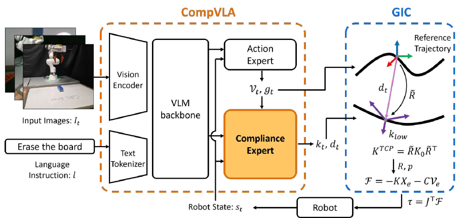
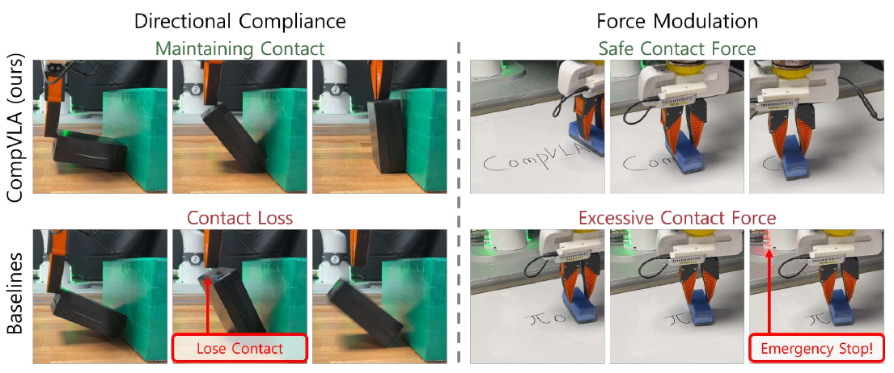
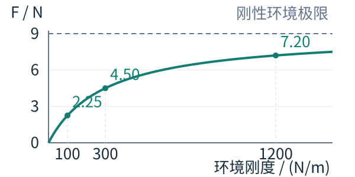






## 1. 问题与背景
{: #problem }

接触操作同时要求机器人决定运动路径与交互方式。擦白板时，末端需要沿表面移动并持续压住板擦；翻转盒子时，接触方向随物体姿态改变，机器人需要顺着接触方向让步，同时维持其他方向的运动精度。CompVLA 将这两种能力表述为 **directional compliance（方向性柔顺）与 force modulation（施力调节）**。[^paper]

论文把 VLA 的输出扩展为参考运动、刚度和虚拟位移。参考运动规定任务路径；刚度规定各方向的让步程度；虚拟位移移动阻抗控制器的平衡点，使机器人沿接触方向产生持续作用力。三者由几何阻抗控制器统一执行。

## 2. 核心贡献
{: #contributions }

1. **为 $$\pi_0$$ 增加 Compliance Expert。** 动作专家生成参考 TCP 运动，柔顺专家结合视觉语言上下文与参考轨迹，预测随时间变化的刚度和虚拟位移。
2. **从示教力信号生成控制标签。** 实测力与力矩用于恢复接触方向、方向性刚度和虚拟目标偏移，将示教中的交互行为转化为监督信号。
3. **将学习输出接入几何阻抗控制。** 在擦拭、翻转、取杯三项接触任务中取得 67.1% 的平均得分，比 ForceVLA 高 12.7 个百分点；抓取放置成功率为 76.7%。

## 3. 方法
{: #method }

### 整体思路：示教力怎样变成可执行标签

示教 F/T 为刚度与虚拟位移提供监督；部署策略读取 RGB、语言和机器人状态，高频几何阻抗控制根据位姿与速度误差执行。柔顺专家训练时以真实参考轨迹为条件，部署时以动作专家生成的轨迹为条件。（§3–4；Appendix A.1–A.2）

| 阶段 | 数据与输入 | 训练目标／处理 | 产物 |
| :--- | :--- | :--- | :--- |
| 示教标签构造 | TCP 轨迹、补偿滤波后的 F/T | 按力方向与幅值设定刚度，再计算虚拟位移 | 监督标签 $$k,d$$ |
| 联合训练 | RGB、语言、状态；真实 TCP 轨迹作为柔顺条件 | 动作与柔顺两项 flow-matching 损失 | 共享 VLM 的双专家 |
| 在线参考运动 | RGB、语言、当前 TCP／夹爪状态 | 动作专家预测 twist 并积分 | 参考轨迹 $$X^{ref}$$、夹爪命令 |
| 在线柔顺执行 | 参考轨迹、预测 $$k,d$$、当前位姿与速度 | 构造虚拟目标和刚度；GIC 计算关节力矩 | 可执行的接触行为 |

### 输入输出：力信号在训练链条中的位置

<figure>
  
  <figcaption><strong>Figure 1 · 双专家与几何阻抗控制。</strong> 参考轨迹同时用于执行与柔顺预测；刚度和虚拟位移共同决定方向性柔顺及施力。 来源：CompVLA，arXiv:2609.23614v1，PDF 第 4 页。 原图许可：<a href="https://creativecommons.org/licenses/by/4.0/">CC BY 4.0</a>；单图摘录，保留原图内容。</figcaption>
</figure>

CompVLA 的策略输入是三路 RGB 图像、语言指令和机器人状态；状态包含当前 TCP 位姿与夹爪状态。示教时采集的 F/T 信号用于构造柔顺监督标签。部署时，策略从视觉、语言与本体状态预测这些参数，控制器根据位姿和速度误差执行柔顺行为。

每个时间步的动作表达为：

$$
m_t=(V_t,g_t,k_t,d_t).
$$

| 输出 | 维度与含义 | 下游用途 |
| :--- | :--- | :--- |
| $$V_t$$ | 六维 TCP twist，描述角速度与线速度 | 从当前 TCP 位姿积分得到参考轨迹 |
| $$g_t$$ | 夹爪命令 | 控制开合 |
| $$k_t=[k_t^R;k_t^p]$$ | 六维刚度，旋转与平移各三维 | 设置柔顺坐标系内各轴的弹簧刚度 |
| $$d_t=[d_t^R;d_t^p]$$ | 六维虚拟位移，旋转与平移各三维 | 确定柔顺方向，并移动虚拟平衡点 |

这套接口的核心是将“怎么移动”和“如何接触”共同编码到动作中。刚度的单位分别为 Nm/rad 与 N/m，虚拟位移分别对应旋转向量与平移向量。[^method]

### 从示教力恢复刚度与虚拟位移

标签生成在平移和旋转空间分别进行。以平移为例，首先用实测接触力方向确定柔顺坐标系的第一轴，其余方向选择与 TCP 坐标系最接近的朝向。该坐标系中的刚度为：

$$
K_0=\operatorname{diag}(k_{\mathrm{low}},k_{\max},k_{\max}).
$$

第一轴沿接触方向取较低刚度，两个正交方向保持较高刚度。接触力幅值 $$f$$ 决定 $$k_{\mathrm{low}}$$：小于阈值 $$f_{\min}$$ 时使用 $$k_{\max}$$，超过 $$f_{\max}$$ 时使用 $$k_{\min}$$，中间区间线性下降：

$$
k_{\mathrm{low}}(f)=
\begin{cases}
k_{\max}, & f\le f_{\min},\\
k_{\max}-\dfrac{f-f_{\min}}{f_{\max}-f_{\min}}(k_{\max}-k_{\min}),
& f_{\min}<f\le f_{\max},\\
k_{\min}, & f>f_{\max}.
\end{cases}
$$

平移参数：$$k_{\max}=500$$ N/m，$$k_{\min}=200$$ N/m；力阈值为 $$f_{\min}=1$$ N、$$f_{\max}=15$$ N。旋转参数：刚度上、下限分别为 30 和 10 N·m/rad，力矩阈值下、上限分别为 0.1 和 2.5 N·m。因此，力越大，接触方向的标签刚度越低，两个侧向轴继续保持轨迹跟踪所需的刚度。[^labels]

虚拟位移的方向沿接触力方向，幅值由力除以该方向刚度得到。这样，$$d$$ 的方向负责定向，$$k$$ 与 $$d$$ 的组合负责表达施力。旋转空间使用力矩与旋转刚度执行相应构造。

<aside class="paper-sidenote" markdown="1">
**为什么还需要虚拟位移？** 刚度决定受力后让步多少；将弹簧平衡点沿接触方向移动，才会在实际接触位置形成弹簧形变并产生持续压力。比如按原文标签规则计算，10 N 接触力对应约 307.1 N/m 的方向刚度，以及约 3.26 cm 的虚拟偏移；两个正交方向仍为 500 N/m。这个数值例子是对标签公式的代入说明。
</aside>

### 双专家训练：运动先提供条件，柔顺再补全交互

实现基于 LeRobot v0.4.3 的 $$\pi_0$$：PaliGemma 提供视觉语言表示，Gemma 架构承担动作专家。新增柔顺专家采用同样结构，并从动作专家复制权重初始化。

动作专家预测 **25 步** TCP twist 与夹爪序列，推理采用 **10 步去噪**。twist 从当前 TCP 位姿积分得到参考轨迹，再传给柔顺专家。每步轨迹条件将旋转矩阵展开为 9 维，加上 3 维位置和 1 维夹爪命令，共 **13 维**；实现将其放入带噪柔顺输入的空余 padding 通道，与 flow time 一同嵌入。柔顺专家同时读取 VLM 上下文，生成相同时间跨度的 $$k,d$$ 序列。

训练联合更新 VLM、动作专家和柔顺专家，总损失为两个 flow-matching 目标之和：

$$
\mathcal L=\mathcal L_a+\mathcal L_c.
$$

动作与柔顺分支分别对各自目标序列加高斯噪声，学习去噪向量场。**训练时，柔顺分支的轨迹条件来自数据集真实 TCP 轨迹；推理时，该条件来自动作专家生成的参考轨迹。** 所有输入与目标在训练预处理时归一化，输出在部署后处理时恢复物理量。关节角作为训练期辅助预测目标，用于保留预训练信息。

训练共 100,000 步，batch size 为 32，采用 bfloat16、gradient checkpointing 和 AdamW。学习率先预热 1,000 步至 $$2.5\times10^{-5}$$，随后 30,000 步降至 $$2.5\times10^{-6}$$，后续保持恒定。初始化使用 [lerobot/pi0_base](https://huggingface.co/lerobot/pi0_base)。[^training]

### 几何阻抗控制器怎样执行

给定参考位姿 $$(R,p)$$ 与 TCP 局部坐标系中的虚拟位移，控制器构造：

$$
R^v=R\operatorname{Exp}(d^R),\qquad p^v=p+Rd^p.
$$

$$\operatorname{Exp}$$ 将旋转向量映射为旋转矩阵。平移偏移先由 $$R$$ 转到基坐标系，再加到参考位置上。接着，分别将旋转与平移刚度从柔顺坐标系变换到 TCP 坐标系：

$$
K^R=\widetilde R^R\operatorname{diag}(k^R)(\widetilde R^R)^\top,\qquad
K^p=\widetilde R^p\operatorname{diag}(k^p)(\widetilde R^p)^\top,
$$

$$
K=\operatorname{blockdiag}(K^R,K^p).
$$

最终得到具有方向性的六维分块对角刚度矩阵。附录实现按 $$c_i=2\sqrt{k_i}$$ 构造阻尼，并进行相同的坐标变换。由几何位姿误差 $$X_e$$ 与速度误差 $$V_e$$ 计算控制 wrench，再通过雅可比转为关节力矩：

$$
\mathcal F=-KX_e-CV_e,\qquad \tau=J(q)^\top\mathcal F.
$$

机器人内环承担动力学补偿。论文在理论控制律中选择期望惯量与机器人实际惯量相同，使显式外力测量项抵消；执行过程通过机器人与环境的物理作用形成柔顺响应。这里的 $$\mathcal F$$ 是控制器算出的命令 wrench，示教 F/T 则承担标签来源的角色。[^control]

### 数据采集与时间对齐

硬件为 FR3 七自由度主从机械臂、ATI Axia 腕部六维 F/T 传感器、前方／侧方／腕部三台 RealSense D435i，并使用 UMI 指尖。四个任务各采集 100 条示教，共 400 条。

原始关节角和 F/T 为 100 Hz，夹爪宽度为 15 Hz，RGB 为 30 fps。处理时统一到 **10 Hz** 时间网格：连续量线性插值，图像采用最近时间戳；通过正运动学得到 TCP 位姿和运动量。力信号经过重力与惯性补偿、传感器到 TCP 的坐标变换、Butterworth 低通滤波和幅值裁剪，再生成标签与 LeRobot 格式数据。

25 步预测跨度对应此训练网格中的 2.5 秒。策略输出的运动与柔顺序列由高频 GIC 执行，论文以高低频分工描述部署控制链。[^data]

## 4. 实验与证据
{: #evidence }

### 任务、对照与指标

接触任务包括擦白板（Erase）、翻转物体（Pivot）和取杯（Cup Dispense），另以抓取放置（PnP）考察标准操作。主实验每次运行、每个任务评估 20 个 episode，共三次运行，报告均值与标准差。擦白板指标为擦除比例，其余任务记录成功率；接触任务平均得分取前三项的平均。

比较组均采用 $$\pi_0$$ 主干：原始 $$\pi_0$$、加入 F/T 的 ForceVLA［11］、利用关节 effort 及未来 effort 辅助预测的 TA-VLA［12］。ForceVLA 适配为三路图像输入；TA-VLA 采用原文比较配置 DePost-1。[^results]

| 方法 | 擦除比例 | 翻转成功率 | 取杯成功率 | 接触任务平均得分 | 抓取放置成功率 |
| :--- | ---: | ---: | ---: | ---: | ---: |
| $$\pi_0$$ | 17.8±7.1 | 31.7±10.4 | 38.0±12.1 | 29.2±9.2 | 80.0±10.0 |
| ForceVLA | 68.1±4.1 | 45.0±15.0 | **50.0±8.7** | 54.4±4.3 | 45.0±15.0 |
| TA-VLA | 52.8±9.7 | 26.7±10.4 | 0.0±0.0 | 26.5±2.0 | **83.3±12.6** |
| CompVLA | **92.9±3.7** | **73.3±10.4** | 35.0±10.0 | **67.1±7.2** | 76.7±5.8 |

单位为 %；来源：[原文 Table 1](https://arxiv.org/pdf/2609.23614v1#page=7)，PDF 第 7 页。CompVLA 在擦拭和翻转中取得最高分，接触任务平均得分比 ForceVLA 高 **12.7 个百分点**。取杯任务由 ForceVLA 取得最高成功率；作者将该任务的表现与小按钮所需的参考运动定位精度联系起来。抓取放置中，CompVLA 的 76.7% 与 $$\pi_0$$ 的 80.0% 接近。

<figure>
  
  <figcaption><strong>Figure 4 · 维持接触与调节压力。</strong> 左侧展示随接触方向变化保持贴合，右侧展示擦拭时的压力调节效果。 来源：CompVLA，arXiv:2609.23614v1，PDF 第 8 页。 原图许可：<a href="https://creativecommons.org/licenses/by/4.0/">CC BY 4.0</a>；单图摘录，保留原图内容。</figcaption>
</figure>

原文 Fig. 4 展示两种控制效果：翻转时，方向性柔顺帮助末端随着接触方向变化保持贴合；擦拭时，虚拟目标与刚度共同调节压力，形成持续作业所需的接触。

### 消融：虚拟位移与可变刚度各自贡献什么

消融各进行 10 个 episode，虚拟位移在评估时移除。擦白板实验中，完整模型的擦除比例为 **96%**；移除虚拟位移后为 **7%**；同时移除刚度预测与虚拟位移、使用位置控制时为 **15.3%**。虚拟目标为持续压紧提供了明确的控制量，与柔顺程度共同决定擦拭效果。

翻转实验将旋转刚度固定为 30 Nm/rad、平移刚度固定为 500 N/m，成功率为 **40%**；采用可变刚度的完整模型为 **70%**。该结果对应随接触过程调整柔顺程度的收益。[^ablation]

## 5. 相关工作
{: #related-work }

**ACP［7］提供从示教位置与 wrench 推断柔顺标签的思路。** CompVLA 将这种标签构造扩展到基于 $$\pi_0$$ 的视觉语言动作模型，并在平移和旋转空间分别表达方向性柔顺。

**几何阻抗控制 GIC［10］提供执行层。** 位姿属于 $$SE(3)$$，旋转与平移在对应几何结构上定义误差和虚拟目标。CompVLA 学习控制器所需的刚度与位移参数，通过这一接口连接低频策略和高频交互。

**ForceVLA［11］、TA-VLA［12］提供力信息输入路线的比较。** CompVLA 把示教 F/T 转为监督目标，重点扩展策略输出端的物理表达。两类设计分别改变策略能够观察什么，以及策略能够要求控制器执行什么。

## 6. Insights · 思考与启示
{: #takeaways }

**CompVLA 将交互意图写进可执行动作。** 参考轨迹、刚度和虚拟位移分别表达运动、让步与平衡点偏置，控制器赋予它们物理含义。接触任务平均得分 67.1% 支持这套系统整体有效；Erase 的 92.9% 与 Pivot 的 73.3% 是主要优势，Cup Dispense 的 35% 则低于 ForceVLA 的 50%，对应论文观察到的参考运动定位瓶颈。（Table 1；§7）

### 1. 移除虚拟位移，究竟移除了什么？

Table 2 中，擦除比例从完整模型的 96% 降至移除虚拟位移后的 7%。这明确说明完整系统依赖虚拟位移；但 $$d$$ 同时负责平衡点偏移和柔顺坐标系定向。若删除时也改变刚度方向，实验就同时动了两个变量。

控制器使用 $$p^v=p+Rd^p$$ 产生压紧偏置，又用 $$d^p/\|d^p\|$$ 确定柔顺轴。原文没有说明该消融如何处理零向量对应的柔顺坐标系。因此 96%→7% 不能单独分配给“施力调节”或“方向性柔顺”的损失；归因需要分别控制这两个变量。（§4.2；Appendix A.2，Eqs. 12–13）

固定同一条预测参考轨迹、$$k$$ 与原始 $$d$$ 的单位方向，只把平衡点偏移幅值设为零，可隔离主动压紧的作用；另一组保留偏移与刚度特征值，仅将柔顺轴固定到 TCP 轴，可隔离方向适应。除擦除比例外，记录法向力、切向轨迹误差和安全停止次数，便能区分“压不住”“跟不准”与“压得过重”。

### 2. 实时 force context 能补哪一类信息？

与 FP2 的实测 wrench 历史条件化相比，CompVLA 先从任务观测预测柔顺参数，再由高频 GIC 实现物理响应。它具有接触响应能力；需要进一步判断的是策略能否识别当前环境与训练环境的力学差别。

考虑一维准静态接触的阅读推导：令机器人刚度为 $$k$$、环境刚度为 $$k_e$$、虚拟目标超过未变形表面的距离为 $$\Delta$$。在线性弹簧、无摩擦和无动态项假设下，两者串联给出

$$
F=\frac{kk_e}{k+k_e}\,\Delta.
$$

<figure class="reading-figure">
  
  <figcaption><strong>阅读重构 · 目标相同，环境刚度仍会改变接触力。</strong> 由上述串联弹簧模型计算：固定机器人刚度 300 N/m、目标越过未变形表面 30 mm，准静态、无摩擦；虚线 9 N 为刚性环境极限。参数为阅读推导的示例值。</figcaption>
</figure>

相同初始视觉几何、相同预测 $$k,\Delta$$，可以因 $$k_e$$ 不同产生不同接触力。这一机制说明：视觉难以区分材料或薄壁杯液体载荷变化时，过去的“参考动作—刚度—虚拟位移—实测 wrench”可能帮助更新接触模型。这一推导给出了检验实时力上下文的具体条件。

检验这一机制时，使用外观与初始位姿相同、背部支撑刚度不同的接触面，固定动作专家和 GIC，对齐视觉、本体状态与动作历史，仅改变是否提供 wrench 历史；另设打乱力历史时间顺序的对照。接触后的本体位移也可能揭示环境刚度，因此需要保留这一路信息作为共同条件。测量接触力偏差、过冲与任务得分，才能区分“仅有力读数更好”与“动作—响应关系支持适应”。真实轨迹条件与预测轨迹条件的差别也应保持一致，避免把轨迹质量变化误归给 force context。（对应训练／推理条件见 Appendix A.1）

### 从动作接口到跨试次上下文

**动作表达可以直接承载交互意图。** 参考轨迹、刚度与虚拟位移分别承载运动路径、扰动响应和平衡点偏置：比较策略时应同时对齐坐标系、单位、时间步和控制器解释，单独比较末端位置会丢失接触语义。

**与 FP2 对照，力信息位于不同链条。** [FP2：交互坐标系与混合控制]() 在线读取 wrench 历史，预测交互坐标系、选择掩码和目标 wrench；CompVLA 用示教 F/T 构造柔顺标签，部署预测 $$k,d$$。这个对照聚焦观测与动作接口；性能比较需要相同任务和评估设置。

**从 ACP 到 VLA，再到力交互 ICL。** [ACP 的近似柔顺标签]() 为本文提供方法基础。CompVLA 已让柔顺专家以参考轨迹为 context，保留了“准备怎么动”与“应该怎样接触”的联系。进一步把过去的参考运动、$$k,d$$ 与实测 wrench 组织成跨试次上下文，延续了这一思路；需要明确试次变化、记忆边界和上述可区分的力学条件。

## 参考与补充

正文中的［编号］沿用 CompVLA 原文参考文献编号。

[^paper]: Kim et al. *CompVLA: A Variable Compliance Vision-Language-Action Model for Contact-rich Manipulation*. 2026。[arXiv:2609.23614v1](https://arxiv.org/abs/2609.23614v1)。
[^method]: 原文 §4.1–4.2、Fig. 1，PDF 第 4–5 页。
[^labels]: 原文 §4.1、附录 B.2，公式 (17)，PDF 第 4–5、13 页。
[^training]: 原文附录 A.1，公式 (8)–(11)，PDF 第 11–12 页。
[^control]: 原文 §3、附录 A.2，公式 (12)–(16)，PDF 第 3–4、12 页。
[^data]: 原文 §5.1、附录 B.1–B.3，PDF 第 6、13–14 页。
[^results]: 原文 §5.1–5.2、Table 1，PDF 第 6–7 页；取杯任务的运动定位讨论见 §7，PDF 第 8 页。
[^ablation]: 原文 §5.3、Tables 2–3，PDF 第 7 页。

- **发表信息核验：** [官方项目主页](https://compvla.github.io/) 当前标注 Conference on Robot Learning (CoRL) 2026，查阅日期 2026-11-07；技术细节采用 arXiv:2609.23614v1（2026-09-20）的正文和页码。
- **资源：** [官方代码](https://github.com/compvla/CompVLA) · [作者公布的数据入口](https://drive.google.com/drive/folders/15SLhbUN81K4f6syi3K83eudc17dwK3hx)。

