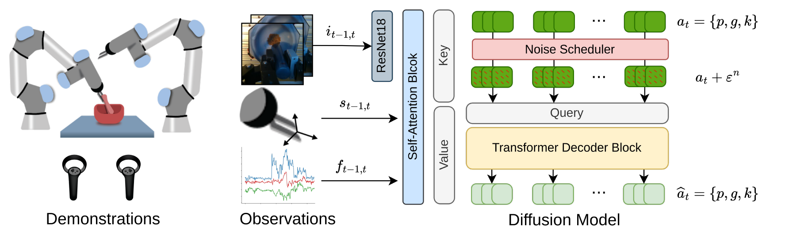
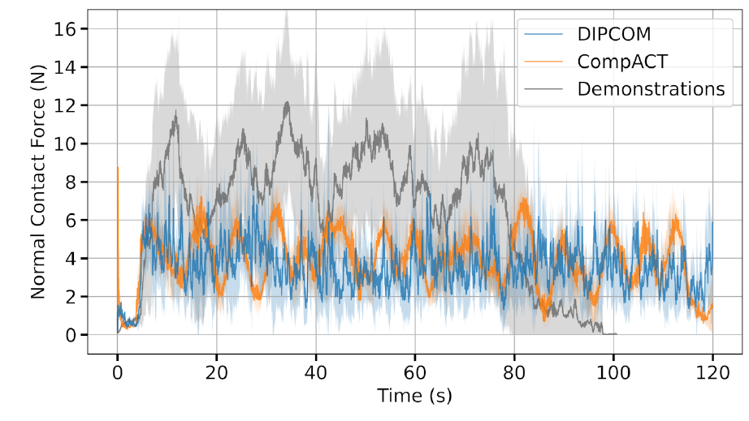






## 1. 问题与背景
{: #problem }

研磨、擦除等接触任务需要反复完成“接触—运动—抬起观察—再次接触”的循环。轨迹既要保持足够接触力，又要持续推进操作；只压住表面而停在原地，力曲线可能合理，任务仍然失败。作者在 CompACT 上观察到这类长时重复动作容易中途停顿，因此将柔顺动作学习扩展到扩散策略。（§I、V）

DIPCOM 的重点是生成**可持续执行的接触运动序列**：视觉、腕部力和末端状态共同条件化动作扩散，输出位姿、夹爪开度及刚度，再交给柔顺控制器。它与 ACP 都让柔顺参数进入执行，但两者的标签来源和参数化不同。

## 2. 核心贡献
{: #contributions }

- **扩散式柔顺动作策略。** 联合生成绝对末端位姿、夹爪和六维对角刚度，继承 CompACT 的人工模式示教及低层柔顺执行路线。
- **调整动作表示与序列执行。** 采用连续 6D 旋转表示、较长动作窗口及 temporal ensemble，改善相邻预测窗口的衔接。
- **比较重复任务与插入任务。** 研磨和擦除质量明显超过 CompACT，而圆柱／长方体双臂插入的成功率相同，呈现生成策略收益的任务边界。（§III–V）

## 3. 方法
{: #method }

### 整体思路：扩散预测动作块，柔顺控制落实接触响应

VR 遥操作提供目标位姿和人工选择的刚度模式。扩散模型联合生成这些动作，重叠窗口做 temporal ensemble 后送入柔顺控制器；腕部力用于策略条件与底层接触反馈。

| 阶段 | 数据与输入 | 训练目标／处理 | 产物 |
| :--- | :--- | :--- | :--- |
| 采集 | VR 目标位姿、夹爪与两档刚度切换；RGB、F/T、机器人位姿 | 保存动作和观测 | 各任务示范数据 |
| 扩散训练 | 含噪动作＋观测条件 | 重建干净动作样本 | 条件去噪模型 |
| 在线生成 | RGB、末端状态、F/T＋初始高斯噪声 | DDIM 迭代生成动作序列 | 位姿／夹爪／刚度动作块 |
| 时序执行 | 多个预测窗口的重叠动作 | temporal ensemble 平滑衔接 | 柔顺控制器的当前命令 |

### 动作表示与条件输入

每臂动作包含 **9D 绝对位姿＋1D 夹爪＋6D 对角刚度＝16D**。其中位置为 3D，姿态取旋转矩阵前两列的 6D 表示；刚度为平移与旋转各三个轴的对角元素。相比 CompACT 原始版本，轴角变为连续旋转表示，12D Cholesky 刚度因子变为 6D 对角刚度。（§III-A、C）

示教沿用 VR 手柄，操作者在任务预设的两档刚度间切换；标签直接来自被选中的控制参数。其刚度监督来自人工模式；ACP 则依据示范力构造方向性标签。DIPCOM 的接触作用由参考位姿、刚度与机器人—环境交互共同产生。（§III-B）

### 条件扩散与动作块

<figure>
  
  <figcaption><strong>Fig. 2 · 观测条件化动作扩散。</strong> 图像、位姿与力特征形成条件；训练将示范动作加噪并重建，在线从高斯噪声生成位姿、夹爪与刚度序列。 来源：arXiv:2410.19235v1，PDF p. 3。 原图许可：<a href="https://creativecommons.org/licenses/by-nc-nd/4.0/">CC BY-NC-ND 4.0</a>；单图摘录，保留原图内容。</figcaption>
</figure>

ResNet18（不使用预训练权重）编码图像，与 F/T、机器人状态拼接后送入 Transformer encoder；decoder 让含噪动作 cross-attend 到观测特征。Fig. 2 标示图像、位姿和 F/T 的 $$t-1,t$$ 观测。策略分布写作

$$
\pi(A\mid I,F,S),\qquad A=\{p,g,k\}.
$$

训练直接预测干净动作样本，采用样本重建 MSE：

$$
\mathcal L_{\mathrm{sample}}=\|a_t^0-\widehat a_t^0\|^2.
$$

在线使用 DDIM 迭代去噪。论文将方法称为 classifier-free conditional diffusion，但没有单列无条件分支、guidance 系数的消融；可确认的实现机制是观测条件化去噪和样本预测。（§III-D）

作者报告平均每窗口约 48 个动作，有的任务更长，并将 ACT 的 temporal ensemble 用于跨窗口重叠预测，以减少新旧动作块切换时的突变。48 表示动作序列长度；正文没有给出可直接复用的端到端控制频率或统一去噪步数。（§III-E）

### 数据和刚度设置

两台 UR5e 提供腕部 F/T，每臂腕部配置 RealSense SR305，另有第三视角相机；三位共同作者采集示范。各任务分别训练策略。（§IV-B）

| 任务 | 示范数／视角／臂数 | 平移刚度低／高 | 旋转刚度低／高 |
| :--- | :--- | :--- | :--- |
| A 研磨 | 40／1／1 | 300／800 | 100／150 |
| B 铅笔擦除 | 60／2／1 | 800／1200 | 150／300 |
| C/D 双臂插入 | 各 60／3／2 | R1：800／1200；R2：200／800 | R1：150／300；R2：100／150 |

来源：Table I，p. 4。这里保留原表参数值，原表未显式标单位。与 CompACT 原论文相比，数据量、刚度范围和任务设置已经改变，跨论文的同名任务成功率不能直接当作模型增益。

## 4. 实验与证据
{: #evidence }

### 指标与结果

| 任务／指标 | CompACT | DIPCOM | 论文位置 |
| :--- | ---: | ---: | :--- |
| 研磨后细粉比例，均值±SD | 9.96%±1.39% | **55.88%±13.54%** | Table II，p. 5 |
| 铅笔标记擦除比例，均值±SD | 26.0%±16.6% | **77.32%±19.48%** | Table III，p. 5 |
| 铅笔全部擦净成功率 | 0.0% | **52.3%** | Table III |
| 双臂圆柱插入成功率 | 100% | 100% | Table IV，p. 6 |
| 双臂长方体插入成功率 | 95% | 95% | Table IV |

研磨使用颗粒速溶咖啡，茶滤筛分得到细粉比例，人类示范为 76.67%±8.4%；DIPCOM 相对 CompACT 提高 **45.92 个百分点**，仍低于示范均值。擦除任务初始文字为“OSX”，通过前后图像计算擦除比例，提升 **51.32 个百分点**。圆柱和长方体插入均为 2 mm 公差，以插入并释放为成功。（§IV-C）

擦除正文明确 CompACT 为 20 次 rollout 全失败，但 DIPCOM 的 52.3% 并非 20 次二元试验的整数比例；论文没有交代可将二者统一的分母。

### 机制证据：力与运动覆盖共同影响研磨质量

<figure>
  
  <figcaption><strong>Fig. 5 · 研磨时的法向接触力。</strong> 两种策略的力幅值相近，细粉比例却明显不同。正文将差异与 DIPCOM 持续圆周运动、CompACT 停滞的行为联系起来。曲线为原文实验数据，阴影表示标准差。 来源：arXiv:2410.19235v1，PDF p. 5。 原图许可：<a href="https://creativecommons.org/licenses/by-nc-nd/4.0/">CC BY-NC-ND 4.0</a>；单图摘录，保留原图内容。</figcaption>
</figure>

研磨时两个模型的作用力幅值相近，但 CompACT 常停在原地，DIPCOM 更能继续圆周运动并定期抬起观察。作者将细粉比例差距与这种行为差异联系起来。擦除时 DIPCOM 同时施加更高作用力并更准确地覆盖标记，收益包含接触强度与运动位置两方面。（Figs. 4–6，§IV-C）

双臂插入中结果相同，但 DIPCOM 展示更多轨迹变化，且会移动支撑臂辅助插入；作者将此解释为更丰富的生成行为。本文没有独立去除力条件、固定刚度、替换动作表示或关闭 temporal ensemble 的定量消融。（§V）

## 5. 相关工作
{: #related-work }

CompACT [4] 提供采集和可变柔顺控制基础；ACT [11] 提供动作块及 temporal ensemble；Diffusion Policy [15] 提供条件动作扩散框架；DDIM [25] 提供推理采样机制；连续旋转表示 [24] 支持从轴角到 6D 表示的变化。引用编号沿用原文 References（p. 7）。

## 6. Insights · 思考与启示
{: #takeaways }

**本文最强的证据指向柔顺执行下的重复运动生成。** 研磨力幅值相近却有明显质量差距，说明能否持续覆盖工作空间，是理解该任务收益的关键。

### 1. 扩散分布能力与表示／执行变化如何分开？

作者以研磨和擦除结果支持扩散模型更适合多模态、循环行为。原文同时引入连续旋转、对角刚度、较长窗口与 temporal ensemble，且没有逐项消融。现有证据支持 DIPCOM 整套配置在两项重复任务上更好，单独归因于生成分布仍有不确定性。

待检验的机制是，ACT 的停顿可能来自多模态动作平均，也可能来自旋转不连续、动作窗口衔接或策略频率差异。最小区分实验是固定 6D 旋转、相同刚度表示、动作窗口、ensemble 与控制频率，只替换 CVAE／扩散动作头；同时在视觉近似相同的循环相位统计速度分布与停顿时长。如果扩散仍保持多个运动分支而 CVAE 聚集在零速附近，才更具体支持“多模态平均导致停顿”。

### 2. 相似法向力为何不能说明等效接触控制？

研磨还依赖切向运动与覆盖。将力、速度分为法向和切向分量，机械功率写为 $$P=f_n v_n+f_\tau^\top v_\tau$$。持续贴面运动时，法向速度可接近零；即使法向力相近，停顿与圆周运动仍具有不同的切向位移和覆盖。该分解解释了为何只看法向力不足以评价研磨，论文并未直接测量功率来验证这一因果链。

**触发条件与检验。** 在轨迹停滞而法向力正常时，单看力误差会误判策略表现。最小对照固定法向载荷，比较同轨迹回放与各策略生成轨迹，记录路径长度、接触覆盖和单位时间细粉率；再固定轨迹比较刚度。这样可区分运动生成收益与柔顺控制收益。对于交互坐标系（IF）表示，建议按接触法向／切向拆开分析，不让总 wrench 误差掩盖任务方向上的有效运动。

[CompACT]() 给出人工刚度模式来源；[ACP]() 从示范力构造方向性刚度，并用虚拟目标编码接触作用。两者应在标签来源与执行接口上对齐比较。与 UMI-FT 的夹持力问题相比，DIPCOM 这里的夹爪输出仍是开度，不能将手臂刚度预测等同于目标夹持力控制。

## 参考与补充

- 正文版本：[arXiv:2410.19235v1](https://arxiv.org/abs/2410.19235v1)，2024-10-25，7 页。作者：Malek Aburub、Cristian C. Beltran-Hernandez、Tatsuya Kamijo、Masashi Hamaya。
- 发表信息： **IEEE/SICE SII 2026**：[作者发表页面](https://cristianbehe.me/projects/imitation-learning.html)将本工作列于 2026 的 SII 项；[会议程序](https://ras.papercept.net/conferences/conferences/SII26/program/SII26_ContentListWeb_2.html)收录题目；出版 DOI 为 [10.1109/SII64115.2026.11404545](https://doi.org/10.1109/SII64115.2026.11404545)。技术细节与结果采用 arXiv v1。
- [官方代码](https://github.com/omron-sinicx/DIPCOM)及其[项目页入口](https://omron-sinicx.github.io/DIPCOM/)。

