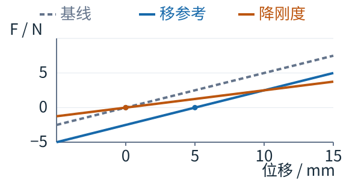






## 1. 问题与背景
{: #problem }

少量示范既要告诉机器人怎样接近物体，也要说明接触后应以多大刚度跟踪。参考位置与实际位置在接触时分离，仅观察实际轨迹很难知道操作者希望施加的接触作用。直接把示范平移、旋转到新物体位置，还可能破坏物体与墙面之间的接触顺序。

Residual Compliant Policy 将问题拆为三步：采集时显式选择柔顺模式，仿真中生成符合场景约束的示范，最后用残差强化学习补充接触恢复。它研究的是带物体位姿估计的状态策略，重点是少示范的 real2sim2real 执行流程。（§I、III）

## 2. 核心贡献
{: #contributions }

- 数字孪生同时显示命令参考与实际机器人状态，配合触觉遥操作与高／低两档刚度，将柔顺意图显式记录进示范。
- 自由空间采用 Laplacian Editing，接触阶段采用仿真轨迹优化，使数据增广兼顾示范形状与物体—环境约束。
- 冻结基础 flow policy，在仿真中用 PPO 学习三维参考位置偏移；基础策略继续决定姿态与刚度模式。
- 三任务共采集 7 条真实示范。40 次困难测试中，Base 为 35/40，Residual 为 40/40；改进来自既有基础行为之上的执行修正。（Table I）

## 3. 方法
{: #method }

### 整体思路：残差究竟改了什么

基础策略决定参考位姿和刚度模式，残差只增加三维参考位置偏移。在线力测量同时进入 30 Hz 策略和 1 kHz 导纳控制，分别改变后续目标与当前物理响应。

| 阶段 | 数据与输入 | 训练目标／处理 | 产物 |
| :--- | :--- | :--- | :--- |
| 真实示教 | 触觉设备、机器人、物体跟踪、两档柔顺选择 | 同步记录参考轨迹与接触模式 | 7 条种子示范 |
| 仿真增广 | 新物体位姿与种子轨迹 | 自由空间形状编辑；接触阶段 CEM 优化 | 40／150 条任务轨迹 |
| 基础策略 | 物体、末端、力、历史刚度 | consistency flow matching 模仿学习 | 参考位姿与刚度模式 |
| 残差训练 | 冻结基础策略、仿真随机化 | PPO 优化成功、力约束与平滑代价 | 参考位置的闭环修正 |

### 导纳控制与示教

底层满足

$$
M\ddot{x}+D\dot{x}+K(x-x_{\mathrm{ref}})=F_{\mathrm{ext}}.
$$

质量矩阵取对角形式，数值为 $$(2,2,2,0.5,0.5,0.5)$$；逐轴阻尼为 $$d_i=2\sqrt{m_i k_i}$$。刚度采用单一模式参数，论文记为 $$K=\operatorname{diag}(k,\ldots,k)$$，其中 $$k\in\{k_l,k_h\}$$。两档间沿受限速度的预设样条过渡，以满足引用文献 [41] 的时变刚度稳定条件。平移和旋转具有不同物理单位，应将这个写法理解为论文选用的数值模式参数化。（Eq. 1，§III-A）

操作者使用 Haption Virtuose 6D Tao 控制 Franka FR3。数字孪生采用物理预测与 FoundationPose 视觉校正：前者在遮挡时继续传播状态，后者根据 RGB-D 与物体网格修正误差，初始化还使用 SAM3。显示参考位置与实际位置之差，使操作者可以看见“弹簧压了多少”。孪生约 30 Hz，论文给出的预测／校正／I/O 耗时为 15／10／5 ms。（§III-B）

<a href="https://arxiv.org/pdf/2610.14035v1#page=3">查看原图</a> · <strong>原文 Fig. 2 · 完整训练与执行流程。</strong> 基础策略输出参考位姿及刚度模式，残差策略增加位置偏移，测得的外力进入导纳控制。 来源：arXiv:2610.14035v1，PDF 第 3 页。

### 从轨迹增广到基础策略

自由空间用 Laplacian Editing 保持局部轨迹形状，朝向由 SLERP 插值；接触部分用 cross-entropy method 在仿真动力学下优化参考轨迹。推箱靠墙再翻起时，接触转换位置由墙决定，单纯以箱体为中心变形轨迹容易过早或过晚到墙。（§III-C）

基础策略输入四步历史：物体 9D 位姿、末端 9D 位姿、滤波 wrench 与之前的刚度。条件 1D U-Net 通过 FiLM 读取上下文，用两段 consistency flow、两步积分采样，预测 16 步动作，执行前 8 步。每步输出 **9D 参考位姿＋1D 刚度模式**。（§III-D）

执行还包含平滑设计：批量采样 8 个动作块取平均，前四个执行步与旧动作块交叉渐变，刚度通道不参与该混合；再用满足速度、加速度、jerk 限制的五次 B 样条连接参考轨迹。这些处理属于完整系统的执行条件，比较时应保持一致。（§III-D）

### 残差策略与学习目标

PPO 残差输出 $$u_t\in\mathbb R^3$$，固定映射得到 $$\delta_t$$，组合命令为

$$
x_t^{\mathrm{cmd}}=(\hat p_t^{\mathrm{ref}}+\delta_t,\hat R_t^{\mathrm{ref}}),
\qquad k_t^{\mathrm{cmd}}=\hat k_t.
$$

它只改变平移参考，保持基础策略的朝向与刚度。输入包括物体相对末端状态、物体倾斜、基础动作、滤波力、上一命令的跟踪误差和上一次偏移；critic 另读无噪声 wrench、物体速度、质量、摩擦与扰动等仿真特权状态。（Eqs. 2–3）

奖励由终止成功／失败、超过力软阈值的惩罚、残差幅值与变化量惩罚构成。训练随机化位姿、质量、摩擦及观测噪声，并加入接触前扰动。残差均值输出层零初始化，起点等于基础策略；PPO 训练 1000 iterations。全部策略以 30 Hz 运行，图 2 标出底层控制为 1 kHz。（Eq. 4，§III-E、IV-A）

## 4. 实验与证据
{: #evidence }

### 设置

Franka FR3 搭配 Resense HEX21 F/T 与 RealSense D435。三任务为 Flip Box、Push and Flip Box、Flip Cube，真实种子示范分别为 1／3／3 条；训练增广轨迹分别为 40／150／150 条，模仿学习为 400／600／600 epochs。每策略每任务 30 次常规测试；后两任务各增加 20 次困难测试，总计 130 次／策略、520 次真机试验。（§IV-A）

困难条件各 5 次：超出训练范围的位置、旋转、执行中外推、质量更大且更滑的新物体。名义纸箱 147 g，新箱 201 g、几何相同。成功判据为旋转超过 85°。指标还包括平均完成时间与平均峰值接触力。

### 主要结果

| 方法 | 推后翻困难测试 | 翻立方体困难测试 | 合计 |
| :--- | ---: | ---: | ---: |
| LE 增广基线 | 7/20 | 17/20 | 24/40（60%） |
| ACP-style 动作表示 | 17/20 | 16/20 | 33/40（82.5%） |
| Base：两档刚度 | 18/20 | 17/20 | 35/40（87.5%） |
| Residual | 20/20 | 20/20 | 40/40（100%） |

来源：Table I，p. 7。ACP 行是该文统一骨干与数据下的 ACP-style 19D 动作对照，应与 [ACP 原论文]() 的原系统评测区分。

常规测试中 Base 与 ACP-style 均为 89/90，Residual 为 90/90。最明显的数据增广差异出现在 Push and Flip Box：LE 为 11/30，ACP、Base、Residual 均为 30/30。相比 Base，Residual 在困难测试增加 5 次成功，即 12.5 个百分点。（§IV-B、Fig. 5）

<a href="https://arxiv.org/pdf/2610.14035v1#page=7">查看原图</a> · <strong>原文 Fig. 6 · 完成时间与峰值力。</strong> 图中比较 LE、ACP-style、Base 与 Residual，保留原箱线分布及坐标单位。 来源：arXiv:2610.14035v1，PDF 第 7 页。

论文报告残差使各任务完成时间减少 7–18%；Flip Cube 峰值力从 Base 的约 10.0 N 降至 8.5 N。图中同时展示分布，说明成功率收益没有伴随更高峰值力。（Fig. 6，§IV-B）

### 对照怎样支持结论

LE 与其余组使用相同骨干、数据预算与训练安排，支持“环境一致的增广有用”。Base 与 ACP-style 主要改变动作表示，支持这组非抓取任务可用较简单的刚度模式完成。Residual 与冻结的 Base 直接对照，支持仿真残差改善域外执行；各困难子条件只有 5 次，强结论应落在这 40 次已测条件上。（§IV-B、Table I）

## 5. 相关工作
{: #related-work }

原文 [14] 的 Flow with the Force Field 使用 LE 与力调制；本文把接触阶段进一步交给仿真优化，以处理墙面等外部约束。[26] ACP 提供连续低刚度方向与虚拟目标表示，本文比较两档刚度加参考轨迹的简化。[27] [CompACT]() 与 [28] [DIPCOM]() 也在示教时选择刚度，本文增加参考轨迹的数字孪生可视化与少示范增广。[18–20,35] 的残差学习则提供“冻结基础行为、学习纠偏”的方法背景。引用编号沿用原论文。

## 6. Insights · 思考与启示
{: #takeaways }

### 参考偏移能改接触力，但何时能替代变刚度？

两档 Base 达到 35/40，高于 ACP-style 的 33/40，支持它在当前枢转任务上的有效性。论文将其归因于输出较简单、各向同性刚度不随物体转动而变化。与 IF 表示对照时，需要进一步区分：需要表达的是目标接触力，还是对扰动的方向性响应？

在准静态平移子系统中，把满足平衡所需的外力记为 $$F_p$$。固定基础参考、刚度和其他观测后，残差 $$\delta$$ 给出

$$
F_p=K_p(p-p_{\mathrm{ref}}-\delta).
$$

冻结残差时，力—位移斜率仍为 $$K_p$$，改变的是零力位置。下图把这一变化与降低刚度放在同一坐标轴中比较，横轴为相对基础参考位置的位移。

<figure class="reading-figure">
  
  <figcaption><strong>阅读重构 · 参考偏移改零点，刚度改变斜率。</strong> 按一维准静态弹簧关系计算：基线刚度 500 N/m；蓝线仅将参考点右移 5 mm，橙线仅将刚度降到 250 N/m。参数为说明用值，曲线表示外力与平衡位移的关系。</figcaption>
</figure>

若残差随着末端位置实时更新，$$\delta=\delta(p)$$，则保持力等其余输入固定，可得位置输入路径的局部斜率

$$
K_{\mathrm{pos}}=K_p\left(I_3-\frac{\partial\delta}{\partial p}\right).
$$

这里的局部斜率仅包含残差对位置输入的偏导。实际策略还读取力，完整闭环响应需要同时计入力反馈路径、采样和延迟。冻结的参考偏移决定力偏置，在线更新的偏移则可能改变低频响应。这个推导解释了为什么“平均接触力相近”仍不足以保证对短时扰动的响应相同。

在保持相同平均接触力的情况下，分别沿法向与切向施加短脉冲，比较两档＋参考偏移与 IF 中各向异性刚度的位移响应；同时冻结／开启残差。若低频表现相近而高频扰动不同，就能区分“目标力调整”与“真实快速柔顺响应”。论文自己的未来工作也指向需要方向性柔顺的插入任务及力矩控制。（§V）

### 七条示范的收益，来自哪些额外资源？

七条真实示范是人类示教预算；训练还使用物体网格、物理仿真、CEM 增广及 PPO 交互。推后翻中 11/30→30/30 的最大提升说明场景约束进入增广非常重要，Residual 进一步补齐 5 个困难失败。

另一种解释是，更好的物体跟踪和仿真先验也能帮助泛化，不能把整体结果仅归于残差的力理解。保持 Base 与真实试次不变，分别移除力输入、物体相对状态或质量／摩擦随机化，比较扰动恢复和峰值力，可分辨触觉纠偏、几何纠偏及域随机化的贡献。对于薄壁杯等可变形物体，刚体孪生的误差将成为首先需要验证的环节。

## 参考与补充

- **正文版本：** [arXiv:2610.14035v1](https://arxiv.org/abs/2610.14035v1)，2026-10-01，9 页。作者主页 [Chunyu Jiang](https://chunyu-jiang.github.io/) 于 2026-11-07 查阅时列为 Under review。
- **官方项目：** [residual-compliant-policy.github.io](https://residual-compliant-policy.github.io/)，方法图与摘要核对一致，代码入口标为 Coming Soon。
- **图源：** 自绘“阅读重构”按 Eq. 1 的一维准静态特例计算，比较参考偏移与刚度变化；原图 Fig. 2（p. 3）、Fig. 6（p. 7）。

