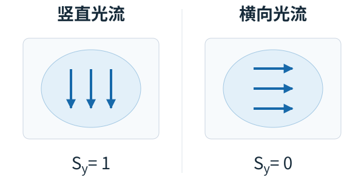






## 1. 问题与背景
{: #problem }

装水的薄壁塑料杯要求夹持力在狭窄区间内变化：太小会滑，太大则留下不可恢复的形变。倾倒时液体载荷和重力力矩不断改变，即使杯子没有掉落，也可能在夹爪内逐渐转动，使杯口偏离目标容器。论文把这一问题归结为持续的夹持调节，而不只是在抓取开始时选定一个力度。（§I）

TactileReflex 在高层规划与夹爪之间加入独立反射层，用双指视觉触觉图像直接调节 effort 与开度。控制规则直接读取图像代理：噪声与接触事件统计用于设置阈值，防滑、减载释放与接触强度保护三个通道负责闭环调节。代理的物理含义和单位在方法节分别说明。

## 2. 核心贡献
{: #contributions }

- **三个可解释触觉代理。** 从灰度差分、光流和加权像素位置提取接触强度、剪切强度和压力中心，分别服务于不同的控制判断。
- **优先级明确的反射调节。** 防滑时加紧，卸载时释放，接触强度过高时保护通道覆盖其他调节；所有动作都落到夹爪 effort／位置接口。
- **统计校准替代任务策略训练。** 约两分钟的静态持握与卸载流程建立阈值；部分阈值可跨已测材料复用，接触强度和 CoP 阈值按目标重新校准。
- **检验“不掉落但失败”。** 在同一手臂倒水轨迹上比较冻结夹爪与实时反射，展示杯内位姿漂移会破坏倒水目标。（§III–V）

## 3. 方法
{: #method }

### 整体思路：高层走轨迹，低层改变握持

先以目标物体校准阈值，再在线计算代理与调节夹爪。高层臂轨迹独立执行；Holding 状态先在防滑与释放之间选择，再检查优先保护。

| 阶段 | 数据与输入 | 处理过程 | 产物 |
| :--- | :--- | :--- | :--- |
| 校准 | 无接触／静态持握图像、滑移与卸载事件 | 统计像素噪声、剪切峰值、CoP 位移 | 阈值及初始参考 |
| 代理计算 | 双指 640×480 灰度图像 | 差分接触区、光流、EMA、双指聚合 | $$F_n,S_y,C$$ |
| 反射判断 | 代理、状态、当前 effort／位置 | 防滑或释放二选一；随后保护可覆盖 | 增减 effort 与行程 |
| 执行 | 高层臂轨迹＋修正后的夹爪命令 | Piper 夹爪运动，下一帧触觉再反馈 | 动态握持 |

### 三个代理量及其单位

两枚 MC-Tac 位于相对指尖，曝光和白平衡固定。对当前灰度图与无接触参考作差，超过像素噪声阈值后经形态学开运算得到接触区 $$U_t$$。将差分的 $$\gamma$$ 次方作为权重 $$W_t(u)$$，主配置 $$\gamma=1.5$$：

$$
F_n^{\mathrm{raw}}=\frac{1}{HW}\sum_u W_t(u),\qquad
C_t=\frac{\sum_u W_t(u)u}{\sum_u W_t(u)}.
$$

这里 $$F_n$$ 是**无量纲图像接触强度**，$$C$$ 是像素坐标。对相邻图像做 Farnebäck 光流，在接触区取竖直分量幅值的中位数：

$$
S_y^{\mathrm{raw}}=\operatorname{median}_{u\in U_t}|v_y(u)|.
$$

$$S_y$$ 是像素运动代理，不是牛顿单位的剪切力。中位数避免直接随接触像素数量增长；防滑通道用原始信号，释放与保护使用 EMA（$$\alpha=0.3$$）平滑信号，双指强度取最大值。CoP 只在双指均有有效接触时计算平均竖直位置。（Eqs. 1–6，Table I）

<a href="https://arxiv.org/pdf/2605.23568v4#page=3">查看原图</a> · <strong>原文 Fig. 1 · 双指视觉触觉与夹爪反射层。</strong> 高层提供臂轨迹，夹爪层读取三类代理并更新 effort 和位置；右侧展示硬件与接触图像。 来源：arXiv:2605.23568v4，PDF 第 3 页。

### 状态机与优先级

系统经过 Idle→Closing→Holding。Closing 以初始 effort 合拢，直到双指接触强度均达到 $$F_{\mathrm{stop}}$$；Holding 才启用以下三个通道。夹爪位置 $$p$$ 越小表示夹得越紧，effort $$e$$ 受上下限约束。（§IV-B，Algorithm 1）

| 通道 | 触发条件 | 对 effort／位置的作用 |
| :--- | :--- | :--- |
| R2 防滑 | 任一有接触的手指 $$S_y^{raw}\ge\theta_s$$ | 增大 $$e$$，减小 $$p$$；限制累计夹紧行程 |
| R3 减载释放 | 双指接触、CoP 参考有效、剪切安静，且 $$\Delta C_y<\theta_c$$ | 减小 $$e$$，增大 $$p$$ |
| R1 接触强度保护 | 平滑后的双指最大 $$F_n>F_{\mathrm{lim}}$$ | 最后执行：减小 $$e$$，增大 $$p$$ |

R2 与 R3 每周期互斥；R1 独立评估。规定保护的 effort 减量大于防滑增量，所以二者同周期触发时，effort 净下降。CoP 基准平时以 0.02 的慢速率更新，释放触发时以 0.3 更新，逐步缩小 CoP 偏差，使释放自行停止。（Eqs. 7–13）

整体约 **12 Hz** 顺序执行双图采集、代理计算、状态判断与发令。离地测试观察到防滑响应约 **170–340 ms**；这比“每周期约 83 ms”包含更多实际感知—执行过程。（§III-B、V-A）

### 校准与参数

像素噪声门限取差分噪声 P98，安静剪切阈值取静态剪切 P95，保护阈值取静态接触强度 P99.9。滑移阈值同时参考噪声上沿和最弱实际滑移；CoP 释放阈值由人工减载事件获得。流程因此包含静态统计和事件响应两部分。（§IV-C、V-A）

| 参数 | 软塑料杯 | 硬量杯 | 跨目标处理 |
| :--- | ---: | ---: | :--- |
| 滑移阈值 $$\theta_s$$ | 0.20 | 0.20 | 本文两材料复用 |
| 安静阈值 $$\theta_q$$ | 0.12 | 0.10 | 接近，可再校准 |
| CoP 阈值 $$\theta_c$$ | −10 px | −3.5 px | 按材料校准 |
| 保护阈值 $$F_{\mathrm{lim}}$$ | 45 | 100 | 无量纲，按材料校准 |
| 初始接触阈值 $$F_{\mathrm{stop}}$$ | 1.3 | 5.5 | 按材料校准 |

来源：Table II，p. 4。该方法无需示范动作训练集；高层倒水轨迹来自动觉示教回放。

## 4. 实验与证据
{: #evidence }

### 代理与校准验证

软杯质量 3.5–5 g、壁厚 0.3–0.5 mm，另一物体是刚性 100 mL 量杯。19 次试验约两万帧覆盖静态持握、移除支撑、手动推动和按压释放。$$\theta_s=0.20$$ 在作者统计的至少 100 次滑移事件与约 6500 静态帧上达到 100% TPR、0% FPR；软杯双指接触强度可相差 7–10 倍，而剪切噪声仍接近。（Tables III–IV）

### 三通道消融

统一过程为抓取→抬起→向下拉→按压释放→侧推；每配置 5 次。成功要求既不掉落，也不出现不可恢复形变或导致溢洒风险的损伤。

| 配置 | 防滑 | 释放 | 保护 | 不掉落且无永久形变 |
| :--- | :---: | :---: | :---: | ---: |
| A | ✓ |  |  | 0/5 |
| B | ✓ |  | ✓ | 0/5 |
| C | ✓ | ✓ |  | 1/5 |
| D | ✓ | ✓ | ✓ | **5/5** |

来源：Table V，p. 6。所有 20 次均无掉落，真正区分方法的是永久形变。A 的 effort 累积到上限；B 在加紧与保护之间大幅振荡；C 的残余剪切使释放条件难以满足；D 由保护先减轻载荷／剪切，为释放创造条件。作者报告 D 对合并 A/B/C 的 Fisher 检验 $$p<0.001$$。

<a href="https://arxiv.org/pdf/2605.23568v4#page=7">查看原图</a> · <strong>原文 Fig. 3 · 四种通道配置的时序行为。</strong> 仅防滑会积累 effort，加入保护仍可能振荡，只有完整组合兼顾防滑和释放；曲线为原文代表试验。 来源：arXiv:2605.23568v4，PDF 第 7 页。

### 动态倒水

两个水量为 45 mL 和 90 mL，各组各 5 次。两种方法先用完整反射稳定持握 2 秒，再记录 effort 和位置；对照将该值冻结，实验组继续更新，手臂回放相同轨迹。对照沿用同一控制器在初始稳定持握时产生的输出。（§V-C）

| 水量 | 冻结夹爪成功 | 反射成功 | 滑移帧比例：冻结→反射 |
| :--- | ---: | ---: | :--- |
| 45 mL | 0/5 | 5/5 | 42±4% → 35±4% |
| 90 mL | 0/5 | 4/5 | 63±1% → 42±5% |

来源：Table VI，p. 7。冻结组均未掉杯，而是杯内持续滑动、杯口偏离目标。反射组唯一失败来自初始偏心导致早期滑移连锁，超过 effort 上限 5000 的余量。90 mL 下峰值剪切仍接近对照，但持续适应维持了 4/5 的正确杯姿，说明任务成功并不要求每一帧零滑移。

## 5. 相关工作
{: #related-work }

GelSight [3]、DIGIT [4] 与 MC-Tac [9] 提供接触图像；本文选择低维代理直接驱动控制，而非先训练物体状态或滑移分类模型。经典触觉自适应抓取 [19] 提供防滑与握持调节思路，本文进一步加入减载释放和优先保护。RT-2 [23]、π₀ [24] 等高层策略出现在架构适配讨论中；本文实证主体是轨迹回放和夹爪反射，直接接入 VLA 仍列为未来工作。引用编号沿用原文。

## 6. Insights · 思考与启示
{: #takeaways }

**核心判断：最有说服力的贡献是把“握稳”和“不过度握持”拆成相互制约的闭环。** 消融中所有配置都不掉杯，只有三通道组合稳定避免永久形变。这比只报告防滑识别准确率更贴近薄壁液体杯的任务要求。

### 统计保护阈值，怎样关联到物体安全？

Table V 支持完整系统在指定软杯与扰动流程下减少损伤，但完整组的峰值接触代理约 67.3，高于 $$F_{\mathrm{lim}}=45$$；倒水也出现 57.9 的峰值。EMA、离散调节和延迟使瞬态越阈实际发生。因此保护的作用是越阈后的反馈纠偏，瞬态峰值仍受延迟影响。

P99.9 描述校准持握状态的统计范围，单凭它不能识别塑料屈曲或损伤阈值。校准时的初始 effort、接触面积、杯壁厚度和位置都可能改变这一映射；这属于从代理到安全性的归因问题。

保持相同传感器与控制增量，交叉改变校准预载与杯壁厚度，记录代理、真实法向力和卸载后的残余形变。若相同统计阈值对应不同损伤边界，预载标准化或独立形变约束便成为将统计保护映射到物体安全的必要补充。

### 相机竖直轴能否持续代表重力与卸载？

$$S_y$$ 只读取一个图像轴的光流，CoP 释放也依赖该轴上的带符号变化。倒水让夹爪坐标相对重力旋转；横向滑移、杯子滚转或接触斑重排都可能改变代理含义。论文成功回放提供特定轨迹的证据，尚未隔离这些几何变化。

<figure class="reading-figure">
  
  <figcaption><strong>阅读重构 · 同样大小的滑移，竖直分量可以为零。</strong> 将 Eq. 6 的竖直光流中位数用于均匀光流示例：两图均为 1 px/frame，方向相差 90°，接触区与其他输入不变。</figcaption>
</figure>

固定杯子、水量和轨迹速度，将传感器／夹持方向旋转 90°，比较原图像轴、光流模长和按姿态投影到重力方向的三个版本。若旋转后原方法滑移触发减少或错误释放增多，而重力投影保持稳定，就支持加入交互坐标表示。

[UMI-FT]() 用标定 wrench 和学习目标力控制握持，TactileReflex 用局部触觉代理快速调节。对薄壁杯，可让高层生成慢速目标，由反射层处理微滑和减载；需要明确二者的命令仲裁与饱和规则。它也为 IF 表示提供一个具体问题：哪些反馈量应随重力／接触坐标变换，哪些可以直接留在传感器坐标。

## 参考与补充

- 正文版本：[arXiv:2605.23568v4](https://arxiv.org/abs/2605.23568v4)，2026-09-23，8 页。
- [官方主页](https://shayfeng.github.io/TactileReflex/) 明确标注 **Accepted at IEEE/RSJ IROS 2026**，2026-11-07 核对。
- [官方代码](https://github.com/shayfeng/tactile-reflex-open-source)；主页分别提供原始／优化控制器、阈值校准及其他传感器后端入口。
- 原图：Fig. 1（p. 3）、Fig. 3（p. 7）；辅助 SVG 根据 Eq. 6 计算不同方向光流的读数，箭长相同，数值为受控示例。

