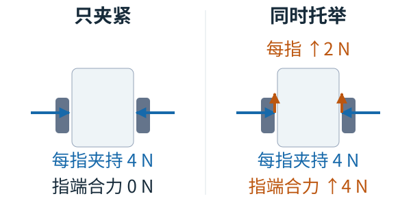
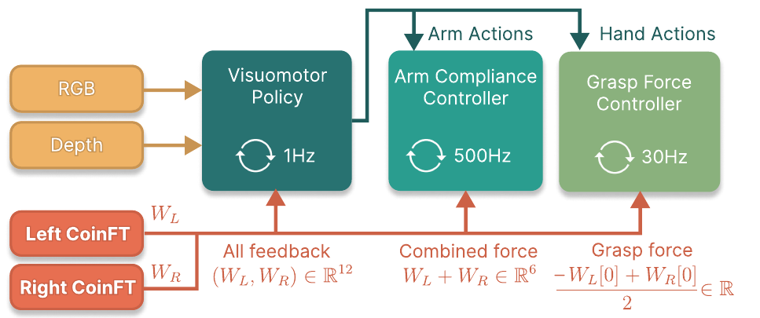
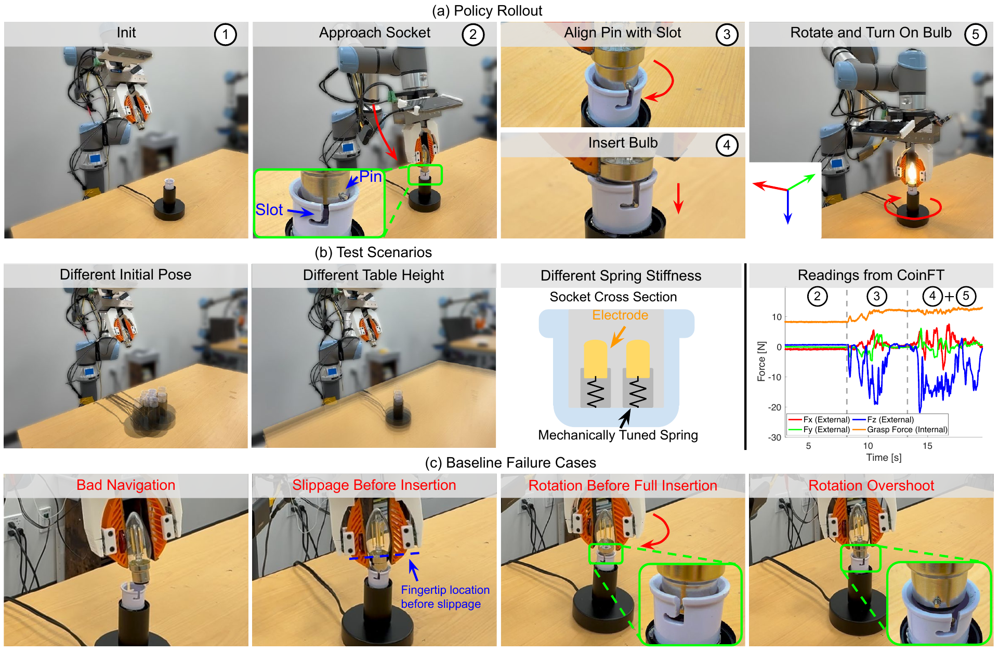






## 1. 问题与背景
{: #problem }

擦白板、穿刺蔬菜和插入灯泡同时要求两种力：机械臂对环境施加的外部接触力，以及两指夹持物体的内部握持力。腕部 F/T 主要测得合力，两个方向相反的夹持力会互相抵消；只控制夹爪开度，又难以适应物体尺寸、形变和摩擦变化。UMI-FT 将六轴力传感器放在每根手指上，使这两类力都能被记录和闭环使用。（§I、IV-A）

它沿用 UMI 的手持示教路线，将“人自然调节握持与接触”的经验转成可执行的控制目标。核心连接是：**手指 wrench 同时进入策略、机械臂柔顺环和夹持力环；策略决定目标，两个较快的控制器实现目标。**

## 2. 核心贡献
{: #contributions }

- **逐指六轴测量。** 两枚 CoinFT 配合 RGB、深度与位姿采集，同时记录外部接触和内部握持。每枚传感器约 2 g、物料成本约 10 美元；该价格为单枚传感器 BOM 成本。
- **ACP 扩展为臂—夹爪协同控制。** 在参考位姿、虚拟目标和刚度之外，预测夹爪宽度与目标握持力，用两个模型控制器执行。
- **三种任务的分层对照。** 保留力输入与握持力调节、移除机械臂柔顺的 DP w/ F，帮助区分握稳物体和维持环境接触的作用。
- **手持采集的场景扩展。** 野外穿刺数据覆盖 15 个场景；硬件和软件从项目页公开。（§III–V）

## 3. 方法
{: #method }

### 整体思路：先区分外力与内力，再区分目标与反馈

策略生成两类设定值：机械臂接收虚拟目标与刚度，夹爪接收目标宽度与握持力。实时双指测量经不同组合后，分别为两条控制环提供反馈。

| 阶段 | 数据与输入 | 训练目标／处理过程 | 产物 |
| :--- | :--- | :--- | :--- |
| 传感器标定 | CoinFT 电容、参考 ATI Gamma 六轴 F/T | 原位 MLP 回归，包含整个手指结构的影响 | 电容→wrench 映射 |
| 手持示教 | RGB、深度、位姿、两指 wrench、开度 | 按 ACP 构造时变三维弹簧的刚度和虚拟目标；提取握持力 | 21 维动作标签 |
| 策略学习 | 视觉与双指力历史、本体信息 | 条件 diffusion policy | 每任务一套目标生成策略 |
| 在线控制 | 策略输出＋实时双指 wrench | 机械臂导纳和夹持力调节 | 臂位姿运动与夹爪速度 |

### 传感器与标定

手持端与机器人端采用相同手指、CoinFT 和 iPhone 设计。主 RGB 与位姿 60 Hz，深度 30 Hz，CoinFT 360 Hz；装置还能采集 10 Hz 超广角图像，但本文策略使用主相机。CoinFT 数据由 USB 连接笔记本记录，时间戳在后处理中对齐，因此当前采集装置仍有线。（§III-A、VI）

CoinFT 的电容—力响应具有非线性，作者在完整手指装配后，以 ATI Gamma 为参考进行原位标定。五层 MLP 隐层宽度为 128/64/36/24/12，输出六轴 wrench；采样覆盖约 25 N 法向、20 N 剪切和 500 mNm 力矩。安装位置靠近指尖，以降低长力臂产生的力矩及传感器分层风险。论文将标定误差称为 MSE，但列出的单位为 N/mNm，与平方误差命名不一致。（§III-B，Fig. 2）

### 两条物理控制通路

两指 wrench 先变换到共同工具坐标系，再相加成为机械臂反馈：

$$
W_{\mathrm{wrist}}=\operatorname{Ad}_{S_1T}^{\top}W_{S_1}
+\operatorname{Ad}_{S_2T}^{\top}W_{S_2}.
$$

<figure class="reading-figure">
  
  <figcaption><strong>阅读重构 · 夹持力相同，指端合力可以不同。</strong> 依据 §IV-A 的双指合力与握持力分工；二维力分解示意，箭头表示手指对物体的力，长度按同一比例绘制，忽略力矩。4 N 与 2 N 为说明用数值。</figcaption>
</figure>

图中的水平分量相消，但每根手指仍在挤压物体；增加切向支撑后，指端合力随之变化，夹持轴上的读数保持不变。逐指测量因此能同时保留握持与外部接触信息。

工具坐标原点置于两指尖中心。通过六维任务空间导纳，机器人表现为虚拟弹簧—质量—阻尼系统。控制器具备六维接口，本文学习与实验使用的可变柔顺仍限于 **3D 平移空间**。（Eq. 1；§IV-A、V）

握持力 $$f_G$$ 取两指在夹持轴上、按符号约定转换后的读数平均；夹爪速度由宽度误差与力误差共同决定：

$$
v_G=K_p(x_G^*-x_G)+K_f(f_G^*-f_G).
$$

因此它同时利用期望开度 $$x_G^*$$ 和期望握持力 $$f_G^*$$。机械臂控制环 500 Hz，夹爪环 30 Hz；原 Fig. 3 标出策略环为 1 Hz。500 Hz 是控制器更新频率，传感器原始采样仍为 360 Hz。（Eq. 2，Fig. 3）

<figure>
  
  <figcaption><strong>原文 Fig. 3 · 三条不同频率的控制通路。</strong> 双指测量进入策略，同时为机械臂合力和夹爪握持力反馈提供输入。 来源：arXiv:2601.09988v1，PDF 第 4 页。 <a href="https://arxiv.org/pdf/2601.09988v1#page=4">原文出处</a>。</figcaption>
</figure>

### 策略表示与训练

每个 RGB／深度输入使用两帧历史；图像调整为 224×224，RGB 做随机裁剪和颜色扰动，经 CLIP 预训练 ViT-B/32 编码。深度复制到三通道并截断至 0.5 m。每指过去 32 步 wrench 经过独立因果卷积得到一个特征向量；视觉与力 tokens 经 Transformer self-attention 融合，再拼接两步末端位姿，条件化 diffusion head。（§IV-B，Fig. 4）

动作共 **21 维＝9D 参考位姿＋9D 虚拟目标＋1D 刚度＋1D 夹爪宽度＋1D 握持力**。九维位姿由三维位置和六维旋转表示组成。离线继承 ACP 的力—运动后处理，得到刚度及虚拟目标；在线重建刚度矩阵，将矩阵和虚拟目标送往机械臂控制器，将宽度和目标力送往夹爪控制器。这些输出都具有执行语义。（§IV-B）

## 4. 实验与证据
{: #evidence }

### 任务与比较条件

平台为 UR5e＋WSG50＋UMI-FT 手指。白板擦拭 275 条示范，五种测试条件各 5 次；五次擦拭后剩余绘迹少于合计 1 cm×1 cm 算成功。西葫芦穿刺 200 条实验室示范，四种条件各 5 次；完整穿透且旋转小于 45° 算成功。灯泡插入 200 条示范，普通条件 10 次、桌高及更硬灯座各 5 次，以灯泡点亮为成功。（§V）

所有基线均用 RGB 和深度。DP w/ F 同时拥有 wrench 输入及握持力调节，但移除机械臂柔顺；DP 不用力观察，仅控制夹爪位置；DP w/ CM 用接触麦克风的动态信号。即使策略不用力输入，实验仍由 CoinFT 执行统一力安全阈值。（§V）

| 方法 | 白板擦拭 | 西葫芦穿刺 | 灯泡插入 |
| :--- | ---: | ---: | ---: |
| UMI-FT＋ACP | **23/25，92%** | **16/20，80%** | **19/20，95%** |
| DP w/ F | 7/25，28% | 14/20，70% | 12/20，60% |
| DP | 4/25，16% | 6/20，30% | 0/20，0% |
| DP w/ CM | 0/25，0% | 移除：接近阶段持续掉落 | 4/20，20% |

来源：Tables I、II、IV，pp. 6–7。相对 DP w/ F，完整方法分别提高 **64、10、35 个百分点**。擦拭和插灯更依赖维持外部接触；穿刺中保留力输入和握持调节的基线已达 70%。作者提出蔬菜自身柔顺可能减小手臂柔顺的额外收益，这是解释假设。（§V-B）

<figure>
  
  <figcaption><strong>原文 Fig. 8 · 灯泡插入中的接触搜索与失败。</strong> 先保持接触搜索槽口，再插入、压缩弹簧并旋转；合力与握持力曲线反映不同物理作用。 来源：arXiv:2601.09988v1，PDF 第 8 页。 <a href="https://arxiv.org/pdf/2601.09988v1#page=8">原文出处</a>。</figcaption>
</figure>

灯座的原弹簧需约 30 N，作者将其改为约 15 N；更硬测试条件为 20 N。该数值界定了成功结果适用的插入力范围。窄板擦比训练形状窄 7 mm，ACP 为 5/5、DP w/ F 为 2/5、无力基线为 0/5，体现握持与接触执行对几何变化的适应。（Table I；§V-C）

### 野外数据与证据边界

野外穿刺共 630 条示范、15 个场景；在一个两组训练集均未包含、加入未见杂物的场景中各测 20 次。野外数据训练的 ACP 为 **20/20**，实验室数据训练为 **4/20**，失败主要来自未对准穿刺目标。（Table III）

该结果同时改变数据量与场景多样性。它支持野外采集方案整体改善此测试场景的泛化，但尚不能把 80 个百分点全部归于场景多样性。策略力输入与夹爪闭环的归因见 Insights。

## 5. 相关工作
{: #related-work }

UMI [1] 提供无机器人在场的手持示教框架；CoinFT [5] 提供低成本六轴测量，UMI-FT 针对指尖结构调整传感器与标定。ACP [8] 提供参考／虚拟目标及各向异性刚度表示，本文把它扩展到目标握持力。ManiWAV [3] 用接触声音丰富事件信息，本文的麦克风对照提示动态接触事件和连续力调节服务于不同控制需求。Diffusion Policy [30] 是动作生成基础，传统阻抗／导纳控制 [27,28] 则把模型输出转成快速物理响应。编号沿用原文 References。

## 6. Insights · 思考与启示
{: #takeaways }

**核心判断：本文最有价值的是把臂的外部接触与手的内部夹持接到同一套数据和控制接口。** [ACP]() 负责“在哪里、朝哪个方向柔顺”；UMI-FT 再回答“用多大力握住”。逐指传感使这一分工可观测，可用于之后比较学习策略和触觉反射的职责。

### 握持力的收益，来自输入还是执行？

穿刺从 DP 的 6/20 增至 DP w/ F 的 14/20，完整 ACP 再到 16/20。前一步同时增加 wrench 观察与握持力闭环，后一步增加手臂柔顺。因此实验强力支持“力感知＋夹持调节”这一组合，但没有单独识别网络读取力的边际收益。

从反馈分工看，接触状态变化可能由高层力条件化捕捉，也可能主要由 30 Hz 夹爪环纠正。最小检验是保持相同握持力控制器，分别训练有／无 wrench 输入的策略；再固定力输入，比较预测目标力与恒定目标力。预期在预抓取、尺寸变化小的穿刺任务中，低层闭环贡献较大；在夹持位置变化或接触阶段切换时，策略条件化可能更关键。这是待验证机制预测。

### 薄壁杯还需要局部接触信息

UMI-FT 输出牛顿意义的目标握持力，适合把任务意图变成可跟踪设定值；薄壁杯还需要处理载荷下降、微滑和局部屈曲。[TactileReflex]() 用触觉代理在线加紧或释放，可作为其下层补充。阅读联想是让 UMI-FT 式策略提供慢目标，反射层限制其短时变化。

关键边界是两指平均力可能相同而局部压力分布不同：杯沿、接触面积与偏心夹持改变屈曲风险。可固定平均握持力，改变接触高度／面积，并测量形变与滑移；再比较仅双指 wrench 与加入触觉压力分布的控制。若相同力下损伤显著不同，便说明需要补充空间接触信息，而非只提高力跟踪精度。

## 参考与补充

- 正文版本：[arXiv:2601.09988v1](https://arxiv.org/abs/2601.09988v1)，2026-01-15，9 页。
- 发表信息：**ICRA 2026**，见[官方主页](https://umi-ft.github.io/)。
- [官方代码与硬件](https://github.com/real-stanford/UMI-FT)。
- 原图：Fig. 3（p. 4）、Fig. 8（p. 8）；辅助 SVG 以 §IV-A 的力分解为依据，用同尺度力箭头解释内力与合力。

