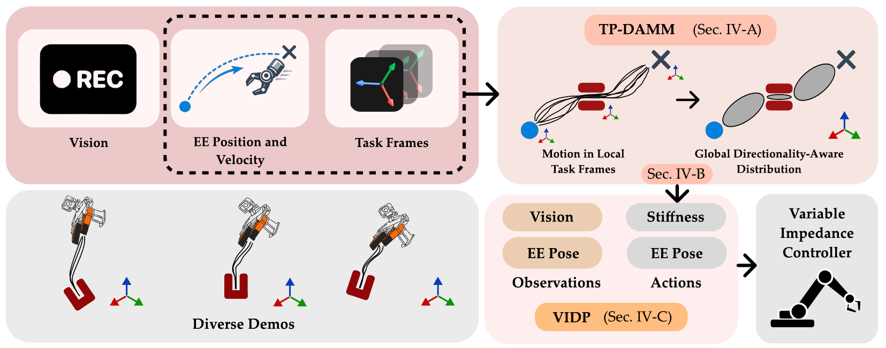
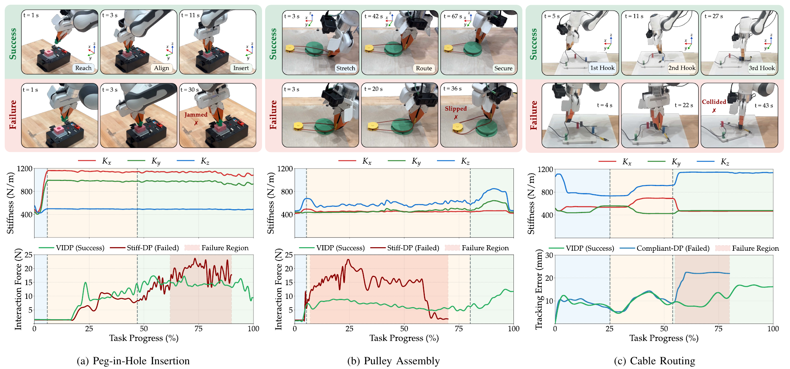
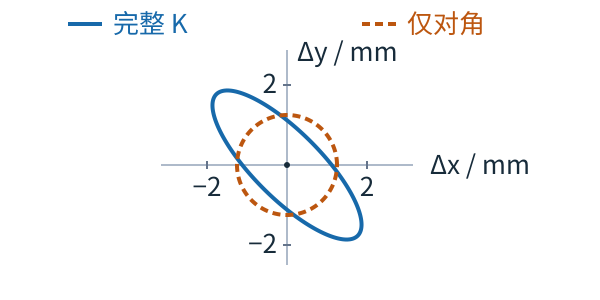






## 1. 问题与背景
{: #problem }

从多条示范的位移方差推断柔顺性，有一个前提：轨迹差异确实反映任务允许的偏差。当孔位、滑轮或线缆挂钩在不同示范中移动时，全局轨迹方差还包含场景几何变化；来回经过同一位置的运动又可能属于不同阶段。直接把这些变化当成“可以变软”的依据，会混合三种不同来源。

VIDP 用任务参考系对齐布局，用运动方向区分重叠阶段，再把局部位置协方差映射为刚度标签。扩散策略从视觉和末端状态共同预测位姿与平移刚度，使无 F/T 示范也能监督可变阻抗控制。（§I、IV）

## 2. 核心贡献
{: #contributions }

- TP-DAMM 将任务参数化参考系与方向感知聚类结合，处理布局变化及同位置反向运动。
- 将融合位置协方差的逆映射为可执行刚度范围，产生随阶段变化的平移刚度监督。
- Diffusion Policy 联合输出位姿和刚度的 Cholesky 表示，在线使用阻抗控制与异步动作块衔接。
- 在插孔、滑轮装配和线缆绕钩中评估成功率、接触力、跟踪误差和机械功，明确比较刚度固定过高与过低的不同失败方式。（Tables I–III，Figs. 3–5）

## 3. 方法
{: #method }

### 整体思路：先对齐几何，再解释剩余方差

TP-DAMM 在离线阶段对齐示范并生成刚度标签；部署策略从视觉和末端状态预测这些标签。方法将低方差方向解释为需要高跟踪精度的方向，再通过预设映射赋予刚度尺度。

| 阶段 | 输入 | 处理／目标 | 产物 |
| :--- | :--- | :--- | :--- |
| 示范采集 | UMI 运动、视觉、Vicon 位姿 | 收集不同空间布局的任务 | 位置、速度与候选参考系 |
| TP-DAMM | 各参考系局部位置、单位速度方向 | 贝叶斯混合聚类、跨参考系融合 | 分阶段位置协方差 |
| 刚度标注 | 协方差逆的特征方向／幅值 | 映射到刚度范围并平滑 | 平移刚度标签 |
| 策略学习／部署 | RGB＋末端位姿历史 | 去噪生成位姿与刚度动作块 | 可变阻抗控制目标 |

<figure>

<figcaption><strong>原文 Fig. 1 · 从多布局示范到柔顺策略。</strong> TP-DAMM 先产生任务分布，刚度标签与位姿共同监督策略，在线由视觉和末端状态生成控制目标。 来源：arXiv:2608.06210v1，PDF 第 3 页。 <a href="https://arxiv.org/pdf/2608.06210v1#page=3">原文出处</a>。</figcaption>
</figure>

### 任务参考系与方向感知聚类

第 $$j$$ 个参考系由旋转 $$A_j$$ 和平移 $$b_j$$ 定义。位置需完整刚体变换，而方向只旋转：

$$
x_t^{(j)}=A_j^{-1}(\xi_t-b_j),\qquad
u_t^{(j)}=\frac{A_j^\top\dot\xi_t}{\|A_j^\top\dot\xi_t\|}.
$$

每个混合成分用单位球面上的 Fréchet mean 描述典型运动方向，再以 Riemannian log map 的模长表示角偏差。增广特征为三维位置加一个方向偏差标量；协方差采用位置块与方向方差相互独立的块对角形式。（Eqs. 5–8）

局部高斯通过 Product of Gaussians 融合，跨参考系相加的是精度矩阵。推断采用带 split/merge 的 Gibbs sampler，位置参数用 Normal-Inverse-Wishart、方向方差用 Inverse-Gamma 先验；高维联合样本不足时用 SVD 降维支持分裂提案。（Eq. 9，Algorithm 1）

插孔任务的参考系为起点与孔；滑轮为起点、终点和滑轮；绕线为三个挂钩。它们是由任务结构预先指定的几何锚点。（§V-A）

### 从统计方差到刚度

对融合空间协方差求逆并分解：

$$
\hat\Sigma_m^{-1}=V_m\Lambda_mV_m^\top,\qquad
d_{m,i}=\kappa_{\min}+(\kappa_{\max}-\kappa_{\min})
\frac{\lambda_{m,i}-\lambda_{\min}}{\lambda_{\max}-\lambda_{\min}}.
$$

这里的最小／最大特征值来自整个任务的全部混合成分。高位置精度对应较大刚度，允许更多位移的方向对应较小刚度；再以 $$K_m=V_m\operatorname{diag}(d_{m,i})V_m^\top$$ 重构并作时间平滑。（Eqs. 10–11）

最终刚度的方向性取决于非对角项是否保留：§IV-B 在完整矩阵重构后，将最终标签写成 $$\operatorname{diag}(K_x,K_y,K_z)$$，而 §IV-C 又用六个 Cholesky 元素表示完整对称平移刚度。正文未解释非对角项是否保留，其方向性后果见 Insights。

### 扩散动作与实际控制

每步动作 15 维：3D 位置、6D 连续旋转表示、6D 上三角因子 $$U$$，在线重构 $$K_{\mathrm{trans}}=U^\top U$$。该形式保证对称半正定；严格正定还要求因子非奇异，正文未给出对角约束的具体实现。旋转与零空间刚度固定，仅学习平移部分。（§IV-C、V-A）

腕部 RGB 经可训练的 CLIP-ViT 与 attention pooling，末端位姿历史经 MLP 编码。1D temporal U-Net 学习 DDPM 噪声预测 MSE，优化器 AdamW、cosine 学习率日程。部署使用 DDIM，并引入 RTC 异步动作块：将模型解释为条件 flow，通过上一动作块与新块的加权一致性项引导衔接。（Eqs. 12–13）

底层将 Cartesian 刚度／阻尼经 Jacobian 投影为关节阻抗增益，并加入动力学补偿和固定零空间项。阻尼比设为 0.707。F/T 不作为示范标签来源或策略输入；机械阻抗仍通过机器人自身的状态与力矩执行产生接触响应。（Eqs. 1–2，§V-A）

## 4. 实验与证据
{: #evidence }

### 数据与平台

示范用 UMI、GoPro Hero 11 与 Vicon 采集；部署用 Franka Panda、定制手指，工作区 65×75 cm。插孔 333 条、滑轮 319 条、绕线 307 条示范，数量为删除人工操作错误和 Vicon 噪声后的结果。训练使用 RTX 4090，部署电脑为 Ryzen 7 6800H 与 RTX 3070 Ti。（§V-A）

两个基线共享 Diffusion Policy：Stiff-DP 各平移轴固定 1200 N/m，Compliant-DP 固定 400 N/m；VIDP 随阶段调整。每任务每方法 20 次 rollout，布局有变化。论文未在实验设置中明确逐项说明 RTC 是否也用于两个基线，解释完整系统收益时需要保留这一归因条件。

### 成功率与物理指标

| 方法 | 插孔 | 滑轮装配 | 线缆绕钩 |
| :--- | ---: | ---: | ---: |
| Compliant-DP | 3/20（15%） | 8/20（40%） | 12/20（60%） |
| Stiff-DP | 16/20（80%） | 7/20（35%） | 0/20 |
| VIDP | **16/20（80%）** | **14/20（70%）** | **15/20（75%）** |

来源：Table II，p. 6；计数由明确的 20 次测试和原百分比换算。VIDP 插孔成功率与高刚度基线相同，滑轮增加 35 个百分点，绕线增加 75 个百分点。绕线的 Stiff-DP 在第三挂钩阶段全部失败，代表其刚度与变形约束不匹配。

<figure>

<figcaption><strong>原文 Fig. 3 · 三类任务的阶段行为。</strong> 每项选取代表性的成功与失败轨迹，比较刚度、力或跟踪误差；这张案例图与总体成功率表承担不同证据作用。 来源：arXiv:2608.06210v1，PDF 第 7 页。 <a href="https://arxiv.org/pdf/2608.06210v1#page=7">原文出处</a>。</figcaption>
</figure>

成功绕线试次的总跟踪误差从 Compliant-DP 的 **10.4±2.3 mm** 降到 VIDP 的 **8.7±1.7 mm**，z 轴从 2.3±0.6 降至 1.6±0.2 mm。（Table III）Fig. 4 展示成功试次的峰值／平均接触力分布；插孔与滑轮中 VIDP 峰值力更低、更集中。Fig. 5 的绝对机械关节功以 J 为单位，同样只统计成功执行。这些条件统计解释成功运行时的控制代价，不等同于覆盖全部失败的总体安全率。

### 聚类证据与消融范围

TP-DAMM 在三任务的局部／全局方向方差均最低。滑轮局部方向方差由 TP-GMM 的 0.726 降至 0.581，cosine similarity 从 0.732 升至 0.781；绕线为 1.028→0.845、0.601→0.662，coverage 达 1.000。（Table I）

这组结果支持更一致的运动分簇。论文没有将不同聚类器产生的刚度标签逐一用于真机策略，也没有同骨干的“固定刚度＋RTC”独立表格，因而聚类质量、刚度自适应和块间平滑分别贡献多少，仍需进一步拆分。

## 5. 相关工作
{: #related-work }

原文 [12] 将位置协方差的逆用于控制精度分配；[27] TP-GMM 提供任务参考系， [28] DAMM 提供方向区分，VIDP 将两者组合。[11] Diffusion Policy 提供动作生成骨干，[31] RTC 提供异步连续执行。[20] ACP 使用力信息构造近似柔顺标签；[18] 对应显式选择刚度的示教路线。相对 [CompACT]()、[DIPCOM]()，VIDP 更关注如何从不同空间布局的运动数据中产生柔顺标签。编号沿用原文 References。

## 6. Insights · 思考与启示
{: #takeaways }

### 对齐消除了几何混杂，但方差是否就是柔顺性？

TP-DAMM 的明确价值是先对齐几何、再区分阶段。Table I 测量的是分簇一致性，Table II 验证这套标签与执行系统有用；它们尚未直接辨识真实机械刚度。剩余方差也可能来自示范者习惯、未记录的任务条件或追踪噪声。

考虑一个可辨识性反例。在线性准静态模型 $$\delta x=K^{-1}\delta f$$ 下，$$\Sigma_x=K^{-1}\Sigma_fK^{-\top}$$。即使任务参考系完全正确，只观测 $$\Sigma_x$$ 仍不能唯一确定 $$K$$：把 $$K$$ 放大 $$c$$ 倍、激励力协方差放大 $$c^2$$ 倍，可得到相同位置协方差。位置协方差因此确定的是与扰动分布相关的统计约束；把它解释为任务精度先验是可行的，恢复真实刚度则还需要激励力信息。

固定几何与意图，分别改变示范过程的外力扰动和追踪噪声。若所得刚度随这些因素明显变化，映射更像统计精度先验。进一步以少量受控扰动力—位移探测校准其物理尺度，就能比较纯运动标签与加入 force context 的版本。这对应 IF 表示的一个具体分工：参考系能隔离几何变化，力响应数据才有机会补足物理辨识。

### 刚度方向经过坐标变化后还能保留下来吗？

由特征向量重构的完整矩阵应满足旋转变换 $$K'=RKR^\top$$。若最后只保留世界轴对角项，这种等变性会丢失。例如二维 $$K=\operatorname{diag}(1200,400)$$ N/m 旋转 45° 后得到对角均为 800、非对角幅值为 400 的矩阵；删去非对角项就变成 $$800I$$，原来软硬方向的差异消失。

<figure class="reading-figure">
  
  <figcaption><strong>阅读重构 · 对角投影会抹掉倾斜的软硬方向。</strong> 由 Δx = K⁻¹Δf 计算 1 N 等幅扰动的位移轮廓：diag(1200,400) N/m 旋转 45° 后，与只取其对角项的 800I 对照。该图说明对角化的条件后果，VIDP 是否实际执行这一步仍待实现澄清（§IV-B–C）。</figcaption>
</figure>

完整矩阵的 1 N 位移轮廓沿软轴延伸到 2.5 mm，沿硬轴只有约 0.83 mm；对角投影将所有方向改为 1.25 mm。丢失的正是“沿一个方向让位、沿正交方向保持约束”的差别。

§IV-B 的对角标签表述与 §IV-C 的完整 Cholesky 表示需要实现澄清。最小测试是将同一任务整体旋转 45°，比较预测刚度与 $$RKR^\top$$，并控制轨迹、刚度特征值与 RTC 完全相同，分别执行完整矩阵和对角投影。它能直接检验 IF 表示保留方向性的价值，避免把姿态泛化与柔顺泛化混在一个成功率里。

[CompVLA]() 提供另一条几何控制接口，[UMI-FT]() 则同时观察双指力并调节夹持。对本系列而言，VIDP 最适合放在“无力标签的精度先验”位置，与真实接触反馈形成互补。论文自身还指出预设参考系、自交轨迹和视觉遮挡是当前边界。（§VI）

## 参考与补充

- **正文版本：** [arXiv:2608.06210v1](https://arxiv.org/abs/2608.06210v1)，2026-08-06，8 页。预印本。
- **图源：** 原 Fig. 1（p. 3）、Fig. 3（p. 7）。自绘图依据 §IV-B–C 的矩阵表示问题，计算等幅外力对应的位移轮廓；完整矩阵与对角投影采用同一毫米尺度。

