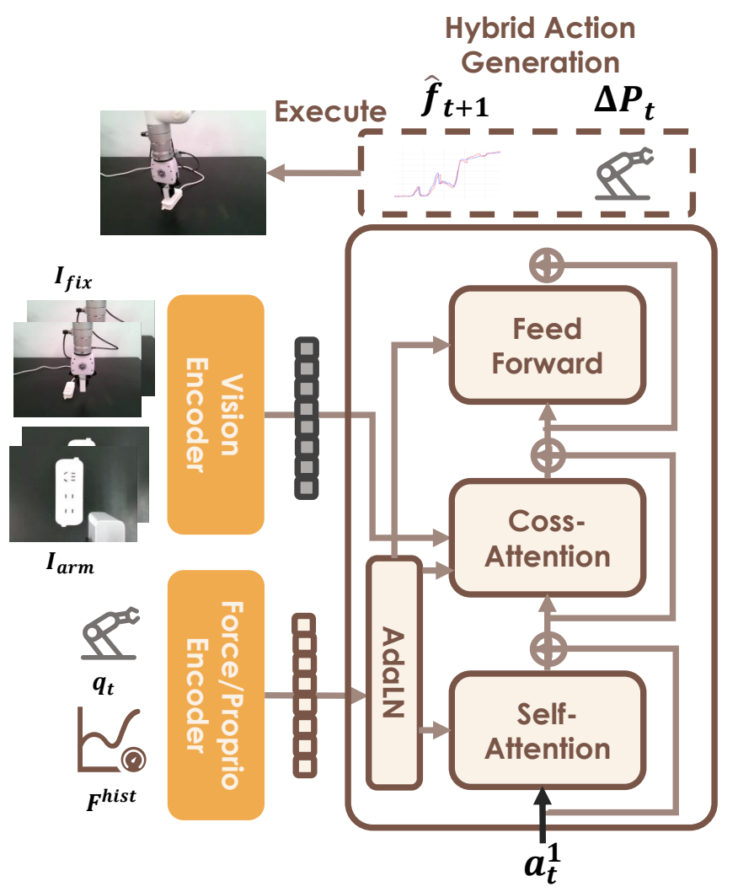
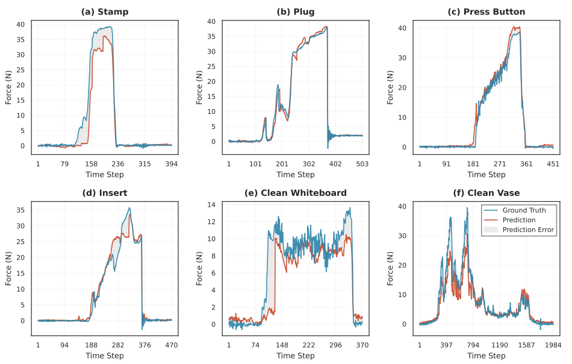
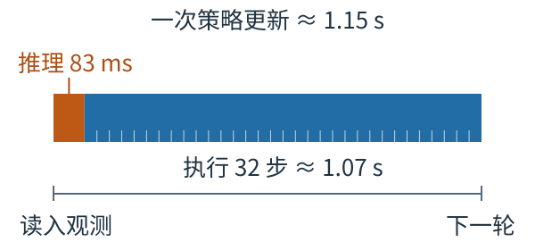






## 1. 问题与背景
{: #problem }

接触操作同时需要两种能力：先找到物体的交互位置，再根据阻力、摩擦与表面形状调整运动。视觉擅长前者，腕部六轴力／力矩能补充后者。ForceFlow 将这两层任务分开：上层 VLM 指出接近位置，下层 flow-matching 策略结合视觉、本体状态和力历史生成动作。（§1、3）

论文的核心是**力历史调制网络、运动与后续力联合生成、视觉定位与接触执行分阶段**。下层采用 ResNet-18 与 DiT，从示范学习接触策略；语言指令主要用于上层定位。理解它的“force control”，应从最终发给机器人的运动接口入手。

## 2. 核心贡献
{: #contributions }

- **非对称融合：** 力历史和本体状态构成全局向量，通过 AdaLN 调制 DiT；双视角图像构成序列条件，通过 cross-attention 被动作特征读取。
- **联合生成：** 在 13 维混合空间中学习 flow matching，同时预测 6 维位姿增量、1 维夹爪命令和 6 维下一步 wrench。
- **V2F 分阶段执行：** VLM 负责目标定位；到达指定空间位置后，交给局部接触策略。
- **真实任务验证：** 六项任务的平均成功率为 81.67%，ForceVLA 为 45%；另外报告执行力偏差、物理变化与空间 OOD 测试。（§3–4）

## 3. 方法
{: #method }

### 输入与两阶段分工

| 阶段 | 输入 | 处理与输出 | 切换／执行条件 |
| :--- | :--- | :--- | :--- |
| Approach | 全局图像、语言指令；几何转换还用深度与标定 | VLM 输出目标像素，转换为机器人基座坐标中的 3D 接近点，运动规划器导航 | 到达空间 waypoint 后交接 |
| Interaction | 腕部／固定相机图像、末端位姿与夹爪状态、六轴力历史 | ForceFlow 生成运动与后续 wrench 序列 | 执行运动块，再采集条件重规划 |

上层采用 Embodied-R1。论文将示范初始帧中的交互区域人工标为二维坐标，以“图像＋指令→坐标”的 VQA 格式微调 VLM。推理时 VLM 定位运行一次，V2F **按位置到达触发**，没有将力阈值设为切换条件。（§3.2、4.4；Appendix G.2）

接触策略使用两帧视觉与本体观测、10 步力历史。力信号来自 xArm 末端六轴 F/T 传感器，包含三个力与三个力矩分量；本体状态为 6 维末端位姿加夹爪状态。这里的力历史在单次执行中提供短时上下文。（Table 6；Appendix A.2、G.3）

### 力走调制，视觉走上下文

<figure>
  
  <figcaption><strong>原文 Fig. 2 · 两种模态进入网络的方式不同。</strong> 力／本体条件调制动作特征，视觉提供可选择读取的上下文；执行接口按 §3.3 读取其中的运动分量。来源：<a href="https://arxiv.org/pdf/2605.11048v2#page=4">ForceFlow，arXiv:2605.11048v2，PDF p. 4</a>；版权归原权利人。</figcaption>
</figure>

力历史 $$F_t^{\mathrm{hist}}\in\mathbb R^{10\times6}$$ 被展平为 60 维，经两层 MLP 编码为 128 维。两帧本体状态分别编码为 64 维，再展平为 128 维；拼接得到 256 维 $$c_{\mathrm{vec}}$$。它通过 AdaLN 改变各层特征的尺度与偏移：

$$
\operatorname{AdaLN}(h,c_{\mathrm{vec}})
=\gamma(c_{\mathrm{vec}})\odot\operatorname{LayerNorm}(h)+\beta(c_{\mathrm{vec}}).
$$

力历史由 **MLP 整体编码**。视觉端每个视角、每帧经 ResNet-18 得到 256 维特征，同一时刻的两个视角拼接为 512 维；两帧组成 $$c_{\mathrm{seq}}\in\mathbb R^{2\times512}$$。动作特征作为 query，视觉序列作为 key／value。这里的视觉序列以观测帧为粒度。（Table 6；Appendix B.2；官方 `pipeline/train.py`）

DiT 使用 12 层、384 维隐藏状态、6 个 attention heads，输出头为 MLP。非对称结构为力与视觉安排不同的信息入口，作者用它缓解高维视觉对低维力信号的掩盖。（§3.3）

### 混合空间的 flow matching

每个时间步的混合目标写为

$$
a_t=[\Delta p_t,g_t,f_{t+1}]\in\mathbb R^{13},
$$

其中 $$\Delta p_t$$ 包含平移和转动增量，$$g_t$$ 为夹爪命令，$$f_{t+1}$$ 为示范中下一步实际测得的六轴 wrench。公开数据加载器将力标签相对动作索引后移一步，并在 episode 末尾用边界值补齐；力目标取自 `data.force`。（§3.3；`dataset/xarm_dataset.py`）

令 $$a^0$$ 为归一化后的示范混合序列，$$a^1\sim\mathcal N(0,I)$$ 为噪声，flow 时间为 $$k$$：

$$
a^k=(1-k)a^0+ka^1,\qquad u^k=a^1-a^0,
$$

$$
\mathcal L_{\mathrm{FM}}=
\mathbb E\left[\left\|v_\theta(a^k,k,c_{\mathrm{vec}},c_{\mathrm{seq}})-(a^1-a^0)\right\|^2\right].
$$

推理从 $$k=1$$ 积分至 $$k=0$$，联合生成 64 步运动与预测力。论文使用 Euler 求解；当前公开推理脚本设为 20 次采样步。这里 flow 的“速度”是生成空间中的向量场，与机器人实际速度命令是两个层次。（Eq. 1；Appendix B；`pipeline/inference.py`）

**机器人执行位姿增量和夹爪命令；预测 wrench 用于联合学习与记录。** §3.3 明确说明其不直接参与底层力控。公开脚本将动作的前 7 维交给执行接口，后 6 维反归一化后打印、保存；`XarmEnv.step` 累加位姿增量，再调用 `set_position`。论文所称 active compliance 主要体现为力条件下的运动调整，而非预测刚度矩阵或向控制器下发目标 wrench。

### 数据、训练与执行节奏

平台为 xArm6、末端六轴 F/T、固定视角 L515 和腕部 D435。每任务采集 50–100 条示范，遥操作工具为 SpaceMouse／Quest Pro，并提供实时力曲线供操作者观察。记录频率 30 Hz，双视角原始图像为 320×240；状态、动作和力使用 MinMax 归一化，图像缩放到 $$[-1,1]$$。（Appendix A、G.3）

论文报告训练 100,000 步，AdamW 学习率 $$10^{-4}$$，余弦调度，权重衰减 0.01，梯度裁剪 1.0，bf16；计算节点配有 4 张 RTX 4090，每任务约 8–10 小时。Table 6 标注 batch 64 为 per-device，A.2 又写 effective batch 64，复现时需要确认并行方式。当前公开配置为单卡、batch 128、图像 resize 至 224×224，不能直接视为论文实验配置。（Table 6；`configs/xarm.yaml`）

预测 64 步后执行前 32 步，再重新推理。Table 10 给出单次推理约 83.3 ms、底层动作频率 30 Hz、重规划周期约 1.150 s。V2F 定位约 1805 ms，按任务运行一次。下文的时间图说明这些量如何对应。

## 4. 实验与证据
{: #evidence }

### 六任务结果与指标含义

主实验每任务 20 次测试。四项短接触任务为盖章、电源插头、按压瓶泵、USB 插入；两项持续接触任务为擦白板和擦曲面花瓶。公开数据卡列出的六任务示范数如下；黄瓜削皮在论文中另作定性展示。（Tables 1–2；Appendix A；官方数据卡）

| 任务 | 示范数 | ForceVLA 成功率 | ForceFlow 成功率 | ForceFlow 力偏差 |
| :--- | ---: | ---: | ---: | ---: |
| 盖章 | 100 | 20% | 85% | 10.61 N |
| 插电源插头 | 100 | 70% | 90% | 3.58 N |
| 按压瓶泵 | 50 | 65% | 90% | 5.03 N |
| 插 USB | 50 | 15% | 60% | 21.79 N |
| 擦白板 | 100 | 100% | 100% | 4.59 N |
| 擦花瓶 | 50 | 0% | 65% | 3.76 N |
| 六任务平均 | — | **45.00%** | **81.67%** | **8.23 N** |

平均成功率增加 **36.67 个百分点**，相对增幅约 81.5%。原摘要的“37% improvement”按表格应理解为约 37 个百分点，项目主页的结果说明也采用 percentage points。

| 其他配置 | 平均成功率 | 平均力偏差 |
| :--- | ---: | ---: |
| π₀.₅ | 24.17% | 23.58 N |
| ACT | 8.33% | 28.38 N |
| Diffusion Policy | 30.83% | 21.42 N |
| ForceVLA | 45.00% | 23.31 N |
| ForceFlow 去掉力 | 44.17% | 22.67 N |

力偏差（Force Cost）比较的是**执行所得的力统计量与专家参考的绝对差**。短接触任务取单次执行的最大力幅值；持续接触任务仅在力幅值大于 5 N 的阶段取平均，再在 20 次试验上求平均绝对偏差。它不是网络预测 wrench 的误差，也不是全轨迹逐时刻跟踪误差。ForceFlow 将该平均成本从 ForceVLA 的 23.31 N 降至 8.23 N，约下降 64.7%。（Eq. 2；Table 2）

<figure>
  
  <figcaption><strong>原文 Fig. 6 · 单次执行中的预测与实测力。</strong> 两者随接触阶段共同变化，花瓶峰值等处仍可见偏差；此图与 Table 2 的执行力成本是不同评价。来源：<a href="https://arxiv.org/pdf/2605.11048v2#page=9">ForceFlow，arXiv:2605.11048v2，PDF p. 9</a>；版权归原权利人。</figcaption>
</figure>

### 物理变化与空间变化

物理 OOD 保持位置不变，替换不同刚度／厚度的擦具和不同高度／触发条件的瓶泵，每任务 10 次。ForceFlow 在按压、白板、花瓶上的成功率为 **80%、100%、60%**；ForceVLA 为 **40%、90%、0%**。（Table 3）

空间 OOD 将目标放到与训练区域不相交的位置。Table 4 中，无 V2F 的全部方法均为 0%。更有比较意义的是附录为基线也加入相同 V2F：每任务 10 次，ForceFlow＋V2F 在按压、插头、白板上为 **40%、10%、50%**，ForceVLA＋V2F 为 **20%、0%、20%**，其余三种基线为 0%。这些结果支持定位与接触分工的价值，也显示插头的空间泛化仍然困难。（Table 9）

### 历史、预测与视觉消融

| 盖章变体 | 成功率 | 力偏差 |
| :--- | ---: | ---: |
| 完整模型 | 85% | 10.61 N |
| 力历史缩为单步 | 55% | 15.50 N |
| 去掉力预测 | 80% | 12.52 N |
| 单步力＋无预测 | 40% | 18.21 N |

Table 5 在盖章任务中显示，历史窗口对完成率的影响更大；力预测对力偏差也有改善。85% 与 80% 在每任务 20 次的设置下只差一次成功，不能据此确定小幅增益的稳定程度。Fig. 7 的个例展示了单步力条件下的振荡与峰值。

接触阶段屏蔽视觉后，盖章／白板仍为 80%／90%，插头／USB／花瓶均降至 0%。力感知保留了部分轴向调节能力，复杂几何仍需要视觉定位。Table 7 的 caption 写每任务 10 次，却列出按压 15%，存在试验数与百分比不一致。（Appendix E）

## 5. 相关工作
{: #related-work }

- **Flow Matching（Lipman et al., 2022）、DiT（Peebles & Xie, 2023）、CleanDiffuser（Dong et al., 2024）：** 分别提供生成目标、Transformer 条件化骨干与实现基础。
- **ACT（Zhao et al., 2023）、Diffusion Policy（Chi et al., 2023）：** 同属示范驱动的动作序列策略，本文在动作表示和条件输入中纳入力信息。
- **ForceVLA（Yu et al., 2025）：** 主要力感知基线，与 ForceFlow 共享双视角 RGB、末端状态和六轴 wrench 输入；具体骨干、融合与生成机制不同。
- **FoAR（He et al., 2025）、RDP（Xue et al., 2025）、ViTaL（Zhao et al., 2025）：** 从接触响应、视觉触觉快慢策略或接触泛化切入，传感模态与本文并不完全相同。
- **Embodied-R1（Yuan et al., 2025）：** 为上层语义定位提供基础；接触执行由独立的 ForceFlow 完成。

相关工作沿用原文作者—年份引用，见 References（pp. 11–13）。

## 6. Insights · 思考与启示
{: #takeaways }

**ForceFlow 最有参考价值的是把力历史放到网络调制路径，并用后续 wrench 给动作学习增加监督。** 评估这种设计时，需要分别看信息是否被用到、预测是否帮助动作、反馈多久才能改变下一次动作。

### 联合预测支持什么程度的“物理理解”？

混合目标学习的是示范分布中的联合关系，可写作 $$p_\theta(\Delta p,g,f'\mid O)$$。它让动作和后续力共享生成过程，但没有单独给出可查询任意候选动作的 $$p(f'\mid O,a)$$，也没有将预测力接入在线搜索或目标力误差反馈。Table 5 支持辅助预测改善盖章的力统计量；Fig. 6 显示预测与实测接近。这两项证据尚未区分“学会动作响应”与“利用当前力的时间相关性预测下一步”。

一个有区分力的检验是在相近接触状态下改变动作方向或幅值，对比下一步实测 wrench；同时加入“下一步力等于当前力”的 persistence 基线，并按接触建立、滑动、卸载分段统计误差。如果预测只在稳态准确，对突然改变动作的响应不敏感，就更适合解释为示范内的辅助表征，而非可用于反事实规划的接触动力学。

非对称融合的归因也应单独检验。现有主要消融改变力历史、预测目标或视觉可用性，没有在相同骨干与预算下直接比较 AdaLN 和拼接／force-token 融合。匹配 ForceVLA 的传感输入有助于比较完整系统，但还不足以将全部增益归给某一种融合机制。（Tables 5、7–9；Appendix F）

### “反应快”应按策略更新周期判断

<figure class="reading-figure">
  
  <figcaption><strong>阅读重构 · 推理时间只是一次更新的一部分。</strong> 依据 Table 10，以 83.3 ms＋32／30 s 计算长度；刻线表示 32 个动作步，图示为报告值重构。</figcaption>
</figure>

代码在每个执行步读取传感器，但在执行完 32 步后才再次调用策略；最近 10 步力数据用于下一轮条件。因而，83.3 ms 的网络推理与 30 Hz 的动作执行，不能合并称为 30 Hz 的力反馈策略。约 1.15 s 的重规划周期，也长于 Table 10 中 Diffusion Policy 的 0.377 s，尽管后者单次推理更慢。

这会直接影响突然碰撞、材料刚度突变或滑移后的反应窗口。要判断能否适配更快的接触变化，应固定模型与初态，改变执行块长，并同时报告重规划时延、峰值力和任务完成率；若需要块内修正，可以研究独立的快速力反馈层。由 ODE 求解器的确定性，也不能直接推出闭环稳定性：给定噪声初值的确定积分，与接触系统在延迟和扰动下的稳定是不同问题，后者需要分析[闭环动力学与能量收支](#passivity)。

Force Cost 同样需要配合时序指标读。持续任务的接触期平均力可以掩盖短时过冲，接触外的失联时段又被阈值排除；相同平均偏差可对应不同轨迹。Fig. 6 提供了时序个例，但要评价持续调节质量，还可查看峰值、失联比例以及相位对齐的跟踪误差。

### 对 force-context 与跨试次适应的联系

与 [ForceVLA]()、[ForceWAM]() 对照，共同问题是：如何让动作网络利用短时接触信息。ForceFlow 给出的具体分工是**历史力调制动作生成，未来力参与训练监督，视觉保留空间参照**。这些历史来自当前轨迹，模型没有显式跨试次记忆或测试时参数更新。

若将其用于物体属性适应，值得进一步比较：只编码 wrench 历史，与联合编码对应动作—wrench 响应，哪一种更能区分摩擦和刚度。相同力变化可能来自不同位移或速度，动作信息决定了响应的解释。对于装液体的薄壁杯，腕部 wrench 还混合重力、惯性与外部接触；指尖夹持力和杯壁局部压力需要另外的感知或估计。这一延伸需要在液体杯夹持任务中检验。

## 参考与补充

- **阅读版本：** [arXiv:2605.11048v2](https://arxiv.org/abs/2605.11048v2)，2026-08-25 修订，24 页。
- **官方资源：** [项目主页](https://jokeresc.github.io/ForceFlow-page/) · [代码](https://github.com/JokerESC/ForceFlow) · [数据](https://huggingface.co/datasets/JokerESC/ForceFlow)。网页与数据卡核对日期：2026-11-09。
- **代码核对：** 提交 `544bb35c8363521c19b7425c529364ae4b80032d` 的 [条件编码与训练](https://github.com/JokerESC/ForceFlow/blob/544bb35c8363521c19b7425c529364ae4b80032d/pipeline/train.py)、[推理与动作执行](https://github.com/JokerESC/ForceFlow/blob/544bb35c8363521c19b7425c529364ae4b80032d/pipeline/inference.py)、[下一步力标签](https://github.com/JokerESC/ForceFlow/blob/544bb35c8363521c19b7425c529364ae4b80032d/dataset/xarm_dataset.py)。
- **关键位置：** 方法 §3／Appendix B；主结果 Tables 1–2（pp. 6–7）；OOD 与消融 Tables 3–5（p. 9）、Table 7（p. 22）、Table 9（p. 23）；训练 Table 6（p. 14）；时延 Table 10（p. 24）。原图见 Fig. 2／6；辅助图按 Table 10 的报告值绘制。

